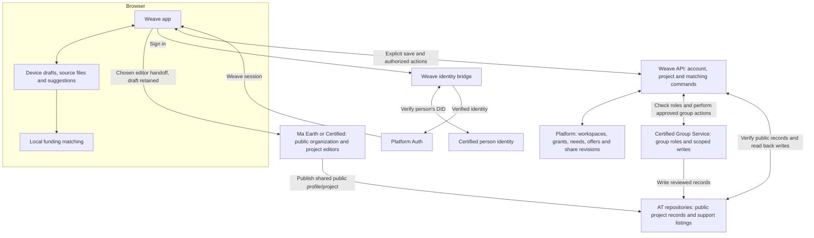
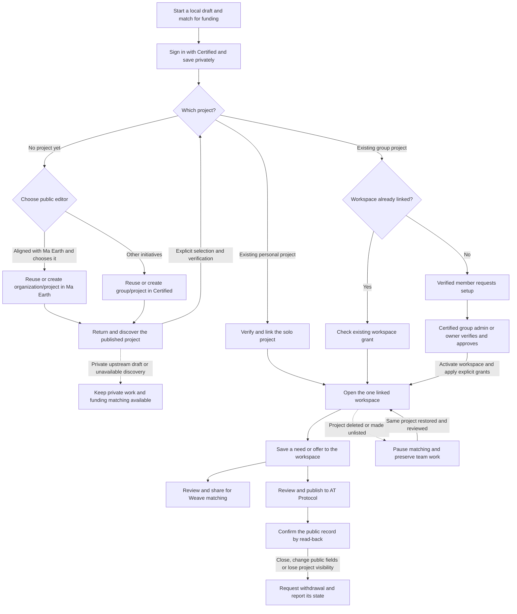
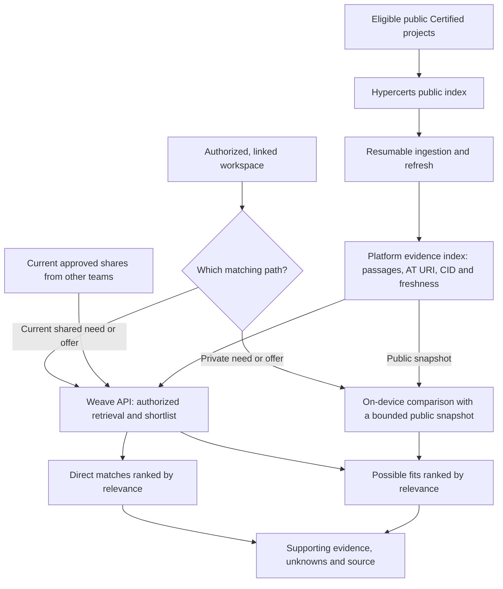
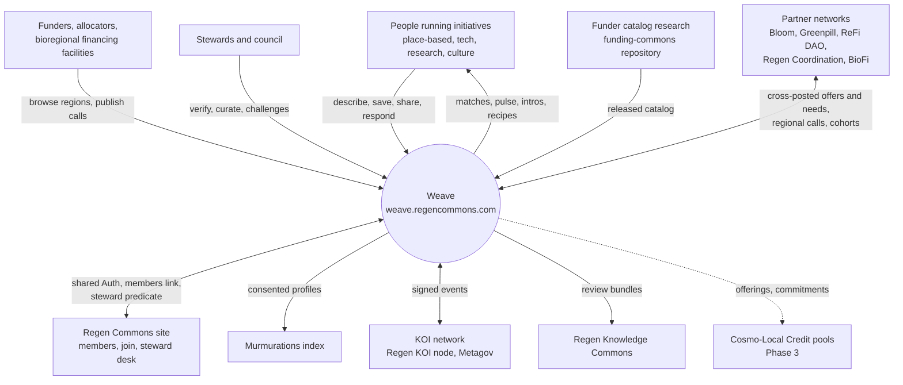
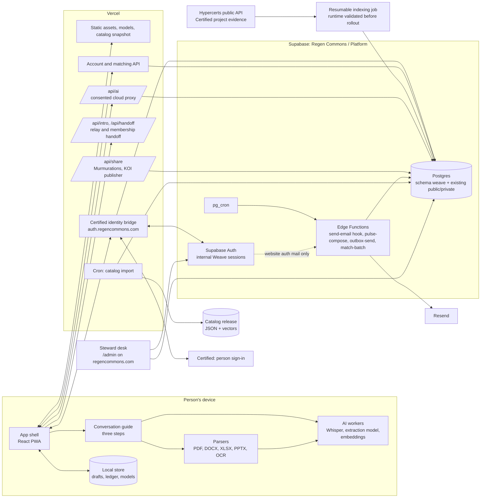
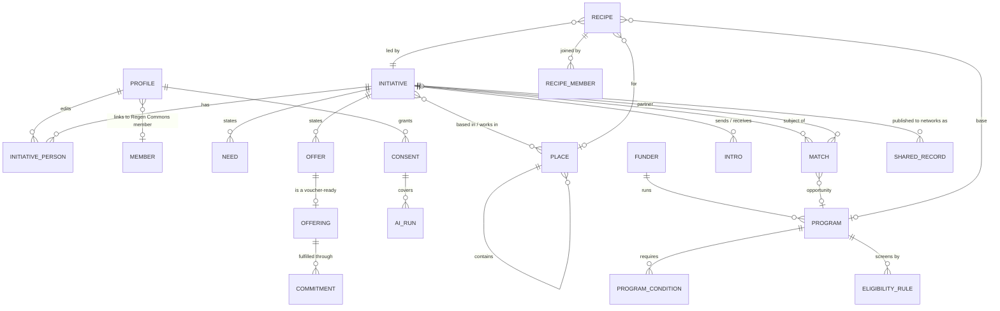
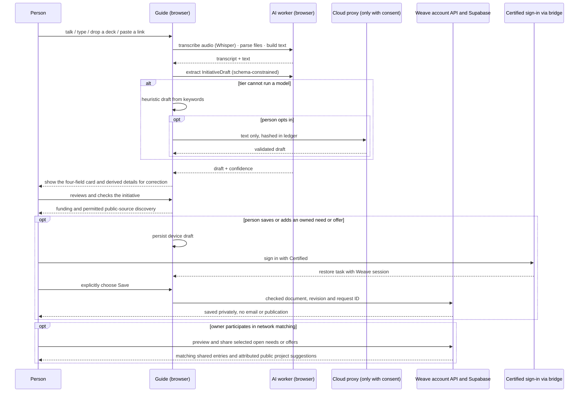
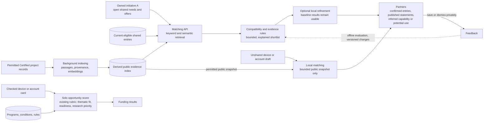
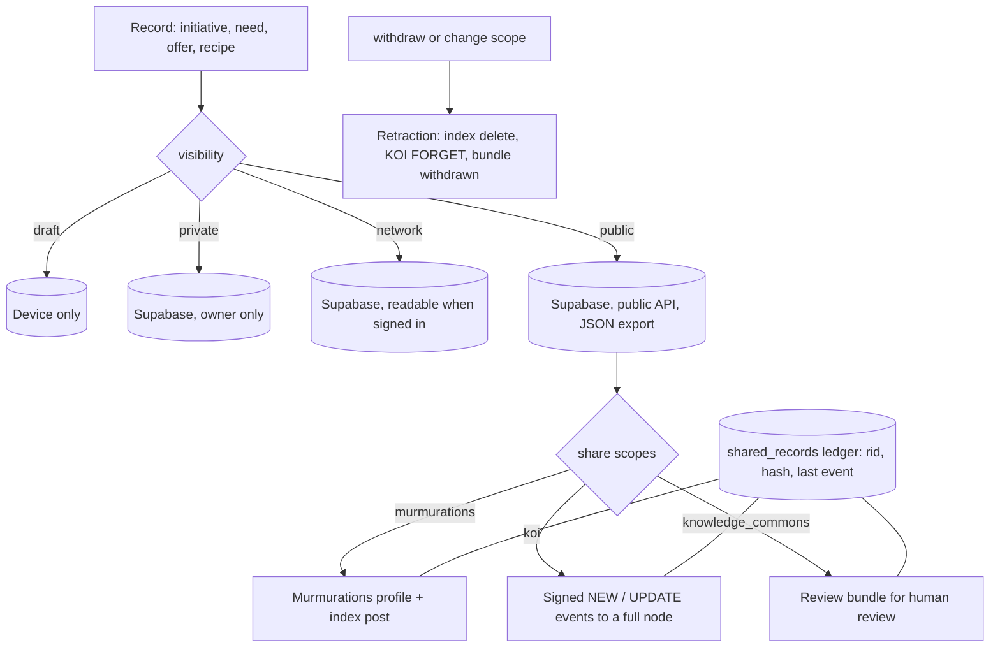
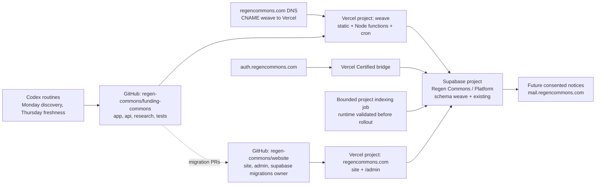

# Logical architecture: Regen Commons Weave (working name)

Status: draft for review · Date: 2026-10-31
Companion documents: [PRD](04-prd.md) · [technical spec](05-technical-spec.md) · [proposal brief](01-proposal-brief.md)

This document describes the shape of the system: the parts, what each owns, how data flows, and how the platform stays one node in a wider commons rather than a new centre. Technology choices and schemas are in the technical spec.

## First-release architecture

These diagrams describe the target for Certified projects, private saving,
sharing and matching. The sections below describe the wider platform, including
later phases. Use the [technical spec](05-technical-spec.md#certified-project-integration-target)
for API and data contracts and the
[build plan](05-technical-spec.md#76-build-plan-and-ui-handoff) for preview
evidence and release checks.

### System and data ownership

A person DID identifies the actor. A group DID identifies a publishing account.
The project AT URI identifies one public project, and its CID identifies the
observed version. The Weave UUID identifies the workspace and stays stable
across saves. Working files and private queries remain on the device. Saving
uploads the selected initiative fields and entries to Platform.

### Project and entry lifecycle

A setup request grants no access and keeps the draft private. Team saves
are visible to teammates with current access. Sharing and public publishing
are independent actions. A person removed from the Certified group loses
workspace access. Eligible team entries can stay live under the remaining
authorized teammates. Confirmed project deletion or unlisting also requests
withdrawal of public listings.

The [12 November editor decision](open-decisions.md#public-project-editors-decided-12-november-2026)
replaces inline public project creation in this target. The handoff may require
another code or consent; prefill and automatic return are not established.
Existing projects are reused, and pending operations from the current Weave
creator must be reconciled before offering creation elsewhere. The diagram
does not assert that Ma Earth and Certified group membership already synchronize.

### Matching and evidence

Results distinguish a confirmed shared entry, a public statement and an
inference. A relevant capability or potential use can appear when an important
detail is unknown. The result names what to verify. A known conflict rules out
the pair. The launch target covers all eligible Certified projects the index can
enumerate. Local snapshots cover a smaller set and show their coverage.

Before release, prove Certified group setup and grants, scoped publishing and
withdrawal, and permissions, refresh and matching quality at launch volume.
See the [validation register](open-decisions.md#project-integration-and-support-listing-validation).

## 1. Five layers

| Layer | Purpose | Owns | Runs |
|---|---|---|---|
| Experience | The three-step conversation, matches, places, recipes, pulse | Drafts, UI state, local AI models | Browser (PWA) |
| Intelligence | Turn source text into checked cards or attributed evidence; retrieve candidates; explain matches | Extraction contracts, derived search index, matching rules, model versions | Local workers, matching API and background indexing; cloud AI only with consent |
| Records | The commons' operational truth: initiatives, needs, offers, places, programs, recipes, consents | Schema, row-level security, audit, revisions | Supabase (shared Regen Commons project) |
| Exchange | Everything that leaves or enters the platform: email, Murmurations, KOI events, knowledge commons exports, later commitment pools | Identifiers, hashes, consent scopes, retraction | Vercel functions, Edge Functions |
| Stewardship | Curation, verification, challenges, metrics, catalog research | Steward commands, pulse controls, research workflow | Steward desk on regencommons.com; repository automation |

The ordering is deliberate: a person can get value from the Experience and Intelligence layers with nothing stored anywhere but their device. Records begin only when a person saves, and they stay private until that person shares them. Exchange begins only with consent. Stewardship tidies; it never gates publishing in the open tier.

## 2. Context

## 3. Containers

What each container owns:

- App shell: routing, theme and components from the [design system](../../DESIGN.md), offline cache, capability detection, consent dialogs.
- Conversation guide: the state machine for the three steps, prompts, confirmation cards, nudges; works with any tier including "no model".
- AI workers: Whisper transcription, extraction with a small instruct model or the browser's built-in model, the embedding model already shipped by Funding Commons. Nothing in a worker touches the network except pinned model files from the app origin.
- Local store: drafts (IndexedDB), the local AI ledger, cached models (Cache API), bounded public snapshots for private matching. Authenticated shared entries never become public offline assets.
- Account and matching API: enforces the caller's session and owned initiative, reads current approved projections, retrieves a bounded shortlist and returns source-backed reasons. Local workers can refine relevance but cannot upgrade evidence or permissions.
- Public project indexer: validates permitted records, preserves source identity/version and supporting passages, and computes search representations once per changed input. The index is derived data, not a second project editing authority. External indexing creates no Weave account, need or offer.
- Certified bridge: proves person identity and establishes the internal session. It is separate from the matching API and indexing job; no additional login is introduced.
- Vercel functions and restricted jobs: hold server credentials only in their intended runtime. The matching read path uses the caller's authorization; the indexer has narrow access to its derived public-data tables.
- Supabase: records, policies, internal Weave sessions, scheduled jobs and outbox. Certified is the only Weave sign-in provider; no Weave credentials, account migration or alternate login. The bridge and [first-build contract](05-technical-spec.md#51-first-build-certified-sign-in-and-private-saving) own this boundary. One project is shared with the Regen Commons site; platform objects stay in their own schema.
- Steward desk: unchanged location and login; gains sections for the platform's records.
- Catalog release: produced by the existing research workflow; the platform is a consumer.

## 4. Domain model

Concepts and their owners:

- Initiative, Need, Offer: an authenticated account owns a Weave initiative, and its needs and offers belong to that initiative. An owner saves privately, then chooses the exact current entries and initiative summary to share for network matching. The public directory has its own visibility choice. See [saving and accounts](08-accounts-and-saving.md).
- Place: a reference, never typed free-hand into records; bioregion, subrealm, realm, basin, country, custom.
- Funder, Program, conditions, rules: owned by the research workflow; the platform reads, never edits.
- Match: computed, explained, versioned; a person's reactions (save, dismiss, contact) are owned by them.
- External project evidence: a source passage about work, resources or a stated request, with provenance. It can support an inferred capability or potential use of an offer; it cannot assert current availability or create an owner-confirmed entry. Both external evidence and shared entries appear in Partners, with distinct labels and actions.
- Recipe: a partnership forming around a base; owned by its lead; joiners bring ingredients.
- Consent and AI run: the audit spine for anything that leaves the device or the platform.
- Offering and Commitment: the bridge to commitment pooling; off-chain records with hashes until Phase 3.
- Shared record: the ledger of what was sent where, with the identifier and hash, so retraction is precise.

## 5. Flows

### 5.1 Three-step intake on a device

### 5.2 Matching

One-way matches are useful. A need can match an external project's experience;
an offer can fit a project's activities even when that project has stated no need.
The latter is an inferred possibility, not a request from that project. Sources,
unknowns and confirmation stay visible. The API performs ordinary search over
prepared indexes; a cloud LLM call is not required on every search. Later
partnership scoring, introductions and pulses consume only their separately
eligible evidence and are outside the [next handoff](05-technical-spec.md#76-build-plan-and-ui-handoff).

### 5.3 Consent and exchange

### 5.4 Weekly pulse

Composer selects eligible initiatives (saved, pulse consent, confirmed within 180 days or due for a confirmation prompt), gathers new partner matches, closing opportunities in the initiative's themes and places, nearby needs its offers could meet, recipes needing its ingredient, applies exposure caps, writes one outbox row per recipient with an idempotency key, and the sender delivers through Resend in batches with retries. Every pulse carries the one-tap "still accurate" link that refreshes the record's confirmed date.

## 6. Decentralisation posture

The council's open question was how to avoid building a new centre. The answer is structural, not aspirational:

1. Local first. Drafts, transcription, extraction, and private funding and public-source matching can run on the device. Shared-entry matching uses the API and a derived public project index to avoid downloading and reprocessing an entire network per visitor. Only bounded public snapshots are used for private local queries; sending a private query or its embedding to a server is a separate disclosed choice.
2. Owned records. People save and share their own records, see where they went, and can withdraw them; retraction propagates to every network they were shared with.
3. Open identifiers and schemas. Every public record has a stable reference identifier and a content hash; profiles are published in Murmurations schemas; exports are JSON and CSV; vocabularies are published.
4. One node among nodes. Later interoperability uses KOI and Murmurations publishing. Weave's search index is a rebuildable projection of permitted evidence, not a replacement for upstream records or a claim of complete network coverage. Knowledge enters the Regen Knowledge Commons only through that project's review, never by direct write.
5. Forkable. Open-source code, an open data licence and a documented deploy let another network run its own instance with its own Supabase project; instances exchange through the same open channels. The Regen Commons instance is the first, not the only.
6. Commons-held operations. The shared Supabase project, the steward predicate and the catalog research live under Regen Commons governance (council, members, stewards) with a published policy for data, consent and retraction.

Where KOI and Coop come in:

- KOI gives the reference-identifier discipline and the event protocol for exchanging records across organisations under consent (the Telescope model: labels travel, material stays home). The platform adopts the identifiers from Phase 0 and the protocol in Phase 2.
- Coop is a pattern library and, later, a capture tool: its provider-tier cascade, JSON repair loop, review-before-share gate and Whisper transcription module are the proven shapes reused here; a Coop receiver on a phone could feed voice and photo captures into the intake as candidate needs and offers. Importing Coop code means AGPL for the platform, which is the proposed licence anyway.

## 7. Deployment view

One migration owner and one shared Platform database. The Weave app, identity
bridge and website have separate deployment boundaries. `auth.regencommons.com`
is the bridge issuer, not a mail domain or the general matching API. Existing
Funding Commons hosting stays unchanged. The research routines keep producing
reviewed pull requests; nothing recurring merges or deploys on its own.

## 8. Architecture decisions (summary)

| ID | Decision | Alternatives considered | Consequence |
|---|---|---|---|
| A1 | Local-first AI with consented cloud fallback | Cloud-only; local-only | Works on weak devices without betraying the sovereignty story; needs a consent ledger and tiering |
| A2 | Shared Supabase project, dedicated `weave` schema, single migration owner | Separate project with member sync | Reuses Auth, members and stewards directly; requires migration discipline and namespacing |
| A3 | Steward desk extended, not duplicated | Admin on the subdomain | One login and release for stewards; the website repo must accept a UI module and SQL by pull request |
| A4 | Reuse the Funding Commons rubric for solo scores; add partner and partnership layers | New model-based ranker | Keeps the audited, explainable rubric; partnership logic is additive |
| A5 | Murmurations and KOI as exchange channels; knowledge commons by review bundle | Custom federation API | Standards-first interoperability; no direct writes to shared knowledge |
| A6 | Offerings and off-chain commitments now, pools later | Wallets at launch | Phase 3 anchoring without data migration; no web3 friction in intake |
| A7 | Places as references (One Earth bioregions, HydroBASINS, countries) | Free-text regions only | Enables watershed curation and regional pulses; requires licence confirmation and a geocoder |
| A8 | React PWA on the shared design system | Vanilla HTML like the main site | Worker-heavy conversational UI needs a component model; tokens and patterns keep the brand consistent |
| A9 | Saving is separate from sharing; private by default; stewards cannot read private initiatives | Publish as one step; device-only until public | People can keep work across devices without going public; the privacy promise changes and needs row-level security tests |
| A10 | `DESIGN.md` as the single token source, with layered CSS and a pattern library in this repository | Copy tokens per app; a shared repository from day one | One source for all surfaces; moves to a shared repository when a second app needs more than tokens |
| A11 | Agent scaffolding before UI code | Add guidance as problems appear | Agents write most of the code, so instructions and checks are part of the foundation |
| A12 | Shared keyword/vector index with local assistance and optional refinement | Reanalyse every external project in every browser; call a cloud LLM for every match | Both owner-shared entries and public evidence participate; bounded downloads, explicit privacy paths and measured quality/latency precede UI polish |
