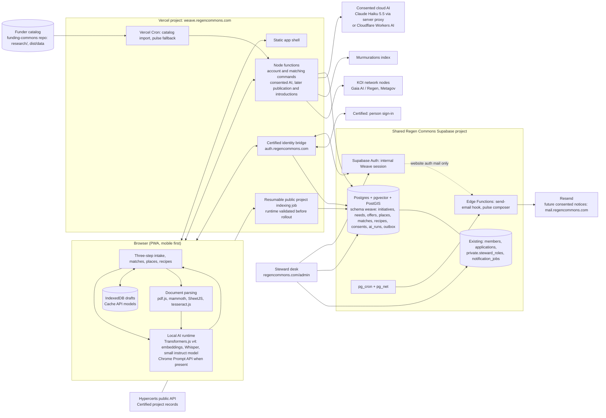

# Technical specification: Regen Commons Weave (working name)

Status: draft for review · Date: 2026-10-31 · Audience: builders and technical reviewers
Companion documents: [PRD](04-prd.md) · [logical architecture](03-logical-architecture.md) · [research digest](06-research-digest.md) (sources for every external fact below) · [saving and accounts](08-accounts-and-saving.md) · [agent scaffolding](07-agent-scaffolding.md) · [open decisions](open-decisions.md) · [design system](../../DESIGN.md)

Requirement identifiers (R1 to R47) refer to the PRD. The 6 November Certified-only revision and first-build contract in section 5 supersede earlier email-auth proposals. The broader schema below is a later target, not a replacement for the tested version-1 private saving contract.

Matching revision, 8 November 2026: section 7 owns the combined matching contract
for shared Weave entries and public projects with no stated needs or offers.
[Section 7.6](#76-build-plan-and-ui-handoff) is the next implementation sequence
and completion checklist. These are planned updates, not delivered matching services.

## 1. Design principles

1. Local first. Private draft analysis, transcription and extraction run in the browser. The server holds what people choose to save or share, the funder catalog, and a derived index of permitted public project evidence. Shared-entry matching uses the API to retrieve a shortlist; private draft matching uses bounded public downloads unless a separate server-query choice is introduced.
2. Reuse the shared Regen Commons Supabase project for Auth, `members`, `steward_roles` and the steward desk. Reuse the Resend sending domains, the brand, tokens and fonts, and the Funding Commons research pipeline and matching rubric.
3. Open by default: open schemas, open identifiers, export anytime, open source.
4. Small surface, explicit contracts. Every AI output is validated against a schema. Every write is idempotent and revisioned. Every cross-network share is consented and retractable.
5. Nothing blocks on a model. Every flow works with plain fields and keyword matching.

## 2. System context



## 3. Repositories, stack and deployment

### 3.1 Decisions

| Decision | Choice | Why |
|---|---|---|
| Where the code lives | Evolve `regen-commons/funding-commons` into a Bun workspace, as in Green Goods: `packages/app` (new PWA), `packages/api` (Vercel function handlers), `packages/design-system`, and `supabase/` at the root (platform migrations, see 3.3). The live site (`dist/`), `research/`, `scripts/` and `tests/` stay at the root unchanged. See the [repository layout](09-repository-layout.md) | Keeps the catalog pipeline, tests and history in one place, and gives each runtime its own package, guide and checks; the directory UI is rebuilt inside the new app rather than kept as a second site |
| Frontend | TypeScript, Vite, React 19, no CSS framework; Workers for AI | The intake is stateful and worker-heavy; a component model pays for itself |
| Design system | Root `DESIGN.md` in the DesignMD format generates the tokens. The `packages/design-system` package (`@regen-commons/design-system`) holds layered CSS, fonts, brand and voice guides, and a pattern library. React components in `packages/app/src/ui` stay thin and render those classes | One source for the static library, the app and later the website. Website values are preserved and checked against a pinned copy. The website's component CSS is desktop-first, so it is not copied. See the [decision log](../../packages/design-system/decision-log.md) |
| Agent guidance | `AGENTS.md`, skills, rules, hooks and checks, built before UI code | Most code is written by agents. See the [scaffolding plan](07-agent-scaffolding.md) |
| Backend | Supabase (Postgres 17, pgvector, PostGIS, Auth, Storage, Edge Functions, pg_cron) plus Vercel Node functions for anything that needs server-held secrets or outbound calls | One trust boundary for data and auth; Vercel for the app shell and proxies |
| Auth | Certified only, through the email-free server bridge into Supabase Auth; see section 5 | One person sign-in; stable internal ownership without Weave credentials or email matching |
| Email | Future consented pulse, introductions and notices through the notification service | Certified owns Weave sign-in messages; website/steward auth mail remains separate |
| Hosting | New Vercel project in the existing Regen Commons team, on Hobby now and Pro once needed, with its root directory set to `packages/app`; `weave.regencommons.com` by CNAME; Node runtime (not Edge) for AI and share proxies. The existing project keeps the repository root and serves `funding-commons.vercel.app` from `dist/` until the redirect in section 15 | Same platform and team as the website, Funding Commons and the current agent. Hobby is for non-commercial use only, so the team moves to Pro (USD 20 per developer seat) once grant money pays a builder. Edge runtime is deprecated by Vercel and capped at 25 s to first byte |
| Licence | AGPL-3.0 for code (council to confirm); CC BY 4.0 for public data | AGPL keeps the option to import Coop modules; CLC software is also AGPL |

### 3.2 Runtime versions to pin

Transformers.js `@huggingface/transformers` 4.3.2 (upgrade from 4.2.0; 4.3 enables WebGPU on Safari 26 and exposes `getSupportedDevices`), `@huggingface/transformers-structured-output` 4.3.2, `onnxruntime-web` as resolved by Transformers.js, `@supabase/supabase-js` 2.118.0 (matching the website), `zod` 4.x, `pdfjs-dist` 6.4.x, `mammoth` 1.13.x, SheetJS CE 0.20.3 from the vendor tarball, `tesseract.js` 7.x, `jsonrepair` 3.15.x, React 19.3.x, Vite 8.x with `vite-plugin-pwa` 2.x, TypeScript 6.0 (not 7.0, whose package drops the compiler JavaScript API that `@vercel/node` uses to build functions), Node 24 locally, in CI and on Vercel, and Bun 1.4.2 for installs and scripts as today. The app shell pins React 19.3.1, Vite 8.3.5, `@vitejs/plugin-react` 6.1.2, `vite-plugin-pwa` 2.0.0 and TypeScript 6.0.3.

### 3.3 Supabase project and migration ownership

Weave uses the existing `Platform` Supabase project in the Regen Commons organization. It runs Postgres 17 in `us-east-1` and retains its project ref `ztygpuzldujfsqrubxic`. The shared project gives Weave one Auth user pool, direct foreign keys to `members` and access to the existing steward predicate `private.is_active_steward()`.

Two repositories cannot both push migrations to one project without desynchronising the CLI history. Decision: all platform tables live in a dedicated schema `weave`, and the platform's migrations are authored in this repository under `supabase/migrations/` but applied through a single owner. For Phase 0 the owner is the website repository's migration folder (platform migration files are copied there by pull request, numbered after the latest website migration). From Phase 1 the schema moves to a shared `regen-commons/supabase` repository that both apps consume, with generated TypeScript types published as a package. CI applies every migration from an empty Postgres 17 as the website CI already does.

Rules inherited from the website schema: enable RLS on every table and revoke defaults; write paths through `security definer` functions in `private` with `search_path = ''` and narrow `execute` grants; `security invoker` wrappers in `weave` for PostgREST; revision checks and `request_id` idempotency on every command; actor IDs use the authenticated UUID; display labels must tolerate absent email and never determine authority; no service-role key in any browser or Vercel function (Vercel functions use the user's JWT or a dedicated restricted role).

### 3.4 Environments

Local development uses `supabase start` with the combined migrations, `vite dev` and the website's fixture pattern with synthetic data and no provider keys. For the first hosted Certified test, a controlled Vercel deployment uses the shared Supabase project that Weave will launch with. Migrations go through the owner repository's reviewed release process. Production app releases run from `main` on Vercel.

## 4. Data model

All new objects in schema `weave`. Types are PostgreSQL. Only the essentials are shown; audit columns (`created_at`, `updated_at`, `created_by`, `revision`) exist on every mutable table.

### 4.1 Vocabularies (reference tables, seeded by migration)

```sql
create table weave.capital_forms (code text primary key, label text not null, definition text not null, sort int);
-- financial, material, living, social, intellectual, experiential, cultural, spiritual

create table weave.lenses (code text primary key, label text not null, sort int);
-- art_culture, research, technology, place_based, funders

create table weave.stages (code text primary key, label text not null, sort int);
-- seed, sprout, flowering, tree   (Regen Commons stages of growth)

create table weave.exchange_terms (code text primary key, label text not null);
-- gift, exchange, paid, commitment, open   (Offers and Needs Market vocabulary plus commitment)
```

Themes reuse the funder catalog's theme vocabulary (the `sectors` and program `focus` strings), normalised into `weave.themes(code, label, aliases text[])` by the catalog importer so initiative tags and program tags share one space.

### 4.2 Accounts and membership

```sql
create table weave.profiles (
  user_id uuid primary key references auth.users(id) on delete cascade,
  display_name text,                                    -- never asked for at sign-in; set later if the person wants one
  -- No required authentication email; future contact preferences are separate.
  member_id uuid references public.members(id),      -- link to a Regen Commons member profile when one exists
  membership_status text,                               -- mirror of members.membership_status, refreshed by trigger
  locale text not null default 'en',
  digest_frequency text not null default 'off' check (digest_frequency in ('weekly','fortnightly','off')),  -- opt-in only
  created_at timestamptz not null default now()
);
```

`weave.profiles` is created on first sign-in by a `security definer` function. `members` is never written by the platform; the membership path pre-fills the public `join` application and the steward desk links the profile when approved (existing `link-profile` command, extended to set `weave.profiles.member_id`).

### 4.3 Initiatives, needs, offers

```sql
create table weave.initiatives (
  id uuid primary key default gen_random_uuid(),
  slug text unique not null,
  name text not null check (length(name) between 1 and 200),
  description text not null check (length(description) <= 4000),
  summary text check (length(summary) <= 300),           -- one-liner derived, editable
  links jsonb not null default '[]',                     -- [{kind:'website'|'social'|'repo'|'deck', url}]
  stage text references weave.stages(code),
  lenses text[] not null default '{}',
  themes text[] not null default '{}',
  beneficiaries text[] not null default '{}',
  languages text[] not null default '{}',
  scale text,                                            -- local, regional, national, global, free text allowed
  eligibility jsonb not null default '{}',               -- optional: legalForm, registrationCountry, applicantType, fundingInstruments, orgSize
  visibility text not null default 'private' check (visibility in ('private','network','public')),  -- a draft never reaches this table
  status text not null default 'active' check (status in ('active','withdrawn')),
  steward_hidden boolean not null default false,         -- set by a steward with a reason; never applies to private rows
  share_scopes text[] not null default '{}',             -- 'murmurations','knowledge_commons','koi'; off by default
  confirmed_at timestamptz,                              -- last "still accurate" confirmation
  embedding vector(256),                                 -- mxbai-embed-xsmall-v1, computed in the browser
  rid text unique,                                       -- orn:regencommons.initiative:<uuid>
  content_sha256 text,
  owner_user_id uuid not null references auth.users(id),
  revision int not null default 1
);

create table weave.initiative_people (
  initiative_id uuid references weave.initiatives(id) on delete cascade,
  user_id uuid references auth.users(id) on delete cascade,
  role text not null default 'editor' check (role in ('owner','editor','contact')),
  primary key (initiative_id, user_id)
);

create table weave.needs (
  id uuid primary key default gen_random_uuid(),
  initiative_id uuid not null references weave.initiatives(id) on delete cascade,
  title text not null check (length(title) <= 140),
  description text check (length(description) <= 2000),
  capital_forms text[] not null check (cardinality(capital_forms) between 1 and 8),
  amount_min numeric, amount_max numeric, currency text,  -- financial only
  timeframe text, urgency text check (urgency in ('now','this_quarter','this_year','ongoing')),
  place_scope text not null default 'anywhere' check (place_scope in ('here','region','anywhere')),
  exchange_terms text[] not null default '{open}',
  purpose text check (length(purpose) <= 1000),           -- what you would do with it
  status text not null default 'open' check (status in ('open','met','withdrawn','expired')),
  expires_at timestamptz,
  embedding vector(256),
  rid text unique, content_sha256 text,
  revision int not null default 1
);

create table weave.offers (
  like weave.needs including all,                        -- same shape, plus:
  capacity text,                                          -- how much, how often
  audience text,                                          -- who it is for
  is_offering boolean not null default false,            -- carries commitment-pool voucher fields when true
  offering jsonb                                          -- {unit, capacity, place, timing, restrictions, terms, redemption, complaints}
);
```

Hybrid search: a generated `tsvector` column with a GIN index on `name || description || summary` for initiatives and on `title || description` for needs and offers; HNSW indexes with `vector_cosine_ops` on the embeddings (optional below a few thousand rows).

### 4.4 Places

```sql
create extension if not exists postgis with schema extensions;

create table weave.places (
  id uuid primary key default gen_random_uuid(),
  kind text not null check (kind in ('realm','subrealm','bioregion','ecoregion','basin','country','admin','custom')),
  code text not null,                                     -- dataset identifier, e.g. One Earth bioregion code, HydroBASINS HYBAS_ID, ISO 3166
  name text not null,
  parent_id uuid references weave.places(id),
  dataset text not null,                                  -- 'oneearth-2023','hydrobasins-v1c','resolve-2017','naturalearth','custom'
  level int,                                              -- Pfafstetter level for basins
  geom extensions.geography(multipolygon, 4326),
  centroid extensions.geography(point, 4326),
  unique (dataset, code)
);
create index places_geom_gix on weave.places using gist (geom);

create table weave.initiative_places (
  initiative_id uuid references weave.initiatives(id) on delete cascade,
  place_id uuid references weave.places(id),
  relation text not null check (relation in ('based_in','works_in')),
  source text not null check (source in ('pin','search','text','steward')),
  primary key (initiative_id, place_id, relation)
);
alter table weave.initiatives add column is_global boolean not null default false;
```

Assignment function `weave.places_for_point(lon, lat)` returns the containing bioregion, subrealm, realm, basin (one row per configured level) and country using `ST_Intersects`. Free-text locations resolve through a server-side geocoder (Nominatim with attribution, or Mapbox if a key exists) to a point, then through the same function; the derived places are shown so the user can correct them. Each place row stores attribution text for display.

### 4.5 Opportunities (funder catalog)

The catalog keeps its JSON contract (`dist/data/enrichment.schema.json`, `funders.json`, `program-conditions.json`, `eligibility-rules.json`, `fund-vectors`). The importer loads it into:

```sql
create table weave.funders (id text primary key, name text, display_name text, website text, record jsonb not null, imported_at timestamptz);
create table weave.programs (
  id text primary key,                                    -- documentId: <fundId>::<programId>
  funder_id text references weave.funders(id),
  name text, instrument text, route text,
  opens_on date, closes_on date, deadline_instant timestamptz,
  themes text[], regions text[], work_countries text[], applicant_countries text[],
  record jsonb not null,                                  -- the program object verbatim
  embedding vector(256),                                  -- from fund-vectors, same model contract
  rid text unique
);
create table weave.program_conditions (key text primary key, program_id text references weave.programs(id), record jsonb not null);
create table weave.eligibility_rules (id text primary key, program_id text references weave.programs(id), record jsonb not null);
```

Import runs on deploy and daily by Vercel Cron (once a day is the Hobby limit), verifying the release manifest hash and model contract before replacing rows in one transaction. The research workflow (Monday discovery, Thursday freshness, draft pull requests) is unchanged.

### 4.6 Matches, recipes, introductions

```sql
create table weave.matches (
  id uuid primary key default gen_random_uuid(),
  subject_initiative_id uuid not null references weave.initiatives(id) on delete cascade,
  kind text not null check (kind in ('partner','opportunity','opportunity_partnership')),
  object_id text not null,                                -- initiative uuid, program id, or program id + partner uuid
  partner_initiative_id uuid references weave.initiatives(id),
  score numeric not null, band text not null,
  breakdown jsonb not null, reasons text[] not null,
  state text not null default 'suggested' check (state in ('suggested','saved','dismissed','contacted','expired')),
  dismiss_reason text,
  engine_version text not null, computed_at timestamptz not null default now(),
  unique (subject_initiative_id, kind, object_id)
);

create table weave.recipes (
  id uuid primary key default gen_random_uuid(),
  base_kind text not null check (base_kind in ('program','problem')),
  program_id text references weave.programs(id),
  problem text,                                           -- when base_kind = 'problem'
  title text not null, idea text not null,               -- "the idea in a line"
  ingredients jsonb not null default '[]',               -- [{lens, capital_forms[], ask}]
  lead_initiative_id uuid not null references weave.initiatives(id),
  place_id uuid references weave.places(id),
  status text not null default 'forming' check (status in ('forming','drafting','submitted','funded','not_this_time','closed')),
  deadline date, working_doc_url text,
  visibility text not null default 'members' check (visibility in ('members','public')),
  revision int not null default 1
);
create table weave.recipe_members (recipe_id uuid references weave.recipes(id) on delete cascade, initiative_id uuid references weave.initiatives(id), brings text, joined_at timestamptz default now(), primary key (recipe_id, initiative_id));

create table weave.intros (
  id uuid primary key default gen_random_uuid(),
  from_initiative_id uuid references weave.initiatives(id), to_initiative_id uuid references weave.initiatives(id),
  match_id uuid references weave.matches(id),
  message text not null check (length(message) <= 1500),
  status text not null default 'sent' check (status in ('sent','accepted','declined','expired')),
  revealed_at timestamptz
);
```

Future introductions need separately consented, verified contact details; Certified sign-in supplies none. Addresses are revealed to both sides only when `status = 'accepted'` and disclosure is explicitly approved.

### 4.7 Consent, AI ledger, sharing, outbox

```sql
create table weave.consents (
  id uuid primary key default gen_random_uuid(),
  user_id uuid not null references auth.users(id) on delete cascade,
  scope text not null check (scope in ('cloud_ai','cloud_transcription','share_murmurations','share_koi','share_knowledge_commons','intro_relay','pulse')),
  initiative_id uuid references weave.initiatives(id),
  policy_version text not null, granted_at timestamptz not null default now(), withdrawn_at timestamptz
);

create table weave.ai_runs (
  id uuid primary key default gen_random_uuid(),
  user_id uuid references auth.users(id) on delete set null,
  tier text not null check (tier in ('t0_browser_model','t1_desktop_webgpu','t2_mobile_webgpu','t3_wasm','t4_cloud','heuristic')),
  provider text, model text, purpose text not null,       -- 'extract_initiative','extract_needs','extract_offers','transcribe','summarise_link'
  consent_id uuid references weave.consents(id),
  input_sha256 text, output_sha256 text, input_tokens int, output_tokens int, latency_ms int,
  created_at timestamptz not null default now()
);
-- Local runs are logged only in the browser by default; the user may opt in to sending local-run metadata (no text) for evaluation.

create table weave.shared_records (
  record_table text not null, record_id uuid not null, network text not null check (network in ('murmurations','koi','knowledge_commons')),
  rid text, remote_id text, content_sha256 text, last_event text check (last_event in ('new','update','forget')),
  last_sent_at timestamptz, primary key (record_table, record_id, network)
);

create table weave.outbox (
  id uuid primary key default gen_random_uuid(),
  channel text not null check (channel in ('pulse','intro','recipe','steward','system')),
  recipient_user_id uuid references auth.users(id), to_email text not null,
  template text not null, payload jsonb not null, idempotency_key text unique not null,
  status text not null default 'pending' check (status in ('pending','sending','sent','failed','skipped')),
  attempts int not null default 0, last_attempt_at timestamptz, provider_message_id text, failure_code text
);
```

### 4.8 Row-level security (summary)

- `profiles`: owner read and update.
- `initiatives`, `needs`, `offers`: owner and `initiative_people` editors full access through commands; `anon` and `authenticated` may select rows with `visibility = 'public'`; `authenticated` with `profiles.membership_status = 'active'` or any signed-in account (configurable tier, R28) may select `visibility = 'network'`; stewards select `network` and `public` rows through the existing `private.is_active_steward()` predicate and never `private` rows. Aggregate counts come from views that expose no row data.
- `matches`: subject owner reads; written only by the matching job (restricted role).
- `recipes`, `recipe_members`, `intros`: members read per visibility; writes through commands.
- `consents`, `ai_runs`: owner read; insert through commands; never updated except `withdrawn_at`.
- `places`, vocabularies, `funders`, `programs`: public read.
- Policies use `(select auth.uid())`, one policy per command, membership checks in `private` functions, and an index on every column a policy compares.

## 5. Identity and access

Certified is the only Weave sign-in flow, per the [6 November decision](open-decisions.md#certified-only-sign-in-and-private-saving). Supabase supplies internal sessions and private data authorization. An internal account is created or retrieved automatically for the proven Certified identity, without separate credentials. There is no account-migration, manual identity-linking or alternate email-code path in the product or implementation scope.

- Use the tested server-side AT OAuth to OIDC bridge approach. Certified proves the person DID; the bridge validates the expected issuer and session DID and emits a stable subject without `email` or `email_verified`. Request only `atproto` identity scope. Configure the Supabase custom provider with `email_optional: true`, `openid`, PKCE and normal nonce checks. The flag permits absent email; omission of email claims is what removes this flow's email-matching input. [Supabase provider configuration](https://supabase.com/docs/guides/auth/custom-oauth-providers), [AT OAuth requirements](https://atproto.com/specs/oauth).
- Keep a fixed bridge issuer, provider identifier and subject mapping across deployments. The same verified identity must reach the same Supabase UUID. No name/email lookup, caller-selected account ID, manual linking or automatic ownership transfer. Unexpected conflicts fail without merging or moving data.
- The Weave callback establishes a host-only HttpOnly session cookie, Secure outside loopback, with the existing at-most-one-hour lifetime. Keep AT tokens and OAuth exchange state server-side. Preserve the account API's existing Supabase access-token transport in the HttpOnly cookie; never expose it to JavaScript storage or response bodies, and retain no Supabase refresh token. Use one-use, browser-bound state and PKCE on each leg, an allowlisted return task, and an explicit SameSite/CSRF design for callback correlation. Ordinary writes retain same-origin JSON checks.
- Weave's private access predicate requires an authoritative `auth.identities` record for the exact trusted provider and validated issuer/DID subject, plus an active session owned by that user, unexpired validity, non-anonymous status and no active ban. Confirmed email alone is insufficient. User-editable metadata never grants access. The database must enforce these rules for direct RPC/table access as well as the API.
- `AccountUser.email` is nullable. Do not invent an email, confirm an absent email or derive identity from a display label. Contact details belong to a separately consented future service. Shared website/steward Auth settings are outside this change; narrowing Weave authorization does not disable their sign-in.
- Sign-in restores the task but never saves, loads or merges a draft. Save uses a persisted request UUID and expected revision; an identical retry returns the same result. Load atomically backs up the complete device state before replacement. Saving sends only checked fields, not source text, files or AI history.
- Certified outage, denial or expiry preserves device work and offers retry through Certified. Sign-out revokes the Weave session and clears its cookie; test the disposition of associated bridge sessions separately. Never claim global Certified logout or deletion of local drafts. Recovery must restore the same Certified identity; replacement identities do not inherit saved work.
- Account, membership and authority to publish a project are distinct. The first build grants only owner-private saving. Membership, teams and public publishing do not follow from sign-in.

### 5.1 First build: Certified sign-in and private saving

**Outcome:** a person with a new or existing Certified identity signs in, explicitly
saves an ordinary initiative privately, signs out, returns through Certified and
loads the same saved document. No Ma Earth listing, public project, email access,
second credential prompt or account migration is involved.

**Baseline:** the proof reused the private-account API and app contract at
`495e95ae6ea27521f355bc7f10af1488a1e290d9`. The shared checkout inspected on 6 November
is `f158d8b`, with a health-only API and stub app routes. Begin implementation in an
isolated checkout of the current reviewed saving baseline, compare it with that
pinned commit, then apply this plan. Do not replace newer saving code with this
older shell or switch the shared checkout. The diagnostic implementation at
`/private/tmp/weave-certified-email-free-poc-20261106` is reference material, not a
repository package, production service or durable release artifact.

| Order | Owning paths and concrete work | Completion evidence |
|---|---|---|
| 1. Establish the deployable auth boundary | `packages/api/src/`: extract the proof's identity validation and callback contracts. Use maintained AT OAuth and OIDC libraries; record task-approved production pins in the workspace lockfile. Choose the stable issuer and prove routing in the Node deployment runtime, durable encrypted state, atomic one-use exchanges, expiry and signing-key rotation. Do not copy fixture login or linking routes. | Process restart and concurrent callbacks cannot lose or reuse authorization state. Wrong issuer/DID, nonce, redirect, browser binding and replay fail. No email claims, tokens or private drafts enter logs/URLs. |
| 2. Enforce Certified-only private access | `packages/api/src/account-contract.ts`, `account-provider.ts`, `account.ts`; website-owned database migration for `private.weave_actor()`. Keep nullable email parsing and require the trusted identity; remove the proof's confirmed-email alternative from Weave's predicate. Reuse existing private command ownership, revision, quota and idempotency behavior. | A Certified user with null email saves/loads; an email-only authenticated user, anonymous user, banned user, forged metadata, removed identity and revoked/expired session fail through API and direct database paths. No service-role bypass. |
| 3. Connect the app task | `packages/app/src/account/`, intake Finish, Settings and one-line `packages/app/api/` entries. Replace Weave's code-request/code-verification UI and API actions with the Certified start/callback flow. Keep explicit Save/Load, saved-card choice, atomic backups and sign-out. | New/returning Certified users finish the same task. No email entry or account linking appears in Weave. Drafts/files survive cancellation, failed local persistence, callback errors and tab conflicts. |
| 4. Prove the complete build | Isolated local Supabase first, then an authorized non-production hosted environment and preview. Keep the website/steward sign-in configuration unchanged. | Real Certified signup, sign-out/re-entry and second-browser Load preserve account UUID, initiative IDs, revision and full document content. Different Certified identities cannot read each other's data. A matching-email negative control detects accidental email-claim leakage. |

The auth surface needs a start operation, the two validated OAuth callbacks, OIDC
discovery/authorization/token/key routes, session status and sign-out. The bridge
uses a dedicated native Node service in the API package because the maintained
OIDC provider requires Node request/response objects. Its listener binds to
loopback behind trusted HTTPS ingress; it is not a Vercel Fetch handler. App-facing
start/callback and account handlers retain one-line app entries. The bridge has an
explicit protocol route allowlist and exposes no diagnostic, fixture, generic
proxy or linking endpoints. Callback success resolves only an allowlisted local
task. Account commands continue to use the authenticated user's Supabase token.

**Implementation evidence, 6 November:** the uncommitted bridge slice is in the
isolated checkout `.claude/worktrees/certified-auth-bridge`, branch
`codex/certified-auth-bridge`, based on the saving baseline above. It adds encrypted
Postgres state, atomic take/consume, grant-revocation tombstones, restricted runtime
access, explicit signing-key provisioning and rotation, and subject-only identity
claims. Five integration tests passed against disposable Postgres 17 and the real
OIDC provider, including process restarts during sign-in and before token exchange,
concurrent replay and invalid PKCE/redirect/client credentials. Certified responses
were synthetic. All 21 API tests, 78 app tests, both package typechecks/builds and
the catalog build/129 tests passed. The native entry also rejected privileged
database connections and missing HTTPS ingress headers while retaining its public
signing keys after restart.
This is fixture integration evidence, not hosted Supabase or live Certified proof.
**Next slice, 7 November:** the isolated build now connects `/api/sign-in` to
Supabase PKCE and stores encrypted, browser-bound callback state under a separate
restricted database role. The app exposes only Certified sign-in and preserves
device work before redirecting. Authentication performs no Save or Load. A candidate
SQL change requires the trusted Certified identity and current session for every
private command; email alone grants no access. Five real local Supabase tests passed
for identity rejection, revocation, private save/reload, revision/retry behavior,
owner isolation and durable single-use callback state. This is local evidence;
the candidate has not been applied to the hosted project. The app handlers also
passed Save/retry/Load against actual local Auth/REST with one synthetic email-free
session. Fixture browser checks passed at 360 px and 1280 px in light/dark themes
with keyboard access, reload, backups and cancellation. Real Certified browser
proof then passed on 7 November: in the ChatGPT in-app browser with local Supabase,
the user completed identity-only consent and returned signed in with the device
draft unchanged. Explicit Save, full-page reload and explicit Load succeeded
without another sign-in; Load created a device backup. A read-only database audit
confirmed one email-free Auth user, one trusted Certified identity, one session,
one privately owned initiative at revision 1 and one save command. The synthetic
device-only note was absent from the initiative and stored save response. The
temporary bridge and tunnel were closed after testing. This used an existing
Certified identity; it does not establish fresh signup or hosted readiness for
this build.
Stable hosting, secret ownership, operational alerts, key retirement, preview proof
and the independent auth review remain open.

**Operational slice, 7 November:** the isolated build adds `auth:check` and
structured bridge events without personal data. The host-local command checks the
restricted runtime role, encrypted state write/consume, stored signing material,
identity-only metadata and both public key sets advertised by the running worker.
It fails on denied state writes, corrupt keys or stale public keys after rotation.
Tests cover those failures, restart recovery, bounded HTTP probes, output privacy
and aborted connections. No public diagnostic route is added. The runbook specifies
health-runner and alert integration; the selected host still needs that wiring,
external HTTPS verification and full hosted callback proof before sign-in is enabled.

**First-build exclusions:** account migration/linking, alternate Weave sign-in,
contact-email collection, public project import/publication, document version 2,
partner discovery, sharing, teams and notifications. Keep the version-1 checked
saving contract. Later profile reuse can add provenance with a separate schema
change; authentication does not require it.

**Hosted test and launch:** reuse the shared project in section 3.3. Set up the
Certified provider, a stable bridge issuer and shared-project runtime credentials
once. Use the same issuer and signing-key set across test and release deployments,
with key rotation through the bridge runbook. Add the exact Weave return URL to
Supabase and keep the existing website Site URL and steward providers in place.
The shared project already had the private-saving schema from
`20261105082413_weave_private_accounts`. Migration
`20261108031732_weave_certified_private_access` installed the Certified-only
Weave access rule and durable bridge and callback state. The existing email-owned
initiative was confirmed to be test data. Its row was retained. Two separate
runtime logins passed verified TLS and privilege checks. The stable issuer is
`https://auth.regencommons.com`, hosted by the Vercel bridge. The test app uses
`https://weave-private-preview.vercel.app`. Namecheap publishes the CNAME for
the issuer and Vercel serves its HTTPS certificate. Discovery, the original
public signing key and the Certified callback metadata passed verification.
Platform has the email-optional `custom:certified` provider and allows the
Weave callback with its one-time `state` query. A hosted check followed the
redirects to Certified, and Platform retained the callback with its state
while rejecting a different path. On 8 November, a user signed in with Certified,
saved a private test initiative and loaded it after signing back in following
the bridge redeploy. Platform retained the same row at revision 1.

**Email entry in Weave.** The hosted test forwarded an encrypted email hint
through Platform to the bridge. The bridge then supplied the address in
Certified’s server-to-server pushed authorization request. Certified’s AT
Protocol provider accepts handles and DIDs in that request and rejects email
addresses. A real attempt failed at the bridge. Leaving the optional field
blank reached Certified’s normal sign-in screen in a browser control test.

For the hosted test only, the user approved the email in the redirect to
Certified. The bridge registers the pushed authorization request without the
address, then adds the email only to the HTTPS redirect to
`auth.certified.one/oauth/authorize`. Weave discloses that the URL can appear
in browser history and request logs. The app and bridge enable this path only
when provisioned with a shared hint key. The Certified identity and saved
initiative ownership still use the DID. Verify the direct code screen and
return to the saved initiative before extending this flow beyond the test.
[Certified email sign-in](https://docs.hypercerts.org/tutorials/epds)

**Isolated proof:** the [Weave Preview project](https://supabase.com/dashboard/project/jivfrekegfqgepvmmbdg)
and two preview-only Vercel deployments exercised the schema and hosting model.
The app Settings page rendered and the Node bridge retained its stable alias
across deployments. The isolated Supabase project held no user initiatives after
the test transaction rolled back.

**Preview schema:** migration `20261108001446_weave_preview_certified_private_saving`
installed the pinned website private-saving baseline and both Certified candidates
in one transaction. The hosted SQL check saved two initiatives for a synthetic
email-free account, revoked its session, and reloaded both under a new session.
A different account and an email-only account were denied. The fixtures rolled
back. RLS and grants passed on all ten tables. [Website migration source](https://github.com/regen-commons/regen-commons-site/blob/3a37d9230886a7c6b54711a7fb01afece7d884be/supabase/migrations/20261105082413_weave_private_accounts.sql)

For the hosted test, use dedicated shared-project runtime roles, `custom:certified`, `openid`, absent email
claims, `email_optional: true`, PKCE and nonce checks. Current hosted Supabase
documentation allows up to three custom providers on Free. The Vercel entry
requires the issuer host and forwarded HTTPS. Signing keys and interaction state
live in Postgres. Expired rows are pruned on traffic. Fresh signup, sign-out and
re-entry, second-browser Load,
cross-account denial and bridge redeployment must preserve account UUID, initiative
IDs, revision and content in the shared project. Use designated test initiatives
and verify that website and steward sign-in still work. [Supabase providers](https://supabase.com/docs/guides/auth/custom-oauth-providers),
[Vercel Node server support](https://vercel.com/changelog/deploy-node-servers-with-zero-configuration).

**Remaining implementation decisions** are tracked in the [central register](open-decisions.md#certified-first-build-implementation-decisions):
stable HTTPS issuer and host, Node runtime adaptation, durable state/key ownership
and rotation, and the non-production hosted environment. Resolve them in step 1
with evidence from the intended runtime. The local tunnel and process-memory stores are
not suitable release choices. The preview schema passed direct SQL tests. Hosted
sign-in and saving through the app still need a browser proof.

**Required checks:** focused API/auth tests, API and app package tests/typechecks,
SQL authorization and concurrency checks, rendered app proof at 360 px and 1280 px
in both themes with keyboard access, cancellation and expiry recovery, and the
repository CI suite on the implementation PR head. Add a second independent auth
review before merge. Label proofs local Supabase or preview and name the browser.
Hosted availability, refresh/expiry, revocation and cross-browser behavior remain
unverified until exercised in that environment.

The [email-free proof](research/certified-hypercerts-2026-11-06/email-free-saving-proof.md)
passed real Certified signup and private save/reload with 24 automated checks and
database denial evidence. Its confirmed-email eligibility branch and diagnostic
UI mean it is partial evidence for this stricter build, not release approval.

## 6. AI pipeline

### 6.1 Tiering and capability detection (R9)

| Tier | Detection | Engine and model | Footprint |
|---|---|---|---|
| T0 browser model | Feature-detected `LanguageModel.availability(...) === 'available'`, with supported text languages | Prompt API with `responseConstraint` = JSON Schema from Zod, after a tap | 0 MB app download; no browser model download initiated |
| T1 desktop WebGPU | `navigator.gpu` adapter with `maxBufferSize >= 2 GiB`, `deviceMemory` unknown or >= 8, storage quota headroom >= 3 GB, not touch-only | Transformers.js `device: 'webgpu'`, `dtype: 'q4f16'`, Qwen3-1.7B (1.43 GB) default; SmolLM3-3B optional | 1.4 to 2.1 GB cached once |
| T2 mobile WebGPU | WebGPU present but `maxBufferSize < 2 GiB` or iOS/iPadOS 26 or `deviceMemory <= 4` | Transformers.js Qwen3-0.6B q4f16 (570 MB), context capped at 2k tokens, total weights under 600 MB | 570 MB |
| T3 WASM | no WebGPU | Embeddings and reranking stay local (existing mxbai model, 24 MB); extraction uses heuristics or T4 with consent | 40 MB |
| T4 cloud (consented) | user opts in | Server proxy to Claude Haiku 5.5 (zero data retention organisation, EU inference where available) or Cloudflare Workers AI (Gemma 4 26B-A4B) | none |
| Heuristic | always | keyword banks per capital form and lens, sentence splitting, regex for amounts and dates | none |

Rules: show the exact download size from `ModelRegistry.get_file_metadata` before fetching; request `navigator.storage.persist()`; run app-managed downloaded inference in a Web Worker; browser-managed Prompt API sessions use the window API, which is not exposed in Workers; watch `device.lost`; warm the model in the background and answer with the heuristic draft immediately (the Coop cold-start policy); tear down idle models after 15 minutes; never auto-download more than 600 MB on a touch device; encourage home-screen install on iOS to escape the seven-day storage purge.

Step 3 connects keyword extraction and already available native capabilities only. `downloadable` and `downloading` do not enable the native option. The [D32 approvals and remaining gates](open-decisions.md#step-3-runtime-proposal-for-d32) permit Zod and the native Window exception; downloaded inference stays behind an unavailable adapter. No model weights, hosting or CSP change is included. Keyword extraction runs in a Worker where supported, with a text fallback; the four-field manual path requires no inference. Native sessions are created only for a requested build and destroyed on completion, failure or cancellation. A failed model leaves the keyword draft available for review.

### 6.2 Contracts (Zod, single source of truth)

The implemented initiative and device-draft schemas live in [contracts.ts](../../packages/app/src/describe/contracts.ts), using the approved Zod 4.6.7. They validate stored data and model replies; the outline below links to the implemented ask contracts. Device drafts retain raw unfinished answers, links, review edits and original file Blobs in IndexedDB. One writer per tab serializes saves, with an atomic stored-revision comparison to prevent another tab's draft being overwritten. Failed reads preserve the stored record; failed writes keep recovery text and truthful memory-only status. Source revisions invalidate stale builds. Public fields remain editable; confirmed derived values and removals survive rebuilding.

```ts
export const CapitalForm = z.enum(['financial','material','living','social','intellectual','experiential','cultural','spiritual']);
export const Lens = z.enum(['art_culture','research','technology','place_based','funders']);
export const Stage = z.enum(['seed','sprout','flowering','tree']);
export const ExchangeTerm = z.enum(['gift','exchange','paid','commitment','open']);

export const InitiativeDraft = z.object({
  name: z.string().min(1).max(200),
  locations: z.array(z.string().max(120)).max(8),
  isGlobal: z.boolean(),
  description: z.string().max(800),
  links: z.array(z.string().url()).max(6),
  stage: Stage.nullable(),
  lenses: z.array(Lens).max(5),
  themes: z.array(z.string().max(60)).max(10),   // post-validated against weave.themes with embedding nearest-neighbour snapping
  beneficiaries: z.array(z.string().max(80)).max(6),
  languages: z.array(z.string().length(2)).max(6),
  confidence: z.number().min(0).max(1),
});

// Need/offer draft schemas and per-step extraction now live in
// packages/app/src/intake/contracts.ts (Step 4).

```

Step 4's [ask contracts](../../packages/app/src/intake/contracts.ts) own the implemented need/offer shape and extraction response. At most five active cards per step may carry all eight forms of capital, with at least one required before Keep. Proposals may leave an unknown kind empty for correction. Both carry description, financial amount/range with explicit currency, place scope, exchange terms and status; needs add timeframe, urgency and purpose, and offers add capacity and audience. Open to anything is exclusive of the other exchange terms. These replace the earlier six-card extraction limit and four-kind cap.

The existing version 1 device draft gains defaulted `needs` and `offers` records, so old Describe drafts retain their identity, revision, words and files. Each step owns its composer, editable turns, file/link references, raw editor, source version and review version. Only the edited step's source version changes. Kept cards and removed source chunks survive re-extraction; pending input, stale builds and pencil cards block continuing, while empty steps can finish. Manual mode requires no inference. The IndexedDB writer still compares the whole draft revision atomically.

Step 4 reuses the local speech and already available browser-model adapters. A keyword Worker returns up to five proposals and the total heard; overflow is explicit and the full source is retained. Model replies must refer to supplied source keys and pass the same schema. PDF text and unread-file reports use Step 3's approved parser. File/link data remains local, with no page fetch. The assistant record adds needs/offers metadata with zero cloud words. Downloaded inference and live cloud calls remain D32 and D35 gates.

`z.toJSONSchema()` produces the schema used by the Prompt API `responseConstraint`, by `@huggingface/transformers-structured-output`, and by the cloud proxy's structured output. Schema design for small models: flat objects, closed enums listed in the prompt, nullable fields instead of required free text, no `maxLength` constraints in the grammar (they distort output), greedy decoding.

### 6.3 Extraction pipeline

1. Gather: transcript text, typed text, parsed document text, fetched link summary (server-side fetch with a 1 MB cap and readability extraction; the summary is produced locally from the extracted text).
2. Chunk to about 1,500 tokens; extract per chunk; merge cards by embedding similarity (cosine >= 0.9 means the same card); final pass over the merged set.
3. Validate with Zod; on failure run `jsonrepair` and re-parse; then re-prompt once with the issue list; after two failures keep valid fields and mark the rest "needs your touch".
4. Snap themes to the catalog vocabulary by nearest neighbour on the shared embedding model; show unmatched themes as free tags.
5. Present cards; the user edits and confirms. Nothing is saved server-side until the person saves.
6. Log a local `ai_run` record in IndexedDB (tier, model, latency, schema pass, repair used). Users can opt in to send these metrics (no text) to improve tiering.

Evaluation: a fixtures folder with golden, noisy, low-signal and adversarial samples per step (the Coop method); CI measures schema pass rate, repair rate and median latency per tier on a reference machine; a release gate requires >= 95 percent schema pass on golden samples for the default model of each tier.

### 6.4 Transcription (R7)

Whisper through Transformers.js remains planned: `whisper-base` (about 77 MB int8, multilingual) on T2 and T3, `whisper-large-v3-turbo` q4f16 (about 0.56 GB) on T1. Capture with `AudioWorklet` at 16 kHz mono Float32; 30 s chunks with 5 s stride; language auto-detect; the transcript is shown and editable before extraction. Step 3 offers Web Speech only when `processLocally` exists and `SpeechRecognition.available({ langs: [language], processLocally: true })` returns `available`. Set `processLocally = true` before starting. Do not install a language pack or fall back to remote recognition. Cloud transcription remains a separate adapter under `cloud_transcription` consent.

### 6.5 Document and image input (R1, R8)

PDF text through pdf.js; when a page yields no text, render to canvas and OCR with tesseract.js (cap at 10 pages on mobile; offer cloud OCR under consent). DOCX through mammoth. XLSX and CSV through SheetJS. PPTX through OOXML unzip and `<a:t>` run extraction. Images: optional SmolVLM-256M (about 190 MB q4f16) caption on T1 and T2 to describe project photos; otherwise the image is kept as an attachment only. File size caps: 25 MB per file, processed entirely in the browser; files are uploaded to Supabase Storage only if the user attaches them to the published initiative.

Step 3 implements plain text, Markdown, CSV text and PDF text with approved `pdfjs-dist@6.5.438`. PDF parsing owns a same-origin module Worker, disables eval, WASM and font loading, and terminates with the build task. The worker is precached for offline use under the existing CSP. Original bytes remain in the device draft. Pages with no readable text and unsupported files are reported, not silently treated as read. Office parsing, OCR and image models above remain dependency gates; link fetching needs the server adapter. No file upload is connected.

### 6.6 Consented cloud fallback (R10)

- Server proxy `/api/ai` on the Vercel Node runtime (300 s maximum on Hobby); the browser never holds provider keys. Zero data retention requires server-side calls anyway (no CORS under ZDR).
- Default provider: Anthropic `claude-haiku-5-5` with structured outputs (`output_config.format`) and `inference_geo` set to the EU where supported; monthly per-user token budget; alternative provider Cloudflare Workers AI for cost or as a fallback. A self-hosted vLLM or Ollama endpoint on a community server (Hetzner GEX45 class) can be configured as a third provider in Phase 2.
- Consent dialog states provider, model, region, retention, what is sent (text only; audio and files never), and links to the ledger. Consent is per session or per field; withdrawal is one tap and is recorded.
- The proxy stores only `input_sha256`, `output_sha256`, token counts and latency in `weave.ai_runs`, linked to the consent row; it strips email addresses and phone numbers before sending; the response is validated against the same Zod schema.
- A "Where did my data go?" panel lists each cloud call with the retention statement in force and offers CSV export.

## 7. Matching engine

### 7.1 Representations

- Reuse the existing embedding contract as the first candidate: `mixedbread-ai/mxbai-embed-xsmall-v1` (256 dimensions, q8). Pin model revision, tokenizer, pooling, normalization and text projection together. Compare its partner-retrieval quality with the lexical baseline before enabling it. Never compare vectors from different model contracts.
- Compute public project passage embeddings once in the indexing job, then only for changed content. Compute shared Weave entry embeddings from the exact reviewed projection in a restricted job; local vectors may accelerate a query but cannot determine authority or evidence class. Private query embeddings remain local. The public fund vectors continue to be generated at build time.
- Structured features: capital forms, lenses, themes (snapped), place set (basin, bioregion, subrealm, realm, country, global flag), stage, eligibility details, freshness (`confirmed_at`), status.

### 7.2 Cross-initiative matching (R12, R16)

**Outcome.** A person signs in with Certified, creates or opens a Weave initiative
they own, adds a need or offer, and chooses which entries to share for matching.
Partners searches both current entries shared by other owners and permitted
public project evidence. The counterpart does not have to use Weave or have
stated a need or offer. Both result types are part of this build, with different
evidence labels and actions. A public Certified project is optional for the
querying owner. Certified proves the person's identity; authority to represent an
external project requires a separate, project-specific check.

#### Ownership and storage

- Reuse Platform's existing `weave.initiatives` row and owner ID, and its
  `weave.needs` and `weave.offers` child rows. The deployed private-saving
  schema already stores the entries separately and assembles the version 1
  document on read. Keep those initiative IDs, ask IDs and account associations.
  The broader schema sketches in section 4 describe the target model. Extend
  the existing tables through the website-owned migration path in section 3.3.
- Create, edit, share and withdraw commands derive the actor from
  `private.weave_actor()`. Check ownership of the parent initiative and the
  revision of each affected record inside the transaction. An initiative link,
  a client-supplied owner ID and the fact that the user is signed in cannot
  authorize edits to someone else's initiative.
- Extend the current Save transaction to reconcile child rows by stable ID.
  Today it deletes and reinserts all needs and offers. Preserve the version 1
  Save/Load contract for existing clients and preserve matching state for
  unchanged entries. Reordering an entry alone keeps its share state. An edit
  to shared content requires the owner to review the new revision before it
  becomes discoverable. Existing records start private.

#### Sharing and matching

- Save keeps the initiative and its entries private. **Share for matching** is
  a separate action that previews the selected entries and the initiative
  summary others will see. For the first build, the proposed audience is
  signed-in Weave users. Public profile publication remains a separate choice.
  Store the reviewed entry revision, audience and confirmation time. The
  private owner view includes drafts and closed entries.
- Matching against other owners' shared entries requires a live Certified session
  and an owned initiative with at least one open entry shared for matching. One open need
  or one open offer is enough to start. A needs-only initiative can match with
  an offers-only initiative.
- Rank pairs in both directions. Match A's needs to B's offers and A's offers
  to B's needs. Require evidence on at least one pair before place, theme or
  lens boosts apply. Reject conflicts in terms, place or timing where both
  sides are explicit. Keep missing details visible as unknowns. Return the
  counterpart and the exact entries that explain the result. Reward
  reciprocity when both directions are supported.
- Read and rank eligible entries on demand in the first build. Use the caller's
  session and a narrowly scoped read projection with only the fields approved
  for matching. Keep private initiative and entry rows owner-only. Enforce
  audience, current shared revision, open status and expiry at read time.
  Closing, withdrawing, editing or expiring an entry removes it from new
  results without waiting for a scheduled job. Authenticated results use
  private, non-cacheable responses.

#### Public project evidence in the same experience

| Query and evidence | Allowed result | Required limit |
|---|---|---|
| Owned need and a current owner-confirmed offer | A direct need-to-offer match | Enforce the reviewed revision, audience, terms, capacity, place, timing and expiry. Confirmation is a representative's statement, not a guarantee of delivery. |
| Owned need and a publicly stated offer or resource | A published offer to check | Preserve the source's words and unknown availability or terms; fetching a page does not confirm capacity. |
| Owned need and a passage describing relevant work | An inferred capability | Relevant experience only; no claim that help is available. |
| Owned offer and a current shared need or public request | A direct match to a shared need, or a published request to check | Distinguish owner confirmation from a statement found in a source. |
| Owned offer and project activities that could use it | A potential use of the offer | Explain the supported activity and label the benefit as inferred. Do not create a need on behalf of that project. |

Evidence belongs to a particular assertion, not a whole project's badge. Store
the project reference, source URI and CID/content hash, supporting passage and
field path, source/fetch dates, extraction version and evidence kind. Missing
information stays unknown. Keep these observations outside `weave.needs` and
`weave.offers`; indexing a project creates no owner, account or confirmation.
The [external research](research/certified-hypercerts-2026-11-06/technical-spec.md#evidence-and-confirmation-contract)
adds upstream provenance and authority constraints; this section owns the build.

Show both sources within Partners, grouped by the owner's need or offer and
clearly labeled by evidence. A published request is not a capability, historical
work is not current capacity, and the same theme alone is not a useful match.
One-way fit is sufficient. Do not fill absent reciprocal asks with invented or
zero-valued answers. Public-source suggestions remain available to private drafts
under the separate privacy path in section 7.5.

The [build order and acceptance checklist](#76-build-plan-and-ui-handoff) require
both a two-account shared-entry match and external evidence in both directions.
The starter public-source catalog is a small lexical prototype, not a Certified
project index. Its experience and published statements must never become
confirmed needs or offers. The existing funding engine remains a separate path.

#### Retrieval and ranking contract

1. Query each open shared entry separately. A need retrieves offers and capability
   evidence; an offer retrieves needs, public requests and evidenced potential uses.
   Retrieve with full-text search and embeddings, fuse ranked lists rather than
   adding incomparable raw scores, and keep a lexical-only fallback. Start the
   experiment with 50 to 100 passages per entry; tune the cap using recall and cost.
2. Apply access, sharing revision, open status and expiry checks in the database
   before returning any data. Apply explicit terms, place, timing and audience
   conflicts to each pair. Unknown geography is not proof of local availability;
   a global or remote offer does not need an arbitrary shared-watershed boost.
3. Rank within evidence classes by relevance to the particular entry and compatible
   scope. Use source freshness and genuine reciprocity as explained refinements.
   Deduplicate by stable project and entry identity so extra documents cannot buy
   extra rank. Do not merge projects by name or infer private Weave associations.
4. Return reasons tied to exact passages or entry IDs and revisions, plus unknowns,
   evidence kind, permitted actions, source dates, corpus/model/engine versions and
   coverage status. Local refinement cannot upgrade evidence or access rights.
   Show no numeric fit bands until evaluation gives them a defensible meaning.

This replaces the earlier uncalibrated weighted formula and its fixed bands.
That formula assumed both sides had stated asks; it is not a release gate or a
fallback for missing evidence. The partnership-scoring sketch in section 7.4 is
later work and cannot use inferred experience to lift a funding eligibility cap.

#### Public-source discovery prototype

The workspace prototype uses a small static catalog of attributed public facts. A
browser-local lexical pass compares each kept, open need with candidate evidence
and each kept, open offer with publicly stated requests for contributions.
Matching requires a shared topic. Capital overlap breaks otherwise equal topic
counts, and known place or exchange-term conflicts exclude a result. Keep one
candidate per ask, using the strongest applicable evidence, and group the results
by evidence type. Show the shared terms and source. A local requirement with
unknown public scope is marked for checking, and an unverified scope cannot
qualify as a direct confirmed offer.

The starter catalog covers Coop, OpenStreetMap, Public Lab and Art+Feminism.
Its entries are evidence of work, published resources or public calls for
contributions. Current offers would require an authorized, dated confirmation.
No partner count, score or funding eligibility is inferred from a Certified
identity or project listing. Saved leads are local draft data. Finish and Partners
use the same result path, while Initiatives shows the public evidence for browsing.
This prototype leaves the existing funding ranking independent. The broader
corpus and owner-confirmed sharing are part of section 7.6; partnership eligibility
evaluation remains later work.

### 7.3 Opportunity solo score (R13)

Reuse the existing Funding Commons rubric unchanged: thematic fit (0 to 100 from shared specific terms and semantic similarity with the published anchors), readiness (next practical check) and research priority (purpose, geography, access, award points with the documented caps). The initiative's eligibility details map onto the existing project fields (work countries, benefit countries, applicant base, registration, applicant type, funding instruments, goal range). Program condition answers remain per initiative and per source date.

Step 5's [catalog adapter](../../packages/app/src/funding/catalog.ts) validates the committed release and retains all 699 funders, 727 researched programs and 41 overview records: 768 browseable entries. The app imports the root matching modules without moving or copying them, preserving the live site. [Local evaluation](../../packages/app/src/funding/engine.ts) uses the full corpus index and the unchanged rubric for each program; parity tests compare the live engine's best results. The current adapter supplies keyword evidence only. Semantic downloads remain behind the existing runtime, hosting and CSP gates; no score is invented for visitors.

Optional funding details and raw unfinished edits live in the device draft, separate from intake source revisions. Blank country, applicant, instrument and budget facts remain unknown; typed locations are not mapped into eligibility facts. Program answers keep their exact condition key and source date. Missing screening data invokes the rubric's provisional limits. Public JSON assets are precached with the app, including the 3.6 MB catalog; the per-file cache ceiling is 4 MiB. Private drafts never enter that asset cache. Stale output is discarded when the initiative or kept funding details change.

The shared [validation runtime](../../packages/app/src/validation.ts) selects Zod's interpreter in both the page and Workers. Its optional JIT probe triggers an `eval` CSP violation even when the library catches the error. The interpreter avoids that probe; a blocked-code-generation regression test and a startup CSP listener verify the unchanged policy.

### 7.4 Partnership score (R14)

This is a later, uncalibrated scoring sketch, outside the section 7.6 handoff.
It must be evaluated before use and cannot treat inferred capabilities or
potential uses as confirmed availability or satisfaction of program requirements.

For an opportunity O and subject A with a solo score capped by at least one gap:

1. Enumerate gaps from the existing eligibility and readiness output: a prerequisite category (applicant model, beneficiary, leadership, history, partner), a geographic condition (work country, applicant base, registration, local component), an instrument mismatch, or a thematic coverage gap (program focus terms not covered by A's themes).
2. Candidate partners B have supported attributes that close at least one gap (registration country in the required set, lens required by the program such as research or place-based, themes covering the missing focus terms) and a separately validated collaboration fit with A. Do not reuse the removed "partial" score band or infer commitment from topical similarity.
3. Combined profile: union of themes, places, lenses; eligibility details from whichever partner satisfies each check. Re-run the solo rubric on the combined profile to get fit and priority; the cap that B lifts is lifted only if B's attribute satisfies that specific rule.
4. The earlier pairwise proposal was 0.6 × combined research priority (0 to 100, normalised) + 0.25 × partner score (A,B) + 0.15 × gap coverage ratio. It is not a live scoring contract for team slots. The prototype review supersedes its two-partner presentation limit: requirements can have several selected initiatives. D29 must settle sourced requirements and explained multi-partner scoring before that integration.

Step 5 implements [Team slots](../../packages/app/src/ui/TeamSlots.tsx) as development-only fixtures, separated from real catalog terms. Coverage counts each requirement once, even if several picks meet it, and de-duplicates selected initiatives across requirements. A single initiative may cover several asks and receives one example request after review. This does not lift any eligibility cap or rerun the solo score. Private fixtures show counts, never names; production has unknown requirements/counts and no introduction control. Live requests and reminders need the Step 7 adapter.

### 7.5 Computation and fairness (R15, R16)

#### Shared index and local work

- A resumable job reads permitted Certified project collections from the public
  Hypercerts API. Validate each record, deduplicate by DID-based AT URI, retain
  CID/version and source provenance, and index bounded passages. This is a
  rebuildable search projection in Platform, not a second project editing
  authority. No private Weave rows or account-to-project associations enter it.
- Keep a durable cursor/checkpoint, bounded batches, retry/backoff, per-record
  failures and content hashes. Recompute derived facts/vectors only for changed
  content or a changed extraction/model contract. Handle deletion and discovery
  restrictions; do not infer deletion from a failed page request. Prove the
  upstream enumeration/change path and redisplay permission before claiming
  full coverage. Hypercerts documents limited index coverage, not every project
  on every PDS. [API and indexer](https://docs.hypercerts.org/reference/services/hypercerts-api).
- The Weave API queries full-text and vector indexes in the existing Postgres
  database. Measure exact search first; introduce an HNSW index where measured
  volume warrants it. Check recall with restrictive filters, not only unfiltered
  latency. [Hybrid search](https://supabase.com/docs/guides/ai/hybrid-search),
  [pgvector filtering](https://github.com/pgvector/pgvector#filtering).
- Shared entries are eligible immediately after a successful sharing command.
  Lexical results work while embeddings are pending. A stale embedding or
  background job cannot revive an edited, withdrawn or expired entry: join its
  revision to the current eligible row before returning it. Return a bounded
  shortlist for optional local refinement; never download all authenticated
  entries to the browser or cache them as public PWA assets.
- Local workers can assist entry creation, embed a private query and refine a
  shortlist. Reuse pinned assets, cache models, cancel obsolete work on initiative
  or revision changes, and keep input responsive. A local generative model is
  optional, with a time budget; validated lexical/semantic results and grounded
  reasons remain usable if it fails. No per-match cloud LLM call is required.
  A server-side public-data embedding job and a third-party cloud AI request
  are different operations; neither authorizes sending private drafts to a model.

#### Privacy and freshness

- Shared-entry searches use the caller's verified session, owned initiative ID
  and selected shared revisions. The server reads the approved projections,
  not an entire private document. Draft query text is not sent to Certified or
  Hypercerts search as a side effect of this path.
- Under the [public-source decision](open-decisions.md#public-source-partner-suggestions-while-private),
  unshared device or account drafts can see names and evidence without sharing.
  Match locally against bounded public snapshots with visible coverage limits.
  Do not claim a small snapshot is a search of the whole network. A later broader
  API search for a private draft needs an explicit disclosure of query data sent
  to Weave. Embeddings are not anonymization. No silent fallback from local to
  server or cloud processing is permitted.
- Compute matches on demand. Recheck audience, revision, status and expiry at
  every authenticated read; return non-cacheable responses and clear transient
  network results on sign-out. Public evidence can use versioned caches. Source
  withdrawal takes effect when observed; report index freshness and uncertainty
  rather than promising immediate cross-network revocation. Saved leads retain
  references and history, not a permanently valid offer assertion.
- A later nightly job may refresh results for pulses. Recheck underlying records
  again when a stored result is read or sent. Scheduled recommendation generation
  is not a prerequisite for the first working matcher.
- Exposure caps: in pulses, no initiative or funder appears to more than 10 percent of recipients in a week; ties are broken toward records with fewer prior impressions (an envy-reducing rotation, not a full stable matching).
- Feedback: `state` transitions on `matches` and introduction outcomes are the training signal; weights are tuned offline and shipped as a new `engine_version`. No online learning in the first year.

### 7.6 Build plan and UI handoff

This is the single execution plan for the next build, revised 8 November 2026.
The outcome is an authenticated owner adding, saving and sharing needs/offers,
receiving useful suggestions from both Weave entries and external project
evidence, and returning to the same work without another identity system.
Design work can start from the current preview and the [simplification handoff](handover/03-weave-preview-simplification.md).
The remaining acceptance checks below apply to release readiness.

#### Starting point

| Surface | Recorded evidence | Remaining work |
|---|---|---|
| Certified-only sign-in and private Save/Load | Local tests and a limited hosted test passed; the user loaded their saved initiative after a bridge redeploy. Section 5.1 owns the evidence and limits. | Release hardening, fresh-user hosted acceptance for the final build, shared website/steward regression checks and independent auth review. Do not rebuild authentication or add migration. |
| Need/offer intake | The isolated implementation workspace has manual editing, kept entries, status and checked-document saving. | Durable per-entry sharing state, safe edits/reordering, expiry, confirmed audience and cross-account reads. |
| Public-source matching | A small static lexical catalog and local leads exist in the isolated workspace; Funding Commons supplies a pinned embedding pipeline. | Real Certified indexing, offer-to-potential-use matching, hybrid retrieval, durable lead handling and evaluation. This is not a deployed network matcher. |
| Full matching experience | Contract specified in sections 7.1 to 7.5. | No two-account-plus-external-corpus acceptance or latency benchmark has passed yet. |

Reconcile the existing `codex/certified-auth-bridge` implementation workspace with
these canonical docs before extending it; the docs checkout is not proof that
the implementation diff is merged. Preserve unrelated work and existing saved IDs.

#### Ordered work

Implementation started on 8 November in three coordinated sessions: owned-entry
storage and sharing APIs; external indexing and matching; and functional app
integration. The orchestrator owns contract alignment, integration, review and
final evidence. Local implementation and release acceptance are separate; the
evidence below does not mark hosted or corpus-quality gates complete. Named paths
below are ownership boundaries; a contract or module existing alone does not
establish a working service.

| Milestone | Updates and owning paths | Completion evidence |
|---|---|---|
| M1. Preserve owned entries | Extend `packages/api/src/account-contract.ts`, `account-provider.ts` and the existing Save transaction; update `packages/app/src/account/` and `intake/`. Reconcile need/offer child rows by stable ID instead of deleting them all. Keep the version-1 private document contract, revision/idempotency rules and existing five-per-kind limits. Candidate SQL follows section 3.3 through the website migration owner. | Existing initiatives reload unchanged with the same account, initiative and entry IDs. Add, edit, reorder, remove, close and reopen work without changing another entry. Stale saves, retry after a lost response, duplicate IDs and unauthorized writes are tested in local Supabase. |
| M2. Share and withdraw selected revisions | Add narrow preview/share/withdraw/renew commands in `packages/api/src/` with one-line app API entries; extend database authorization and the owner controls. Review the initiative summary plus exact entries, audience and expiry before sharing. Keep unselected entries private. | Two Certified-authorized accounts can read each other's shared projections, never each other's private documents. Save alone cannot publish. Changed shared content becomes ineligible until reviewed again; reorder/unrelated edits preserve sharing. Concurrent Save/Share, expiry, sign-out and direct Data API bypass attempts fail safely. |
| M3. Index external project evidence | Add a bounded adapter and resumable job under `packages/api/` plus website-owned schema changes for source/evidence projections, index versions and checkpoints. Reuse public API contracts and the pinned embedding contract. Validate corpus permission, coverage, stable IDs, updates, deletions and model/runtime costs. Keep the auth bridge separate. | A real permitted sample across art, software, research and place-based work can be indexed and queried without a user login to the source. Restart/resume produces no duplicate evidence; a source update invalidates the right version. Source outages produce partial/stale status, not fabricated records. No inferred need or offer is written into owner tables. |
| M4. Retrieve and explain both directions | Add the authenticated matcher in `packages/api/src/`, a browser-safe matching contract/rules module with no server imports, and update `packages/app/src/partners/`. Use one authoritative rule implementation for compatible server/local paths. Compare lexical and hybrid retrieval, apply eligibility rules, deduplicate, and return source-backed reasons and unknowns. | A shared need finds another owner's offer and a relevant external capability. A shared offer finds another owner's need and an external project's evidenced potential use. Missing reciprocal entries do not exclude a result. Explicit conflicts, negation, past work and identical unmet needs do not become direct matches. Withdrawal disappears on the next read. |
| M5. Connect the complete app flow | Wire active initiative selection, intake, Finish and Partners to the real commands. Add private save/dismiss handling for leads keyed by initiative, query entry and candidate; persist references/feedback separately from the version-1 checked document. Add local worker/cache integration with baseline results first. Support all four flows in the accounts guide and keep funding behavior unchanged. | First/returning users, with/without a public Certified project, can finish the same task. Only owned entries are editable. Switching cancels stale requests; saved leads survive return and show current evidence status. Empty, partial, stale, expired-session, offline and model-unavailable states are functional. External leads offer a source link, not a nonworking introduction. |
| M6. Prove quality, performance and release readiness | Add evaluation fixtures and a reproducible benchmark beside package tests; run the acceptance checklist below. Record migration/application versions, rollback and index-rebuild procedures, restricted job credentials and operational ownership. Update this status table with evidence, then prepare the UI handoff. | Local and authorized hosted proofs pass; a fresh Certified signup, Save/Load and sign-in after redeploy retain initiative/entry IDs and state. Shared website/steward access still works. Evaluation and latency reports name corpus, versions, device/browser and limitations. Required package, guidance and CI checks pass; critical auth/RLS work has a second review before merge. |

M2 depends on M1. M3's read-only source and corpus validation can begin while M1
and M2 are being completed. M4 combines M2 and M3; M5 connects the services; M6
proves the combined behavior. Do not defer the external-evidence path until after
the UI handoff. Dependency additions, hosted migrations and deployments follow
repository approval/release rules; this plan does not perform those actions.

#### Local implementation and evidence, 8 November

The implementation lives in the isolated `codex/certified-auth-bridge` checkout.
It is not merged. The matching slice is deployed to the Weave preview as recorded
below. The current contracts are
`packages/api/src/matching-contract.ts` and `partner-matcher.ts`; the functional
app uses them directly. No dependencies were added for this matching slice.

| Milestone | Implemented locally | Acceptance still open |
|---|---|---|
| M1 and M2 | Version-1 Save/Load compatibility, stable entry reconciliation, selected revision review/share/renew/withdraw, expiry and private leads. Real PostgreSQL tests cover two synthetic account identities, grants/RLS, stale retries, removal/re-add and a two-connection Save/Share race. | Full Supabase Auth/PostgREST and hosted Certified acceptance on the final migration. |
| M3 | Bounded public Hypercerts adapter, explicit permitted-project manifest, durable transactional checkpoints, restricted indexing role, source suppression and optional pinned passage embeddings. | A live permitted corpus across all four domains, deployed job credentials/scheduler and measured freshness. The live source probe was blocked by this environment's network access; fixture success is not live source proof. |
| M4 | Directional lexical matching, current shared projections, public evidence/provenance, unknowns, reciprocal fit, private leads and optional pgvector hybrid retrieval. A separate restricted worker embeds current shared query revisions. | Held-out relevance/recall and intended-host performance. The final evidence gate remains lexical. Hybrid candidate recall alone does not establish better final suggestions; semantic retrieval remains disabled pending validation. |
| M5 | Functional Finish/Partners controls, explicit Save/Load binding, sharing review, renewal, withdrawal, private saved/hidden leads, cancellation on account/initiative changes and a device-only public text worker. | Hosted four-flow acceptance and a permitted refreshed browser corpus. The device fallback still uses the bounded starter collection. |
| M6 | Package tests, real PostgreSQL/pgvector authorization and race fixtures, synthetic scale/model comparisons, Chrome fixture rendering and the authorized hosted preview rollout below. | Independent critical review before merge, real-user acceptance, held-out quality and hosted performance. |

The database proof used PostgreSQL 17.11 and pgvector 0.8.2 with synthetic Auth
claims. It exercises actual grants, row security, transactions and vector
operators. It is not a full local Supabase stack or Certified browser proof.
The app proof is **fixture, Chrome**: selected sharing with the keyboard, a second
entry remaining private, confirmed and inferred evidence shown separately,
360 px and 1280 px in both themes, and no horizontal overflow. It does not prove
hosted persistence. Account callback success still performs no Save or Share.

Final local verification passed `bun run typecheck` and `bun run ci` in the
implementation checkout: 129 site/catalog tests, 59 API tests, 94 app tests,
20 design-system tests and 78 harness/quality tests. Ten opt-in auth/database tests
were skipped by the aggregate suite; the separate PostgreSQL proofs above do not
turn those skips into full Supabase or hosted proof. An earlier concurrent run
hit readiness-test timeouts; the unchanged checks passed after the worker runs
finished. The canonical docs checkout separately passed `bun run guidance:check`
and `git diff --check`. No timeout or safety check was weakened.

The synthetic benchmark uses four queries, concurrency one and 1k/10k/100k
in-memory passages. It measures retrieval and ranking, not network or database
latency. `packages/api/scripts/partner-evaluation.mjs` reproduces it; its
`--semantic` option separately compares candidate recall and the final evidence
gate with the existing pinned model. Neither test meets the human-held-out or
hosted latency gates below. There is no claim of whole-network coverage.

#### Runtime and rollout boundary

- `POST /api/matching` accepts owned initiative IDs and entry revisions through
  the existing Certified session. It never accepts arbitrary private draft text
  as a network query. Private Save, Share and public directory publication remain
  separate actions. Responses use `private, no-store`.
- The public indexing job is
  `node packages/api/scripts/project-index.ts --refresh /absolute/path/to/approved-manifest.json 10`.
  Its manifest is `{version:1,generation,projects:[{uri,redisplayUntil}]}`.
  `WEAVE_INDEX_DATABASE_URL` belongs to a restricted job login. Use
  `--embeddings` only when preparing the optional local model index. Existing
  pinned model assets are checked before inference; no paid model API is added.
- The reviewed-query job is
  `node packages/api/scripts/partner-query-embeddings.mjs 10`, with
  `WEAVE_QUERY_EMBEDDING_DATABASE_URL` injected for its separate restricted login.
  It reads only bounded reviewed projections. Its result is accepted only while the same initiative,
  entry, content revision and share version remain eligible. A changed summary,
  edit or withdrawal invalidates derived vectors; expired entries cannot be
  consumed. Neither job may enable hybrid retrieval or read private owner tables.
- The website migration owner holds the applied migration history. The three
  tested candidates under `supabase/candidates/` were applied in order; see the
  exact versions below. Do not apply them again as new migrations. pgvector is
  installed in `extensions`, and the shared Platform data is preserved.
- Provision the two restricted job logins through the deployment secret store,
  with no service-role key in app requests. Deploy the API and app from the same
  tested revision. Keep `private.weave_matching_retrieval_settings.hybrid_enabled`
  false until quality review authorizes enabling it. Lexical matching and private
  saving must continue when the index or model is unavailable.
- For rollback, disable hybrid retrieval and stop the new jobs first. Revert app/API
  to the previous compatible release if needed; retain saved initiative and entry
  data. Do not drop owner tables to undo a derived index. A newer empty permission
  manifest withdraws the public pilot. Rebuild only derived index data from the
  approved manifest and current reviewed entries; recheck permissions and versions.
- The Platform baseline consists of
  `20261105082413_weave_private_accounts` and
  `20261108031732_weave_certified_private_access`. Their exact hosted statements
  were restored to the website checkout's `supabase/migrations/` alongside the
  three new migration records. Those files still need normal review and commit;
  restoring them locally does not mean they are present on `origin/main`.
- Before broad release, prove fresh Certified signup, returning sign-in,
  private Save/Load across a redeploy, real owners sharing opposite entries,
  withdrawal and existing website/steward browser access. Record the job operator,
  permitted corpus, recovery procedure and measured behavior before activating
  jobs. These remain acceptance gates, not another authentication design.

#### Hosted preview rollout, 8 November

The user approved applying all three migrations to shared Platform and deploying
the Weave preview with semantic retrieval disabled. Platform project
`ztygpuzldujfsqrubxic` now records these migrations (versions use 9 November UTC):

1. `20261109045842_weave_matching`
2. `20261109050006_weave_project_index`
3. `20261109050112_weave_matching_vectors`

[Weave preview](https://weave-private-preview.vercel.app) was initially served by
Vercel deployment `dpl_CXgSGavfzj27HpJ2uqxQyTedGNeW`. It includes the functional matching
flow and development banner. The release used the reviewed implementation
working copy, not a merged commit. The preview project's stable alias uses
Vercel's production target; this is not the Funding Commons production project.
The Certified bridge was not redeployed.

Hosted checks established:

- Before/after hashes and counts match for both existing initiatives, the existing
  need and offer, and all four email records. A final check after the test below
  matched too. No account email migration or merge was performed.
- A rollback-only transaction against actual hosted roles passed private
  Save/Load, private-by-default entries, selected sharing, two-owner isolation,
  counterpart retrieval, withdrawal and missing-session denial. It used synthetic
  Auth records and rolled back all test records. This proves database behavior,
  not Certified signup, PostgREST session handling or browser persistence.
- The deployed health endpoint returns 200. The account endpoint reports real
  Certified authentication available, a signed-out user and no initiatives,
  with `private, no-store`. A **preview, Brave** accessibility snapshot confirmed
  the home page and banner. Browser reconnections prevented completing the
  additional rendered checks; the earlier fixture responsive proof remains
  separate. The local modern-web-guidance cache was unavailable, so this check
  used repository guidance without refreshing the package.
- Vercel completed app/API builds and 94 app tests. The full API suite and CI
  evidence remain the local results above. The explicit install used Bun 1.4.2
  with the frozen lockfile; Vercel's function-packaging phase separately reported
  its bundled Bun 1.4.4. The deployment requested Node 24.
- `private.weave_matching_retrieval_settings.hybrid_enabled` is false. Both job
  roles remain without login credentials; no scheduler or permitted live corpus
  is configured. Lexical matching between reviewed shared entries is available;
  this is not a claim of live Certified-network coverage or validated AI quality.

The prior compatible preview deployment is
`dpl_6A1eaFc48CcmdddstHkeXNusUruP`. It is the application rollback target; retain
the additive database schema and saved records. No new database backup was
created by this rollout, and restoring a shared Platform backup is not the
routine application rollback. Security advisors reported no new matching-related
warning or error; private tables intentionally use RLS without client policies.
Fresh/returning Certified browser acceptance and the quality/performance gates
below remain open. No additional sign-in is introduced by matching.

The subsequent acceptance pass found the stable preview alias on
`dpl_ykn9ctFtKvsZbopsC4GgausFL511`, following the separately authorized banner and
full-width hero update. Vercel reports the build READY on the same preview
project. Its artifacts retain the account, sign-in and matching functions, and
the served app retains private Save, selected Share and Withdraw controls.
The signed-out account response reports Certified mode with no private records;
a cookie-free same-origin matching POST returns `401 sign_in_required` with
`private, no-store` and `Vary: Cookie`. The newer build has no Git source in the
connector response and an empty health commit field. Independent archive
comparison nevertheless established that the two uploaded overlays differ only
in four app/layout and design-system files; their authentication and matching
source is byte-identical. The current overlay digest is
`eb18f60893aa8d535feefb91ece3cec1c9f24263`.

Brave became visible after the user reconnected it, but browser navigation and
tab selection still timed out. At the user's request, validation moved to the
Codex in-app browser, where preview Settings opened successfully. Choosing
Certified sign-in with the optional email blank reached the stable authentication
bridge, which returned `sign_in_failed` before showing Certified. Bridge logs
confirm an interaction failure but do not record a sufficiently specific cause.
This is an authentication acceptance blocker; fresh signup, authenticated
matching and persistence across an app redeploy remain unverified in this pass.

A diagnostic-only bridge patch is implemented in
`packages/api/src/certified/{adapters,bridge,operations}.ts`, with regressions in
`certified-operations.test.ts`. It records fixed failure stages/categories,
bounded HTTP status and allowlisted OAuth error codes, never raw exceptions,
provider descriptions or request contents. The API suite passed 62 tests with
10 opt-in skips, typecheck passed, and independent review approved the final
patch for one controlled reproduction. After explicit user approval, bridge
deployment `dpl_rXuq9bikKxQPJXvNRCBLkgcmXZKP` became READY at
`auth.regencommons.com`. It layers only the four reviewed files over the previous
bridge release; the diagnostic archive SHA-1 is
`9beac4fd2ea67ed35fef96f458b629ecf430be8f`. The remote build passed typecheck and
all six diagnostic tests. The deployed runtime reports Node 26 despite the
deployment request specifying Node 24; the version mismatch remains to resolve.

The controlled **preview, Codex in-app browser** retry reached Certified's account
selector and then its email screen. The bridge recorded an interaction 303,
discovery/key responses of 200 and no start-failure event for that attempt.
No account code was requested by the agent. The user was handed the browser for
fresh signup and consent. This establishes that sign-in initiation worked after
redeployment, not that the original failure's cause was found or fixed. Callback,
private Save/Load and matching acceptance still await the authenticated test.

Two subsequent attempts exposed expiry behavior. The first returned Certified's
`access_denied` timeout. On the next, the user completed authorization and the
bridge's Certified callback returned 303, followed by its OIDC interaction and
authorization redirects. Supabase then returned `bad_oauth_state` with
`OAuth state has expired`, redirecting the browser to `http://localhost:3000/`,
where the connection was refused. Bridge initiation at 06:51:34 UTC and callback
at 06:56:59 UTC on November 9 span about 5 minutes 25 seconds. This confirms an
expired Supabase flow and an unusable error destination, not a successful Weave
session or a private-data failure. Do not reuse that callback or weaken state
validation. Start the next attempt from preview Settings when the user is ready,
so browser handoff time does not consume the authentication window. Before
release, replace the shared project's localhost fallback with an agreed hosted
recovery destination, assess effects on its other consumers, and prove expiry
recovery without losing the person's local initiative draft. The shared Site URL
has not been changed during this investigation.

The next user-started attempt failed before reaching Certified. The deployed
observer recorded `certified_start_failed`, stage `authorize_redirect`, category
`validation_failed`. In the current implementation that stage identifies the
optional-email redirect guard. Read-only inspection of Certified's live discovery
document in the Codex in-app browser confirmed issuer `https://certified.one` and
authorization endpoint `https://auth.certified.one/oauth/authorize`. The guard
accepts only the issuer-host authorization endpoint, so it rejects the currently
published endpoint when handling an email hint. Repair the exact endpoint
allowlist while preserving the identity issuer check and rejecting credentials,
fragments, unexpected hosts and paths. This is separate from the expired-state
failure; neither private persistence nor fresh signup acceptance is proven yet.
The endpoint correction passed 62 local API tests with 10 opt-in skips and
passed typecheck. Independent review found no remaining blockers after 10 focused
tests and 10 additional malformed-URL probes. With user approval, Vercel deployed
the correction as `dpl_6FYn7Bd4uQLhTFbmVbwLKwshgnVy` and assigned it to
`auth.regencommons.com`. The release archive SHA-1 is
`734f11c4280af91203c62acd2e0760b9616c009f`. The build passed typecheck and all 13
sign-in and bridge operation tests. The previous diagnostic release
`dpl_rXuq9bikKxQPJXvNRCBLkgcmXZKP` is the rollback reference.

In the **preview, Codex in-app browser**, entering a synthetic email in Weave
Settings and choosing Certified sign-in reached Certified's “Enter your code”
screen at the published authorization endpoint. The new bridge logged a 303
interaction response. The synthetic test stopped at the code screen. The runtime
again reported Node 26 despite the Node 24 deployment request. The expired-state
fallback to localhost remains open.

A subsequent **preview, Codex in-app browser** test used the email field and a
real Certified sign-in. Weave displayed “Signed in with Certified” on return.
The test used Weave's device backup step, checked a synthetic initiative with
empty needs and offers, and saved it using “Save checked card privately.” After
starting a blank device draft and refreshing Settings, the account list still
showed the saved initiative. Explicit Load restored it to the device draft and
Weave displayed “Checked card saved” in the same session. This verifies the email
sign-in return and private Save/Load on the deployed release. Fresh signup,
sign-out and return, persistence across a subsequent redeploy, and authenticated
matching remain separate acceptance checks.

No signing keys, provider configuration or Platform initiative data were changed
by this diagnostic deployment. The previous bridge deployment
`dpl_HPfTSEGurknuYEr8tpxECZ2Fzvrx` remains the rollback reference.

Independent review also found that signing out clears the current tab but does
not immediately clear already-rendered matching results in another open tab.
Subsequent requests remain database-authorized. Add cross-tab session invalidation
and verify it with a delayed-response and two-tab test before the functional
handoff. This is a source-level finding, not a completed browser reproduction.
Earlier database and fixture evidence remains distinct from browser proof.

#### Quality and performance proof

- Build a labeled set of at least 20 needs and 20 offers in each of art, software,
  research and place-based work, using permitted real passages plus synthetic
  failure cases. Reserve a held-out portion before tuning. Include sparse
  descriptions, language differences, one-way fit, no-match queries and explicit
  incompatibilities. Report annotation disagreement and abstentions.
- Measure candidate recall separately from top-five relevance, for each direction,
  domain and evidence kind. Report missing evidence and coverage; do not treat
  ranking quality as proof of whole-network coverage. Proposed target: at least
  80 percent relevant returned top-five suggestions per domain/direction on
  held-out queries with known relevant candidates, without filling empty slots
  with weak matches. Zero unsupported confirmed-need/offer assertions and zero
  privacy leaks in the acceptance set are required. Numerical relevance targets
  remain test targets in the decision register, not claimed results.
  Agree a recall floor from the labeled corpus before tuning; a high precision
  score obtained by returning almost nothing is not sufficient. Enable a semantic
  or local reranking path only with recorded improvement over the baseline and
  an explicit account of regressions by domain/direction.
- Benchmark representative corpora of 1,000, 10,000 and 100,000 passages, multiple
  entries per initiative, and concurrent requests on the intended hosting tier.
  Synthetic scale tests do not establish real retrieval quality. Report p50/p95
  end-to-end latency, database retrieval time, query embedding time, first model
  download/init, memory, transfer bytes, index size and refresh lag separately.
- Initial service target: first useful results within 2 seconds at p95 for an
  already shared/indexed entry on the documented test connection and load.
  Measure newly shared entries and server cold starts separately; return lexical
  results while embeddings are pending. Optional local refinement gets a 3 to
  5 second budget and cannot block baseline results. Test a mid-range phone and
  desktop, warm/cold caches and a no-WebGPU/no-model path. These are budgets to
  validate, not measured guarantees. The model shortlist and batch size remain
  adjustable without changing the privacy or evidence contract.
- Keep operational diagnostics to timings, counts, versions and stable error
  codes; exclude private text, source contact details, credentials and query
  embeddings. Opt-in local-run metadata follows the AI ledger policy. A scheduled
  job runtime is selected from measured batch duration/memory and the existing
  hosting limits; no new host or always-on GPU is assumed.

#### Release acceptance to revisit

- [ ] Two different Certified identities create owned initiatives. A shares a
  need, B shares a compatible offer, and each sees the exact supporting pair.
  Add reciprocity and verify both explanations; one direction remains useful
  without it. Keep a second entry private and prove it is not exposed.
- [ ] A sees an external project's relevant capability for its need and a
  potential use of its offer, without the project joining Weave. Source passages,
  dates, inference labels and unknown availability are visible. No source text
  silently becomes an owner-confirmed entry or funding eligibility evidence.
- [ ] Editing, closing, withdrawing, expiring and changing audience invalidate
  affected results; stale workers, caches, retries and old vectors cannot restore
  them. Source updates/deletions follow observed refresh with visible lag.
- [ ] The four first/returning flows preserve private initiatives, entry IDs,
  share state and saved leads through sign-out, sign-in and an app/bridge redeploy.
  Callback success alone still performs no Save, Load or Share.
- [ ] Tests reject outsider writes, guessed IDs, revoked sessions and direct
  database access to private records. Public snapshots contain only permitted
  public evidence; a private query never silently leaves the device.
- [ ] Quality, performance and accessibility evidence is recorded. Render the
  functional screens at 360 px and 1280 px, both themes, with keyboard access and
  the five-minute review. Label each proof `fixture`, `local Supabase`, `preview`
  or `production` and name the browser; fixtures cannot satisfy hosted gates.
- [ ] The handoff links this section, the four flows, API/error contracts,
  evidence labels, working preview, test fixtures and remaining launch blockers.
  Claude can improve layout, copy and interaction while preserving these rules.

Out of this handoff: public upstream project creation/claiming, team permissions,
introductions and emails, paid membership, scheduled pulses, external publishing,
partnership eligibility scoring and new funding logic. These keep their later
phase contracts. They do not need placeholder controls to complete matching.

## 8. Places and geodata (R4, R17, R18)

- Bioregions, subrealms, realms: One Earth Bioregions 2023 (185 bioregions nested in 52 subrealms and 14 realms, built from the 2017 ecoregions and extended over coastal waters). The shapefile is obtained through One Earth's dataset request form and is licensed CC BY-NC 4.0 with a required citation; that fits a non-commercial commons but rules out paid platform tiers built on it. Fallback and finer unit: RESOLVE Ecoregions 2017 (846 ecoregions, CC BY 4.0).
- Watersheds: HydroSHEDS HydroBASINS (Pfafstetter levels 3, 5, 6 and 7). HydroBASINS is not CC BY: it is covered by the WWF HydroSHEDS version 1 licence agreement, which allows use inside derivative works (commercial included) but forbids redistributing the data as a standalone product and requires the licence notice and citations. BasinATLAS carries the same basin geometry under CC BY 4.0 at the cost of larger files, so the import script supports either source. Basins carry no names; the platform shows the river name from the nearest named river in OpenStreetMap, the Wikidata basin label where one exists (property P4614), and lets communities name their basin as a commons contribution, storing the label with its source.
- Countries and admin fallbacks: Natural Earth 1:10m (public domain). GADM is not used (no redistribution, non-commercial only). Optional national precision later: USGS Watershed Boundary Dataset (public domain), Canada's drainage areas (Open Government Licence), Copernicus EU-Hydro.
- Territories: Native Land Digital territories, languages and treaties shown as an acknowledgement layer only, fetched live through their keyed API under the 2025 Data Sovereignty Treaty terms (non-commercial, no storage or redistribution, credit required, boundaries disclaimer), never persisted on records.
- Storage: validated and subdivided geometries (`ST_Subdivide`) in `weave.places`, with simplified display copies; expected 2 to 4 GB in PostGIS, which needs Supabase Pro (8 GB included); while on the free plan's 500 MB, Phase 0 stores only place references and simplified display geometries, and assignment runs in the browser (below); place lookups cost single-digit milliseconds after subdivision.
- Assignment: one RPC `weave.places_for_point(lon, lat)` doing point in polygon per layer with a nearest-neighbour fallback within 25 km for coastal points; results cached on `initiative_places` with dataset versions for provenance. In-browser fallback for private drafts: simplified, quantised TopoJSON of bioregions (about 1 to 3 MB compressed) and level 4 or 5 basins globally, with level 6 and 7 loaded per continent on demand, using a bounding-box index and Turf.js point-in-polygon; served as part of the app with the attribution block, never as standalone downloads.
- Named-place resolution: Nominatim (OpenStreetMap, attribution required, one request per second, no autocomplete) through the server with caching; a self-hosted Photon or a paid geocoder if autocomplete is wanted; Who's On First for coarse place to centroid. Users pick a suggestion or drop a pin; "global" skips geocoding.
- Attribution block on the places pages and the API: One Earth citation; RESOLVE CC BY 4.0; the HydroSHEDS licence statement with Lehner, Verdin and Jarvis (2008) and Lehner and Grill (2013); "Made with Natural Earth"; OpenStreetMap contributors (ODbL); Native Land Digital credit and disclaimer.
- Reference places get their own identifiers (`orn:oneearth.bioregion:<code>`, `orn:hydrobasins.lev06:<id>`) so initiatives, needs and opportunities on different nodes can reference the same place without copying geometry.

## 9. Pulse and email (R23, R24)

- Composer: a Supabase Edge Function `pulse-compose` scheduled by `pg_cron` every Monday 07:00 UTC enqueues one `weave.outbox` row per eligible initiative whose owner opted in, and skips empty weeks, with the rendered payload: new partner matches since last pulse (max 3), opportunities closing within 21 days in the initiative's themes and places (max 5, from the existing Funding Pulse logic), open needs in the same basin or bioregion that the initiative's offers could meet (max 3), recipes forming that need an ingredient the initiative carries (max 2), and the one-tap confirmation link (signed token, extends `confirmed_at`).
- Sender: Edge Function `outbox-send` claims rows with a lease, renders React Email templates, calls Resend `/emails/batch` in groups of 100 with `Idempotency-Key = outbox.idempotency_key`, records `provider_message_id` or a fixed failure code, and retries up to three times over 24 hours (the website's retry rule).
- Deliverability: send pulses from `mail.regencommons.com` (new verified subdomain), website/steward auth mail remains separate; Certified owns Weave sign-in messages, with DMARC on the root; disable click tracking on transactional mail; `List-Unsubscribe` and `List-Unsubscribe-Post` headers on every pulse; a per-profile `digest_frequency`; regional pulses for stewards and funders are opt-in audiences in Resend.
- Volumes: 150 initiatives and 50 regional subscribers means under 1,000 pulse emails a month, inside Resend's monthly free allowance. Private saving sends no Weave email. Future opted-in notifications contribute to sending limits; do not infer contact addresses from authentication. Move to the USD 20 Pro tier when daily sends approach 100 or before a large public invitation.

## 10. Interoperability (R29 to R32)

### 10.1 Identifiers and hashes

Every public record gets `rid = orn:regencommons.<type>:<uuid>` for `initiative`, `need`, `offer`, `recipe`, `program` and `place`, and `content_sha256` = SHA-256 of the RFC 8785 canonical JSON of its public representation, recomputed by trigger on change. The public HTTPS URL of each record is a second valid RID. The `orn:regencommons.*` types are proposed to the RID registry by pull request.

### 10.2 Murmurations

A Vercel function renders each consented public initiative as a Murmurations `organizations_schema` profile and each consented need or offer as an `offers_wants_schema` profile (exchange type, item type, transaction type mapped from exchange terms, geographic scope from place scope, tags from themes and capital forms, `expires_at` from `expires_at`), serves them under `/murmurations/<rid>.json`, and posts them to the Murmurations index on publish, update and retraction. Inbound: the places pages can show Murmurations profiles near the place as "also in this region", linked out, not copied.

### 10.3 KOI (Knowledge Organization Infrastructure)

Phase 2: the platform acts as a KOI-net partial node (publisher). One ECDSA P-256 key pair held in Vercel secrets; node RID `orn:koi-net.node:regen-commons+<sha256(pubkey)>`; a first-contact handshake with an agreed full node (the Regen KOI coordinator run by Gaia AI, or Metagov's); then signed `NEW`, `UPDATE` and `FORGET` events for records whose `share_scopes` include `koi`, as bundles (manifest + contents) or manifest-only for large objects. Anything the platform wants from the network (funding knowledge, regional research) is pulled by polling `/events/poll`, `/manifests/fetch` and `/bundles/fetch` on a schedule. There is no official TypeScript library, so the implementation is a small module: RFC 8785 canonicalisation, compact-JSON ECDSA signing with raw `r||s` Base64 signatures, and the five request types. Withdrawal of consent emits `FORGET`. The spec is a draft, so the module is isolated behind an interface and pinned to the Python reference behaviour where the draft is ambiguous.

### 10.4 Regen Knowledge Commons

Export, never direct write. A steward can export consented records as candidate knowledge objects in the Knowledge Commons base shape (id, class, title, revision, contentDigest, sourceRefs, evidenceRefs, uncertainties, maturity, publicUseBoundary) with proposed classes `Organization` (initiative), `Place`, `FundingMechanism` (program), and a proposed new `Opportunity` class for open calls, plus `CaseStudy` for funded recipes. The export is a review bundle (JSON plus Markdown) that enters the Knowledge Commons review flow; `capitalLenses` is populated from the platform's capital forms once the Knowledge Commons pins that vocabulary.

### 10.5 Commitment pooling compatibility (R32)

Offers flagged `is_offering` carry the voucher-term fields used by Cosmo-Local Credit (unit, capacity, place, timing, restrictions, terms, redemption, complaints). Accepted exchanges between initiatives are recorded in `weave.commitments(id, offering_id, from_initiative_id, to_initiative_id, quantity, unit, terms, status in ('proposed','accepted','fulfilled','discharged'), signed_json, sha256)`, signed with platform-held keys. Nothing is on-chain. In Phase 3 a pilot bioregion can anchor fulfilled commitments to a pool on Celo through a steward-run custodial signer (the CLC core services) or members' own wallets; events carry the off-chain record hash, so no data migration is needed.

## 11. Steward desk extension (R33)

The existing desk (`regencommons.com/admin`) gains a `weave` section group using the plug-in seam already used by the membership UI: list and detail views for initiatives, needs and offers, recipes, intros, matches, pulse and challenges, each calling new RPC commands in `private` with the same shape as `membership_command` (revision, reason, request id, audit event). Steward reads use the existing `steward_read` pattern on the new tables. The desk stays on the website origin; the platform repository ships the SQL and a small UI module that the website repository imports by pull request. No new admin surface is created on the subdomain.

## 12. Security and privacy

- Content Security Policy on the app shell: `default-src 'self'`; `connect-src` limited to the app origin, the Supabase project, the model asset origin (self-hosted model files under `/models` as today, checksum-verified) and nothing else; `worker-src 'self' blob:`; `wasm-unsafe-eval` for ONNX Runtime; no third-party fonts or analytics.
- Models and runtime are served from the app origin with pinned revisions and SHA-256 checks (the current practice), not from the Hugging Face hub at runtime.
- Write endpoints require a same-origin `Origin` header and JSON; bodies capped (64 KB; files go directly to Storage with RLS).
- Rate limits: sign-in requests throttled client-side and by Supabase; save, share and intro commands limited per account per hour in a `private.limits` table (the website's intake quota pattern).
- Secrets: provider keys, KOI private key and geocoder keys only in Vercel and Supabase secrets; a restricted Postgres role for jobs; no service-role key anywhere in app code.
- Privacy posture documented on a public page: what stays local, what is stored, what is shared where, how to retract, how to export, retention (drafts stay on the device until saved; saved and shared records until withdrawn or deleted; AI ledger 24 months; outbox payloads 30 days). It also says that people who administer the database can technically read stored records under the data policy, so "Only you" describes the product, not the database.
- Abuse: honeypot fields, steward hide with reason, duplicate detection by name and link similarity when a record is shared, no public email addresses, intro relay with accept gate.

## 13. Observability and operations

The cost figures below are original planning estimates, not measured costs for
the new matching index. Section 7.6 requires indexing, storage, transfer and
runtime measurements before choosing the pilot scheduler or approving new spend.

- Metrics (R35) computed by SQL views and shown in the desk; no third-party analytics in Phase 0 and 1. Error reporting through Vercel and Supabase logs; optional Sentry later behind consent.
- Costs in Phase 0: about USD 0 per month. Vercel Hobby in the existing Regen Commons team (cron once a day, 300 s functions, non-commercial use only); Supabase free plan or the existing Regen Commons project (500 MB database, paused after 7 days without activity, no automatic backups; sharing the website's project keeps it active, and a nightly `pg_dump` from GitHub Actions to private storage stands in for backups); Resend free (3,000 emails a month, 100 a day); domain and DNS existing; geocoder free tier. Upgrades only when needed: Supabase Pro USD 25 per month for the full place layers, daily backups and branching; Resend Pro USD 20 when daily sends approach 100; Vercel Pro USD 20 per developer seat once grant money pays a builder, or when per-minute cron or longer functions are needed. Cloud AI under USD 10 per month at a 20 percent fallback rate on Haiku 5.5 pricing; optional community inference server about EUR 214 per month in Phase 2.
- Backups: Supabase daily backups (Pro); weekly export of public records to the repository as a versioned open-data release.

## 14. Verification

- Unit: Zod contracts, extraction merge logic, scoring functions with golden fixtures (ports of the existing `tests/matching.test.mjs`, `scoring`, `thematic-fit`, `deadlines`).
- SQL: suites run on a disposable Postgres 17 applying all migrations; policy tests for each role (anon, authenticated non-member, member, steward, owner), including that a steward cannot read a private initiative; command idempotency and revision conflicts.
- Design system: `packages/design-system/test/design-system.test.mjs` runs in CI. It covers stale tokens, the DesignMD linter, website values, contrast in both themes, raw values in CSS, undocumented or unused patterns, inventory lineage, copy rules and document links.
- AI: fixture-based schema pass, repair and latency per tier; a manual device matrix (iPhone 11 on iOS 26, mid-range Android, M-series Mac, Windows laptop with integrated GPU, Firefox desktop) recorded before each phase release.
- Browser: Playwright flows for the three steps by typing, by voice fixture and by upload fixture; matches; recipes; Certified sign-in and saving, including denied consent, expired callbacks, a mail-app round trip, full-page return and preserved drafts; accessibility checks with axe; reduced motion.
- People: one usability round with real users before 30 November, following the [testing plan](../../packages/design-system/principles/usability-testing.md); the regular rhythm is set after launch.
- Email: rendered previews of every template; a staging audience; bounce handling verified before Phase 1.
- Interoperability: Murmurations profile validation against the library schemas; KOI envelope signing verified against the Python reference implementation in CI (a tiny Python job).

## 15. Migration from the current site

1. The directory is now the app's Funding route. During Step 5, the live site's data and matching modules stay at the root and are imported by the app, with parity tests; moving them would break the still-running site. The app bundles the committed public data as hashed assets. Legacy `?fund=<id>&program=<id>` links resolve to the exact app program; unknown program IDs never substitute another call. The embedding runtime is not moved or activated by this step.
2. Local project profiles (`funding-commons:saved:v2`) are importable as a draft initiative; favourites become saved opportunity matches; notes stay local.
3. The September 2026 hub doc rows (seven initiatives, eight recipes) are imported as unclaimed records and shown in pencil; claiming requires separately verified representative authority after Certified sign-in. A matching contact email never grants ownership; claiming is outside the first private-saving build.
4. The research workflow and its tests stay as they are; only the import target changes (JSON release plus the `weave.programs` load).
5. The current Vercel project keeps serving `funding-commons.vercel.app` with a redirect to the subdomain once DNS is live.

## 16. Phase mapping

| Phase | Requirements | Infrastructure |
|---|---|---|
| 0 Seed | R1, R2, R3, R4 (in-browser place layers), R5 (basic), R6, R7, R8, R9, R10, R11, R12, R13, R14 (basic), R16, R25, R27 (visibility), R28 (open), R34, R36 to R39, R41, R44 to R47 | Agent scaffolding, React layer on the design system, Vercel project, model tiering, consent ledger, subdomain, `weave` schema v1, catalog import, Certified-only sign-in with explicit private Save/Load, hub import |
| 1 Sprout | R12 and R14 refinements, R17 (PostGIS layers), R18, R23, R24, R27 (sharing), R29, R33 (initiatives, needs, offers, pulse), R40, R42 | PostGIS places on Supabase Pro, pulse composer and outbox, Murmurations publishing, desk extension v1 |
| 2 Flowering | R15, R19, R20, R21, R22, R26, R28 (members-first), R30, R31, R33 (recipes, matching, challenges), R35, R43 | KOI partial node, knowledge commons export, funder accounts, feedback loop, metrics views, community inference option |
| 3 Tree | R32 anchoring, federation | CLC pilot, shared schema repository, multi-instance exchange |

## 17. Decisions log and open technical questions

Decided here (to be ratified by the council): shared Supabase project with a single migration owner and a `weave` schema; React plus Vite PWA; AGPL-3.0 code licence proposed; Certified-only sign-in through the server bridge (user decision, 6 November); future consented notification delivery; Anthropic Haiku 5.5 as the default consented cloud provider with Cloudflare Workers AI as an alternative; mxbai embeddings retained; One Earth bioregions (CC BY-NC 4.0, obtained by request) plus HydroBASINS under the WWF licence or BasinATLAS under CC BY 4.0 as place references.

The current list of open questions, with recommendations, is in [open decisions](open-decisions.md). When this spec was first drafted they were: (1) who administers DNS for `regencommons.com` and the subdomain CNAME; (2) whether the Regen KOI coordinator or Metagov's node is the first-contact node; (3) the One Earth dataset request and whether the non-commercial clause is compatible with any future paid tier (if not, switch the bioregion layer to RESOLVE ecoregions); (4) written confirmation from Native Land Digital if territory names are ever cached on records; (5) whether the website repository or a new shared repository owns migrations from Phase 1; (6) the Zero Data Retention arrangement with Anthropic for the organisation account; (7) the stable bridge issuer/runtime, durable auth state and key ownership for Certified-only sign-in. The website Send Email hook is not a dependency for Weave saving.
