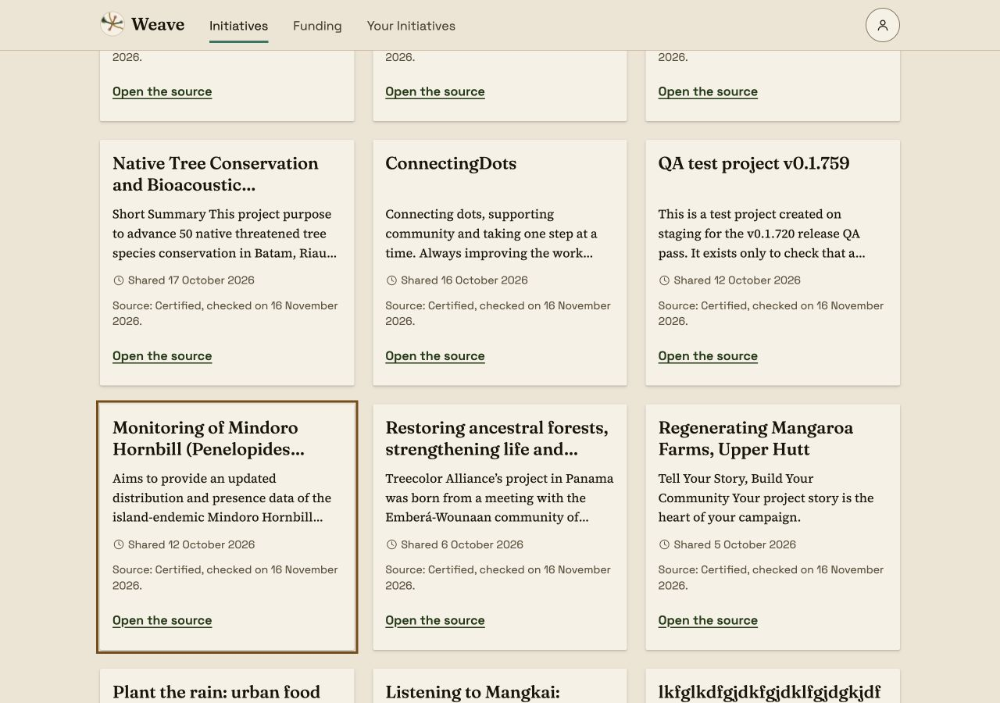
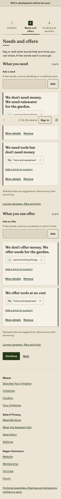

# Production go-live evidence, 16 November 2026

Weave is enabled in production, but launch QA is blocked. The user designated
negated-money classification and stale private UI after cross-tab sign-out as
launch blockers. No current-task support entry was shared. Reviewed fixture fixes
do not establish production repair or permission to release.

QA took place on 15 to 16 November 2026, Pacific time. Production proof used the
user's existing Brave profile. Chromium 156 was reported by the user; the version
page was blocked, so the exact version was not independently verified. This
documentation session operated no browser or database and changed no Auth,
deployment or catalog settings. The approved production cloud QA cleanup is
recorded below. Public evidence uses account A and account B only.

## Production state and rollback

| Component | Observed state | Rollback or limit |
|---|---|---|
| [Weave](https://weave.regencommons.com) | Main `21a090098b166c403b6ee4cdda772bf8489fb92a`, serving `dpl_EMW6rhioSLdBxrR5pqTvpFBpNTkA`; [deployment URL](https://weave-hon4x1z4g-regen-commons.vercel.app). Health returned 200. | Prior deployment `dpl_G9gEf6vLVZLY5nDFdeRDFzZX5Dix`. No rollback executed. |
| Production settings | Inventory: 21 environment records. Only `CRON_SECRET`, `WEAVE_INDEX_REFRESH=all-public` and `WEAVE_PUBLIC_PROJECTS_ENABLED=true` were added. Project enabled/authenticated access flags predated this task. Existing keys, credentials, CA and origins were preserved; no passwords were reset. | No pilot identity list, `WEAVE_SUPPORT_GROUP_LIFECYCLE_VERIFIED` or `WEAVE_CERTIFIED_PROJECT_PDS_ORIGINS` was set. No shared Auth, DNS or Ignored Build Step change. |
| Rebuilds | `dpl_EVVm8yXy8qsCGK2r5TA4zcQwRytA` was a duplicate rebuild of the same code and settings; the serving deployment is the one above. | This was not another code release. |
| Public index | First manual refresh: 63.2 seconds, 46 pages, 1,131 records, 1,123 listed, 8 invalid, 112 test-host records excluded, 1,011 indexed, 998 shown, 13 without description hidden, zero failures. | Slower than the requested sub-minute estimate. The daily cron is enabled at `0 4 * * *` for `/api/project-index-refresh`; scheduled firing and multi-day freshness remain unproven. |
| Index access | Unauthorized refresh returned 401. Public list returned 200 and 998 total. QA read `checkedAt=2026-11-16T04:19:06.910000Z`. | That timestamp does not prove the scheduled 04:00 UTC invocation fired. |
| Index rollback | Existing [all-public index runbook and evidence](../../../../../packages/api/evidence/project-index-all-public-2026-11-15.md) owns behavior. | Disable/unset `WEAVE_INDEX_REFRESH`, redeploy, then run `node packages/api/scripts/project-index.ts --withdraw-all` using the restricted index connection. To restore the starter list, unset `WEAVE_PUBLIC_PROJECTS_ENABLED` and redeploy. These are rollback references, not executed actions. |
| [Identity bridge](https://auth.regencommons.com) | Vercel project `weave-certified-preview`, live and rollback `dpl_A3pK35hYcLGzS3g8vixKrykjiv9j`. [PR #60](https://github.com/regen-commons/weave/pull/60) was already deployed; no new release, environment or key change was needed. Pre-existing Node 26 runtime was preserved. | Zero runtime delta. The recovered `store.ts` exactly matches merge `f4cfb8a89daa123932a87f422e6268a8c8e72a68`; seven retained upload files matched Vercel SHA-1 digests. Independent review found no blocking issue. |
| Bridge continuity | Discovery, `/jwks`, `/client-metadata.json` and `/at-jwks.json` each returned 200 unchanged. Public OIDC key ID `PNJi9otFeNK6hvIYvq373HuXRlH0FPPz`; AT key ID `-jnWRUAqPt6TSsV9Sz4xWnjvIekFae3N`. | Host-local production readiness was not executed because production credentials were not retrieved. |
| [Funding Commons](https://funding-commons.vercel.app) | Unchanged at `b6d4ca8` on `codex/funding-commons-demo`; November catalog shows 699 funders. Weave shows 699 funders and 771 program records. | No Funding Commons publication. |

The bridge artifact check ran API tests (36 passed, 11 opt-in skips), typecheck and
build. After the user approved repairing the disposable fixture setup, all six
PostgreSQL 17.11 integrations passed with zero skips, including A/B/A/A,
restart, revocation, interaction, replay and identity boundaries. The earlier
schema-setup failure is superseded by that successful run. The disposable container
and test credential file were removed. This fixture cleanup is separate from the reviewed production QA cleanup
recorded below.

Bridge archive SHA-256 values:

- Deployed upload: `2aa8ecbad6fc6e70f947f28ffe046382f0ef0295bf458383a0e7ab939c85b604`.
- Verification with unchanged fixture schema: `ae49eb156bd15876ed981037f73df850290152b143d722004fab07b24a35683b`.

## Eight-block acceptance matrix

All rows below are **production, Brave (Chromium 156)** unless explicitly
labelled fixture.
"Observed" covers the stated subset; it does not close the unproven criteria.

| Block | Result | Observed | Skipped, stopped or unproven |
|---|---|---|---|
| 1. Sign-in and return | Observed flows passed | Private save/reload A/B/A passed 3/3 with fresh cloud-list isolation. Later QA returned A to `/your-initiatives` in 226 seconds, B to `/funding?sort=fit` in 42 seconds, and A to `/initiatives` in 31 seconds, all within five minutes and without localhost. Local drafts/backups were separately labelled. | Expired sign-in behavior was not reproduced in this run. Same-profile local backups are not evidence of a cloud isolation failure. |
| 2. Describe | Partial | Form name, place, about and link survived reload. Typed Talk it through preserved supplied facts without inferring language or stage. A one-page synthetic PDF was read on device and produced its source text. Speak stayed absent. | PDF structured Where stayed blank although Awka was in its source description. Audio and browser-model extraction were N/A in Brave. No phone or real speech install tested. |
| 3. Bring projects | Partial | A/B membership refreshes returned `access=ready`; both existing team workspaces opened. Imported name and Certified shortDescription matched. Duplicate warning and Use this project reused B's existing workspace without a duplicate or team overwrite; the temporary card remained device-only and was restored to its synthetic QA content. | Source place and links did not import. Both projects already had workspaces, so a separate On Certified entry was unavailable. Source produced zero new pencil entries, so removal/reload persistence could not be tested. New Green Goods identity, exact AT-URI/PDS and import are unproven. Older real/QA and withdrawn entries were preserved. |
| 4. Needs and offers | Failed launch gate | Ten needs and ten offers covered all eight kinds, with expected kinds declared before observing. [Exact synthetic sample](quality-results.json): 16/20 exact (80%). Equipment, amounts, mixed kinds and Portuguese positive `água` worked; no amount or date was invented. Manual correction did not inflate the denominator. First-batch entries were removed with visible Undo before reusing five-card limits. | Both negated-money cases wrongly included Financial. Two soil research/data cases wrongly added Living alongside Intellectual. The numeric 80% threshold alone does not override the user's negation launch blocker. |
| 5. Share and match | Stopped by user | Zero current-task support entries shared; zero withdrawals needed. Fresh private account lists were isolated in block 1. | Positive cross-account match, explanations, edit/withdrawal propagation and private-entry exclusion within that shared flow remain unproven. Resume after reviewed fixes receive an approved release. |
| 6. Funding | Partial | 699 funders / 771 records. NLnet search: 5 programs. Closing 30 days: 16; with Open now: 12. Africa: 276; Grant: 635; Climate & environment: 276; Research leads: 0 for the synthetic card. Clearing filters restored 771. All offered sorts changed order. [Thirteen official date spot-checks](deadline-checks.md) matched, including NLnet, FUNBIO and CDFW. | Weave offers Research priority, not a literal Thematic fit sort. The existing private card had no lead-group widget matches; this does not mean zero thematic overlap. New Green Goods exact fit/ranking remains unproven. Haymarket note/header are stale. CDFW exact cutoff instants remain unresolved. |
| 7. Initiatives | Partial | 998 shown. Search, Show more (12 to 24), descending first-page shared dates and three Home items matching the first directory cards worked. First two API pages contained 12 each with zero overlap. | An older Green Goods public result is not proof of the new project by name alone. New Ma Earth project is private, so public appearance after creation/refresh was not proved. No new project was published to force this test. |
| 8. Across the app | Failed cross-tab gate; other checks partial | PDF, Funding and Initiatives had equal document/viewport widths at 360, 375 and 1280 in explicit Light/Dark. Keyboard navigation, Enter/filters and reload preservation worked. In two sign-out reproductions, one each for A and B, the other tab retained signed-in controls and cached cloud cards until reload. | No continued server authorization or protected stale-tab write was established. Stop rule applied after the second reproduction. No release occurred during QA, so returning-visitor update transition remains unproven. 200% text zoom, reduced motion, offline and physical phones were not checked. Limited error-log groups do not establish a global 5xx count. |

The project backend startup probe used a CLI POST with `Origin`, JSON and body
`{}` to `/api/projects`: 400 `invalid_project_command`, not 503. The browser's
read-only evaluation API did not allow page fetch, so this is **production, CLI**
proof of startup, not a browser-authenticated project command.

## Green Goods and import boundary

The user completed setup on Ma Earth. Inspection found the organization at
[Green Goods](https://maearth.com/organizations/green-goods) and the project at
[platform](https://maearth.com/green-goods/platform), marked **Private / Project
preview**. About/categories matched the approved content; the displayed location
was United States. The project was preserved without republication or field
changes. The earlier organization slug returned 404 and is superseded by the
organization URL above.

The new project's exact AT-URI/PDS and relationship to the older indexed Green
Goods record were not established. The old record's name is insufficient identity
proof. For B's existing source, Certified's shortDescription was already shortened;
that shortening is not evidence of Weave losing the longer Ma Earth story. Missing
place and business links were observed separately.

## Findings and tracking

The two launch blockers are user decisions. "Fix this week" and "later" below are
triage recommendations, not new launch policy. GitHub Issues is disabled (HTTP
410), so [six separate finding records](findings.md) in this draft PR track the
uncovered work. No issue was created and no repository setting was changed.

| Priority | Finding | Tracking / boundary |
|---|---|---|
| Blocks launch | Explicitly denied money suggests Financial. | [Draft #80](https://github.com/regen-commons/weave/pull/80). No duplicate issue. Not deployed. |
| Blocks launch | Cross-tab sign-out leaves cached private UI and signed-in controls. | [Draft #81](https://github.com/regen-commons/weave/pull/81), independently reviewed; supported fixture cases passed below. Focus timing, browser race timing and export bytes remain unproven. No production repair claimed. |
| Fix this week | Certified link/import loses source place and links. | [Source-field finding](findings.md#certified-source-place-and-links). Covers explicit fields, not the already-shortened description. |
| Fix this week | Soil research/test data adds Living unnecessarily. | [Soil-data finding](findings.md#soil-research-and-test-data). Outside #80's patch. |
| Fix this week | Selective cloud-card and local draft/backup deletion is absent. | [Deletion finding](findings.md#selective-deletion-and-qa-cleanup). Cloud QA removed by reviewed maintenance; self-service/local deletion remains absent. |
| Fix this week | Haymarket source wording note and Research snapshot header are stale. | [Catalog finding](findings.md#stale-catalog-notes-and-date-header). Date checks passed; no catalog edit/publication. |
| Later | PDF source place is not assigned to structured Where. | [PDF finding](findings.md#pdf-structured-place); source text was retained. |
| Later / known | Expired Certified attempt can land on localhost. | [Known-expiry follow-up](findings.md#expired-sign-in-returns-to-localhost). Not reproduced here; shared Auth changes need approval. |

Expected limits, not new defect claims: only the configured production PDS is
supported; Certified group lifecycle publication stays intentionally off; the 13
description-free indexed projects stay hidden. Zero new suggestions cannot prove
suggestion-removal persistence. PRs #9, #71, #69 and #3 were untouched.

### Negation fix: fixture only

[Draft #80](https://github.com/regen-commons/weave/pull/80), commit
`d343dd4ed00642afe6486178465f465c63322134`, targets `develop`. The independently
reviewed two-file patch SHA-256 is
`4ff6d32b95650ca0bd9bffb1697d381f008bc82f7ff5c7d387aa471163f995ff`.
Forty independent probes passed. Full CI passed: root 147, design system 34,
API 217 plus 56 conditional skips, app 323, harness 78, guidance 95 and
type/design checks. Four GitHub workflows passed on the exact fix head.

**fixture, Brave (Chromium 156, user-reported):** both negated-money inputs suggested Living only; tools with
negated money and tools at no cost suggested Material only, 4/4. Keyboard manual
correction, Keep and Continue retained the chosen kind. The established route was
`/start/needs?fixture=draft&speech=none`; the supplied `/needs` route was stale, not
an app routing defect. Explicit Light/Dark at 360, 375 and 1280 had no horizontal
overflow. Narrow English negation is covered; non-English and elliptical
negation remain unsupported. Positive Portuguese `água` remains intact. Soil-data
over-tagging is unchanged. Fixture server 5173 was stopped after proof.

### Cross-tab fix

[Draft #81](https://github.com/regen-commons/weave/pull/81), commit
`6bfc1d26fa9074d1d70501180e87350811d1e39f`, targets `develop`.
The independently reviewed v2 patch SHA-256 is
`d9ddc777c1a86d5a4680e4632f3c15d724117428626b2e99af34eff4f1af7f31`,
based on `187f331`, across 15 paths. Independent review is clear; 54 focused
tests passed with zero skips. Full CI passed: root 147, design system 34, app
338, API 217 plus 56 conditional skips, harness 78 and type checks. The earlier
v1 candidate is superseded. The fix is a draft, not a production release; no
production repair is claimed. Four GitHub workflows passed on its exact head.
The Weave preview deployment has completed.

For both #80 and #81, the Funding Commons Vercel status is `success` with
description `Canceled by Ignored Build Step`: **skipped as configured**, not a
Funding Commons deployment. The Weave statuses separately say `Deployment has
completed` ([#80 preview](https://vercel.com/regen-commons/weave/9zcBhFGHmgp1CeGFur7sq6HJXqYz),
[#81 preview](https://vercel.com/regen-commons/weave/DfhiucgbyEQc9gkahRyPM29K8e1Y)).
Those deployment statuses do not prove browser acceptance or production repair.

**fixture, Brave (Chromium 156, user-reported):** the completed v2 review exercised the normal app account and
social providers against a synthetic backend on `127.0.0.1:5178`, without a
`?fixture=` UI scenario. The observer tab was never reloaded in these cases:

| Supported case | Observed result |
|---|---|
| Synthetic viewer keyboard sign-out | Observer removed `Cross-tab fixture cloud A` and Account controls and showed Sign in. |
| Synthetic editor keyboard sign-out | Observer removed both synthetic cloud cards and Account controls and showed Sign in. |
| Viewer and editor reentry | With the explicitly approved `account=signed-in` return-marker simulation, observer showed only the selected synthetic card; workspace role matched viewer/editor. |
| Direct viewer-to-editor switch | The same return marker replaced the synthetic viewer card with the editor card and changed the role from view to edit. |
| Visible local retention | Description, unfinished sentence and backup-list title/timestamp stayed unchanged across sign-out and switches. `cross-tab-local-note.txt` remained listed. No cloud save was used for that local draft. |
| Responsive/theme | Signed-out observer had no horizontal overflow at 360, 375 and 1280 in Light/Dark; capture dimensions were independently checked. |

The fixture selector omitted the normal app callback marker, so reentry/switch
proof uses the source-verified return-marker simulation. It does not prove a
production OAuth roundtrip. Actual focus-return timing remains unproven: CUA
could not activate a tab, and the narrowly permitted DevTools inventory showed
only `about:blank`, so the same real profile could not be verified and no focus
action was taken. Async Save/Load races passed the 54 focused implementation and
review tests; their timing was not established by this browser run.

A device-export attempt timed out and reset the CUA kernel; it was not retried,
and the expected export artifact was absent. Exported attachment-byte equivalence
is unproven. The supported retention claim is visible text/backup equality and
attachment listing. The existing real Brave tabs were rebound after reset;
appearance returned to System and the viewport override was cleared. This
consolidation session only inspected the supplied artifacts and images.
Production `21a0900` is unchanged; the fixture pass is not clearance to release.

## Cleanup retained, not completed

**Production cloud QA cleanup completed on 16 November 2026.** After independent
review and a successful `ROLLBACK` dry run, the orchestrator committed a guarded
transaction deleting exactly **two private, unlinked, zero-entry QA initiatives
and their two matching idempotency save receipts**. The guards checked exact
owner/identity, full synthetic content, revision and timestamps, zero related
entries/references, pinned foreign keys and absence of non-internal DELETE
triggers/rules. Non-target account A/B record counts were unchanged. A separate
read-only postflight found **zero target initiatives and zero target receipts**.
This is **production, Supabase SQL** proof. Fresh owner-checked lists
(**production, Brave (Chromium 156)**) then retained **three older cloud cards
for A and two for B**, with
neither targeted QA card present and no QA card saved or recreated. Final browser
verification: `2026-11-16T11:11:18.125725Z` (16 November, 3:11 a.m. Pacific).

A fresh workspace listing would have required renewed consent, which was not
taken. Workspace preservation is supported by the guarded database reference and
count checks, not a new browser listing. Both account lists and Settings were
checked; the browser reservation was released after the completion summary.

The orchestrator's post-cleanup public smoke returned health HTTP 200 at
`21a0900` and public-projects HTTP 200 with a bounded index, 998 total and 12 on
the first page. Its `checkedAt` remained `2026-11-16T04:19:06.910000Z`, which
still does not prove a scheduled cron firing. Fresh remote verification kept
`origin/main` at `21a090098b166c403b6ee4cdda772bf8489fb92a`. No release occurred.

No current-task support entry was shared: withdrawal count **0**. Remaining
**production-origin** scope is **zero cloud QA cards, one device draft and seven
backups**. The separate local fixture also retains one synthetic draft, one
backup and one listed attachment. No selective local removal path is supported.

| Storage | Exact synthetic title | Final status / identifying UI detail |
|---|---|---|
| Production cloud, account A | QA 15 Nov A | Removed by the reviewed transaction; matching receipt removed |
| Production cloud, account B | QA 15 Nov B | Removed by the reviewed transaction; matching receipt removed |
| Production device draft | QA 15 Nov PDF Garden | 1 retained; synthetic PDF, zero needs/offers, never saved to a team or cloud |
| Production local backups | QA 15 Nov Talk Garden | 2 retained; displayed 15 November, 11:23:14 p.m. and 11:22:19 p.m. Pacific |
| Production local backups | QA 15 Nov A | 3 retained; displayed 15 November, 6:40:16 p.m., 6:36:59 p.m., 6:35:47 p.m. Pacific |
| Production local backups | QA 15 Nov B | 2 retained; displayed 15 November, 6:39:36 p.m. and 6:39:19 p.m. Pacific |
| Separate local fixture, `127.0.0.1:5178` | Cross-tab local draft; cross-tab-local-note.txt | 1 draft, 1 backup and 1 listed attachment retained |

The app still has no individual saved-card or device-backup delete control.
`/api/account` exposes list/load/save/sign-out; `DraftRepository` exposes
load/save/replace/backups, and replacing a draft backs up its predecessor.
The reviewed one-off database operation adds no app deletion feature. The
[deletion finding](findings.md#selective-deletion-and-qa-cleanup) therefore remains
open for supported selective controls and safe local cleanup.

Backup display times are `draft.updatedAt`, not backup key timestamps; title/time
alone cannot safely select deletion targets. Local cleanup needs exact
keys/draft IDs/revisions with compare-before-delete and preservation checks.
No arbitrary browser/IndexedDB mutation, whole-account deletion or browser-wide
clearing was attempted. Real data, older QA, workspaces, withdrawn entries and
the real-data backup made while opening an older card were preserved. Private
selectors, full cloud documents and executable deletion SQL are excluded from
this public evidence. The private identification manifest was removed after
verification and its absence independently confirmed. No forensic erasure is claimed.

## Rendered proof

The following existing captures were visually inspected before inclusion. They
contain synthetic fixture inputs or the public directory, with no real private
cloud card, account address or record URI. Captured widths were checked from the
image files. Full-page fixture images include a fixed toolbar at the viewport edge;
the overlap is a capture artifact, not a removed input.

| production, Brave (Chromium 156), 375 px, Dark | production, Brave (Chromium 156), 1280 px, Light, scrolled public directory |
|---|---|
|  |  |
| fixture, Brave (Chromium 156, user-reported), 375 px, Light | fixture, Brave (Chromium 156, user-reported), 1280 px, Dark |
|  |  |
| fixture, Brave (Chromium 156, user-reported), 375 px, Dark, synthetic viewer return | fixture, Brave (Chromium 156, user-reported), 1280 px, Light, synthetic editor return |
|  |  |

The separate **production, Brave (Chromium 156)** stale-tab capture is
**1460 px**, not 1280. It is retained locally,
not committed as private-card proof. Production appearance was restored to System
and temporary viewport overrides cleared after QA.

## Log limits and evidence provenance

Vercel clustered runtime errors were empty for app and bridge during
`2026-11-16T06:50:00Z` to `07:43:00Z`, then `07:43:00Z` to `08:14:24Z`
(15 November, 10:50 p.m. through 16 November, 12:14:24 a.m. Pacific).
Grouped app logs were empty; bridge summaries had 44 then 32 info records and no
error group. Observability Plus was required for global request/5xx totals; no
billing was enabled. These bounded summaries prove neither zero global 5xx nor
ongoing monitoring.

This record was checked against the completed workstream handoffs and these local
source artifacts. Private/raw captures and account data are not committed. Hashes
allow the retained artifacts to be checked without publishing their full content.

| Source artifact | SHA-256 |
|---|---|
| `production-results.md` | `c7c005447906924f8de8032809fd5ffae9f3300b9073e8b7588772af7dc09121` |
| `quality-results.json` | `7d783d8fae7f1d56949079141c5e53eb4ee42c7eee249257054a9b8ff731704e` |
| `deadline-checks.md` | `433ac0fe730dab4082a601c7b4f89f7536f69f1e9a09ba21d92ee619a521100f` |
| `two-tab-signout-reproduction.md` | `7b0fae4190d57a994e2435efce7cc64a1e650fa2f259086ea7b08d5d34b8dcd6` |
| `cleanup-remaining.md` | `0717049e67cb5568c45f15965417686cbf314415eb10675071a16176083781eb` |
| `fixture-negation-review.md` | `3fd2091c2b3bf49cd56f0814409f003e727fd4471e11ad6e2e713009aec8bd15` |
| `fixture-negation-results.json` | `34b8c16267fd1b3288c2e3ced30f74c965e00a0c742f1eeee012a2bb0c7bda28` |
| `fixture-cross-tab-review.md` | `6a90fe5c06997f279369a50cc7827ee63e7491d9060527b3f9a5adf27db177b7` |
| `fixture-cross-tab-results.json` | `5e2ab9ab6063623687e7c888c383321855279494b2626a5342db22e0d6bbeccf` |

Bridge `verification-status.json`, `test.log` and `test-auth-db.log` were inspected
in the retained bridge artifact directory. Configuration, index refresh and
private-save outcomes above are attributed to the completed production
workstreams; this documentation session did not rerun them. QA used no new
dependencies. Its online modern-web-guidance refresh was blocked by the sandbox
registry restriction, so repository standards were used.

Consolidation checks ran in an isolated branch from `origin/develop` at
`187f331db97ef367fc7e288bdabb44ff04bc71be`, separate from the dirty source checkout:

- `bun install --frozen-lockfile`: 574 packages installed; no lockfile or
  dependency change, Bun 1.4.2 and Node 24.20.0.
- `bun run ci`: passed. Root 147, design system 34, API 217 passed with 56
  configuration-dependent skips, app 319, harness 78; design/type builds and
  guidance checks passed. The initial sandbox attempt stopped at the pinned model
  download; the approved network-enabled run completed.
- `bun run guidance:check`: 98 Markdown files passed.
- `git diff --check`, local Markdown links and JSON/sample counts passed.
  Text checks found no email, DID, AT-URI, database URL, private-key marker or
  em dash in the new evidence, decision diff or issue drafts. Six selected image widths
  were confirmed as 375/1280 and visually inspected.

Supported cross-tab fixture cases and responsive captures passed; focus timing,
browser race timing and exported-file bytes remain unproven. The six uncovered
findings are tracked in this evidence draft PR because repository Issues is
disabled. Nothing here authorizes a merge, release or production mutation.

## Follow-up phone and release checklist

These are **unrun acceptance steps**, not passes. Sharing and returning-visitor
release/update checks wait for an approved release of the blocker fixes.

- iPhone Safari: sign in, describe, type needs and offers, then share. Speak should
  stay hidden.
- Android Chrome: check Set up speech on this device, then speak a need if the
  browser offers local setup; audio must stay on the device. The prior
  [speech evidence](../speech-setup/README.md#not-proven) did not prove Android
  support, so an unavailable/hidden result must be recorded rather than assumed
  to pass.
- Desktop Chrome: complete real local speech setup and Speak; Brave cannot prove
  that flow.
- Add to the home screen, reopen offline, and try 200% text zoom.
- After the approved fixes are released: repeat production negation and two-tab
  sign-out, complete sharing/matching and withdrawal checks, observe the
  returning-visitor release transition, and finish supported selective local cleanup when available.
