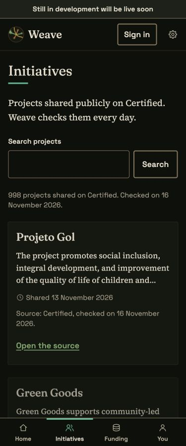
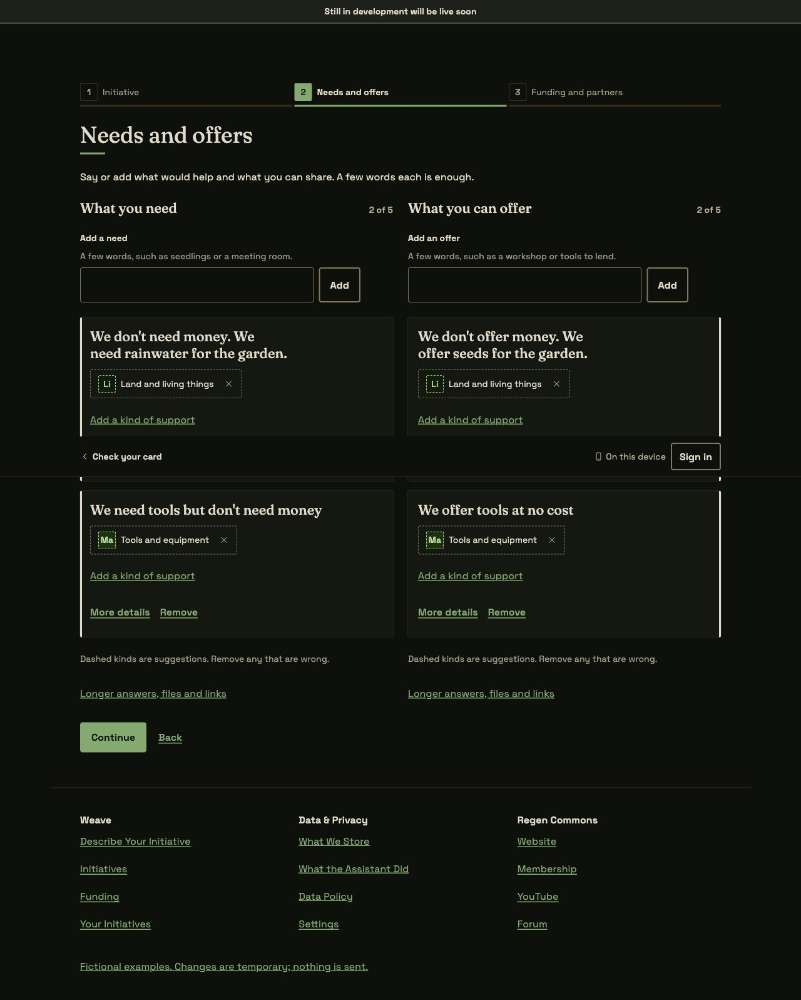
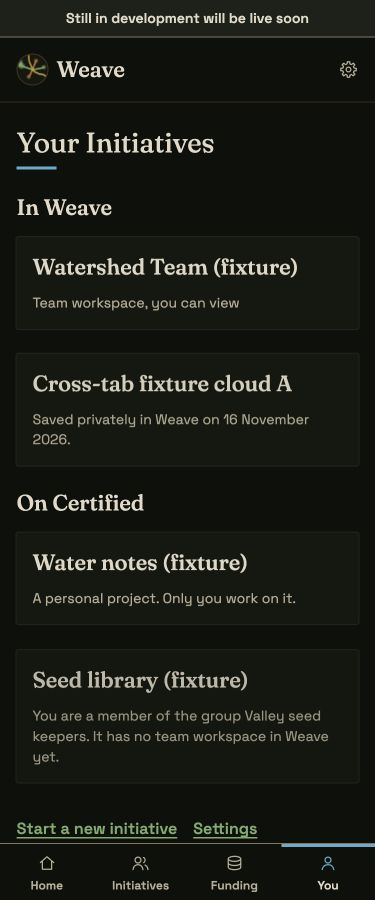
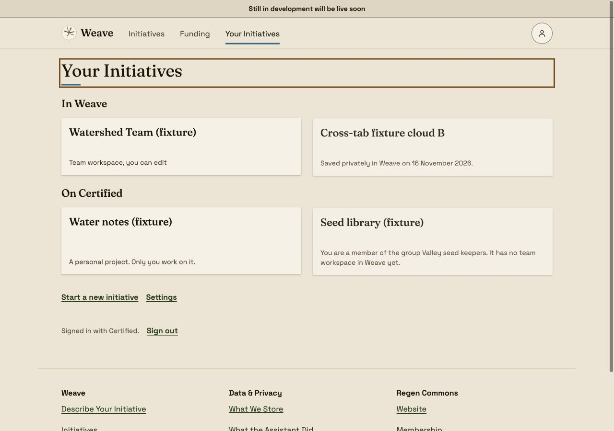
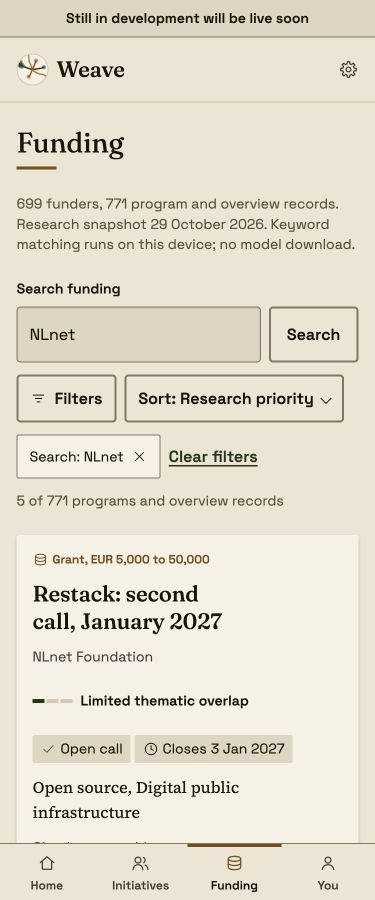
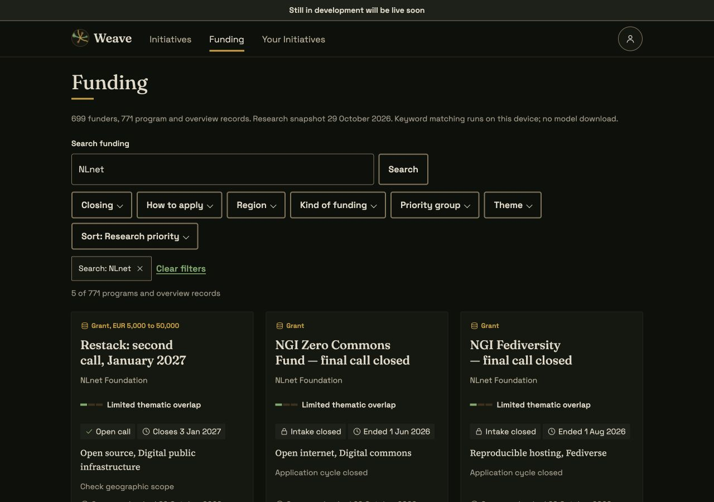

# Production go-live evidence, 16 November 2026

Weave went live at `ea2b810` on 16 November and is now at `3b8df8b`, from the
[intake redesign release](#release-of-99-and-100-19-november). It followed the
[layout fixes release](#release-of-101-18-november) and the
[polish release](#release-of-95-to-97-18-november) on 18 November, and the
[17 November release](#release-of-85-to-93-17-november). Both previously designated launch-blocker gates passed
on the verified new production client: negation classification and real A/B
cross-tab session changes. Sharing remains stopped by the user's direction after
browser-control timeouts. Matching and its dependent acceptance checks remain
unproven; those timeouts do not establish an application regression.

QA took place on 15 to 16 November 2026, Pacific time. Production proof used the
user's existing Brave profile. Chromium 156 was reported by the user; the version
page was blocked, so the exact version was not independently verified. These evidence changes alter no Auth, deployment or catalog settings. The approved production cloud QA cleanup is
recorded below. Public evidence uses account A and account B only.

## Release of #99 and #100, 19 November

The user approved releasing the "Start an initiative" redesign once the saved-card
overwrite found in its last review was fixed, and asked to finish the work so they
could do final QA.
[Release PR #103](https://github.com/regen-commons/weave/pull/103) merged as
`3b8df8bb4579fa1c2961deca4dd98a97f7f19f03` at 17:43 UTC on 19 November (9:43 a.m.
Pacific). Its tree matches `develop` at
`977aa2d`, the merge of #100.

| Change | What it does |
|---|---|
| [#100](https://github.com/regen-commons/weave/pull/100) | Rebuilds "Start an initiative" as three steps: one page to describe an initiative, filled on the device from the person's own words; four needs and four offers; several initiatives in one browser, kept in step across tabs; every "Start An Initiative" starting a new card; and step 3 kept in the flow (DL-110 to DL-114). |
| [#99](https://github.com/regen-commons/weave/pull/99) | Adds the records of the two 18 November releases below. Docs only. |

The release changes no deployed function, server contract, database schema,
dependency, security header or deployment configuration. It does change where each
browser keeps unsaved drafts (DL-114): drafts move to a new IndexedDB database,
`weave-drafts`, and the released database, `weave-device-drafts`, is copied from and
never upgraded or created. A tab already open on the earlier build keeps working until
it is reloaded, and a rollback finds each browser's draft as that build last wrote it.

#100 is critical tier. It went through six independent review rounds before merging,
and every finding was reproduced with a failing test before it was fixed. Among the
findings fixed: an automatic reload of hidden tabs that could discard typed words (the
reload was dropped), a deletion that could remove newer words, keyword rules that could
run for an hour on long input, and a new card that could reuse a cleared saved card
and overwrite it on Save.

| Release evidence | Verified result |
|---|---|
| Checks before the merge | `bun install --frozen-lockfile`, `bun run ci`, `git diff --exit-code` and `git diff --check` exited 0 on #100's head `d6a2b67`: root tests 150 of 150, `@weave/app` 613 of 613, `@weave/api` 240 passing with 0 failures, design system 70 of 70, harness 78 of 78. #100's seven GitHub checks passed, and the release PR's four passed on `977aa2d`. |
| Weave production | Vercel reported the deployment for `3b8df8b` complete at 17:46 UTC on 19 November ([status](https://vercel.com/regen-commons/weave/H7sKabndeLfDnvDRzHkLUczQ7yCV)). [Weave](https://weave.regencommons.com) health returned status ok, commit `3b8df8b`, at 17:46 UTC. The deployment was not inspected with the Vercel CLI. |
| Weave rollback | The deployment that served `2893fb1` before this release ([status](https://vercel.com/regen-commons/weave/81RYzb4MUUS3LERaTBqYGhEQpbip)). No rollback was performed. |
| Rendered check | Class `production`, the Claude desktop app's built-in Chromium browser at 375 px, signed out, dark theme, with nothing typed so nothing was stored. Both "Start An Initiative" links on Home went to `/start/new` and opened a blank step 1 with the words box, Name, Where you work, About it and one link, and the three-step stepper. Your Initiatives loaded. Neither page scrolled sideways. |
| Device storage | In that browser, `weave-device-drafts` stayed at version 2 and `weave-drafts` was created at version 1 beside it, as DL-114 intends. |
| Funding Commons | `Canceled by Ignored Build Step` on `3b8df8b`: skipped as configured, not published. |

**Not proven in production:**

- Filling, adding needs and offers, and step 3 with real words. They were checked on
  the fixture only.
- The copy from the released database with a real earlier draft, an older tab writing
  after the copy, and a deletion reaching the released database. All storage tests run
  on a fake IndexedDB, and Safari, Firefox and a real phone are untested.
- Voice and the built-in model, which work only in desktop Chrome.
- Signing in, saving, sharing and matching. Nothing was signed in, saved, shared or
  deleted in production.

The user's final QA follows this release.

## Release of #101, 18 November

The user checked the polish release on 18 November and found three items from the
feedback review only partly fixed: the gap above the footer, skeletons that did not
match the loaded layout, and surfaces left behind text sections. They approved the
fixes and then this release.
[Release PR #102](https://github.com/regen-commons/weave/pull/102) merged as
`2893fb134aa0727df2b496301b0b5eb681634679` at 07:01 UTC on 19 November (11:01 p.m.
Pacific on 18 November). Its tree matches `develop` at
`54ab290dff143fa429ddd12ba75b3474e8e98675`.

| Change | What it does |
|---|---|
| [#101](https://github.com/regen-commons/weave/pull/101) | List cards keep fixed rows, so a skeleton and a loaded card are one height and a loading list holds the loaded layout (DL-108). A page ends one step above the footer's line, no section is a tinted band, and the "Describe your initiative" prompt is a plain section (DL-109). Initiatives opens on the starter list when the browser last heard the public list was off. |

The release changes no deployed function, server contract, database schema,
dependency, security header or deployment configuration. The intake redesign is still
not released.

| Release evidence | Verified result |
|---|---|
| Checks before the merge | `bun install --frozen-lockfile`, `bun run ci`, `git diff --exit-code` and `git diff --check` exited 0 on #101's head `7f53132`, and its seven GitHub checks passed. On `54ab290` the four GitHub checks of the release PR passed. |
| Weave production | Vercel reported the deployment for `2893fb1` complete at 07:02 UTC on 19 November ([status](https://vercel.com/regen-commons/weave/81RYzb4MUUS3LERaTBqYGhEQpbip)). [Weave](https://weave.regencommons.com) health returned status ok, commit `2893fb1`, at 07:03 UTC. It still returned `a1470b6` at 07:03:06. The deployment was not inspected with the Vercel CLI. |
| Weave rollback | The deployment that served `a1470b6` before this release ([status](https://vercel.com/regen-commons/weave/AzPmryd76FHq3LXBNMMYSt3RAJDG)). No rollback was performed. |
| Returning browsers | A browser that had the earlier build kept showing it from the service worker's cache through two page loads after the deployment. It showed the new build on the load after the worker had updated. |
| Funding Commons | `Canceled by Ignored Build Step` on `2893fb1`: skipped as configured, not published. |

Each page below was opened from another page in production and sampled every 16 ms,
comparing the last frame that showed a skeleton with the final frame. Class
`production`, the Claude desktop app's built-in Chromium browser, signed out, dark
theme, with the live catalog and public project list.

| Page | Before, at `a1470b6` | After, at `2893fb1` |
|---|---|---|
| Funding, 1280 px | 12 skeleton cards of 282 px loaded into 24 of 315 px | Identical: 24 cards of 339 px, same filter bar, list end and footer |
| Funding, 375 px | 12 skeleton cards of 282 px loaded into 24 of 258 to 290 px | Identical: 24 cards of 314 px, same filter bar, list end and footer |
| Initiatives, 1280 px | Cards matched; the footer moved 72 px | Identical: 12 cards of 258 px, same list end and footer |
| Initiatives, 375 px | Not measured | Identical: 12 cards of 233 px, same list end and footer |
| Home, 1280 px | "Recently Shared" held 3 skeleton cards and loaded 8; the section below moved 282 px | Identical: 8 cards both times, nothing moved |
| Home, 375 px | "Recently Shared" skeleton cards of 231 px loaded at 258 px; the footer moved 27 px | Identical: 8 cards of 233 px, nothing moved |
| Home, last text to the footer's line | 96 px at 1280 px, across a tinted band and a 40 px strip | 40 px at 1280 px and 32 px at 375 px, with no tinted section |

**Not proven in production:**

- A real phone, the light theme, reduced motion, and widths other than 375 and
  1280 px.
- A first visit to Initiatives while the public list is off. That case still jumps
  and cannot be seen while the list is on.
- A person with a card, for whom ranking lines still arrive after the list.
- Signing in, saving, sharing and matching. Nothing was signed in, saved, shared or
  deleted in production.

## Release of #95 to #97, 18 November

The user approved releasing the desktop and phone polish from `develop` to `main` on
18 November 2026, Pacific time, ahead of the intake redesign.
[Release PR #98](https://github.com/regen-commons/weave/pull/98) merged as
`a1470b66e8bf9f9e1e73a34a1476470e4c0c293e` at 04:58 UTC on 19 November (8:58 p.m.
Pacific on 18 November). Its tree matches `develop` at
`eb92f04e7603a831ab8791e9914c7a5ddafaa040`.

| Change | What it does |
|---|---|
| [#96](https://github.com/regen-commons/weave/pull/96) | The desktop and phone polish from manual QA and the 18 November UX feedback review, recorded as DL-079 to DL-107 in the design system's decision log. It includes a development-only, opt-in read of the public project list from production. |
| [#97](https://github.com/regen-commons/weave/pull/97) | Rewrites the README around Weave, with matching edits to `AGENTS.md` and the app package's description. |
| [#95](https://github.com/regen-commons/weave/pull/95) | Adds the 17 November release record below. Docs only. |

The release changes no deployed function, server contract, database schema,
dependency, security header or deployment configuration, so nothing had to be applied
before or after the merge. The intake redesign (a one-page describe step, four needs
and offers, several drafts per browser) is not in this release. An independent review
found defects in it, and it stays on its own branch until they are fixed.

| Release evidence | Verified result |
|---|---|
| Checks before the merge | `bun install --frozen-lockfile`, `bun run ci`, `git diff --exit-code` and `git diff --check` exited 0 on #96's head `f90bab6`, and its seven GitHub checks passed. `develop` then differed from that tree only by #97's three files. On `eb92f04` the four GitHub checks of the release PR passed: `guidance-check`, `design-check`, `build-and-test` and `weave-check`. |
| Weave production | Vercel reported the deployment for `a1470b6` complete at 05:00 UTC on 19 November ([status](https://vercel.com/regen-commons/weave/AzPmryd76FHq3LXBNMMYSt3RAJDG)). [Weave](https://weave.regencommons.com) health returned status ok, commit `a1470b6`, at 05:00 UTC. A minute earlier it still returned `024d713`. The deployment was not inspected with the Vercel CLI, whose sign-in on the release machine had expired. |
| Weave rollback | `dpl_5TqNXtaEQp52pHKvRn2rmW2oyrss` at `024d713`, the deployment that served production before this release. No rollback was performed. |
| Rendered check | Class `production`, the Claude desktop app's built-in Chromium browser, signed out, dark theme only. Home at 1280 px showed the title case heading and buttons and the header's theme switch. Funding at 375 px showed the fixed tab bar with Home, Initiatives, Funding and You, the sort menu button with no native select, and 771 programs from 699 funders. Neither page scrolled sideways or logged a console error. |
| Funding Commons | `Canceled by Ignored Build Step` on `a1470b6`: skipped as configured, not published. |

**Not proven in production:**

- A real phone. Safari and iOS behaviour has only been emulated: safe areas,
  rubber-banding, sheet drag, the fixed mycelium canvas as the address bar shows and
  hides, and its clip.
- The light theme, the keyboard, page slide motion and reduced motion. The production
  check above covered two pages in the dark theme.
- The install shortcuts and screenshots in an installed app.
- Signing in, saving, sharing and matching for this release. Nothing was signed in,
  saved, shared or deleted in production.

## Release of #85 to #93, 17 November

The user approved releasing `develop` to `main` on 17 November 2026.
[Release PR #94](https://github.com/regen-commons/weave/pull/94) merged as
`024d713b8ac55e8ddbf75a2fdab2018d3d7720e1` at 19:56 UTC (11:56 a.m. Pacific). Its
tree matches `develop` at `7194d4896bbffae6877781ee9e870daaf7b166c6`.

| Change | What it does |
|---|---|
| [#86](https://github.com/regen-commons/weave/pull/86) | A return from an expired sign-in recovers to the person's task instead of failing. Needs the identity bridge redeploy below. |
| [#90](https://github.com/regen-commons/weave/pull/90) | A person can delete one saved card or one device backup without touching the others. Needs the deletion migration below. |
| [#88](https://github.com/regen-commons/weave/pull/88) | A linked Certified project keeps its source place and links. |
| [#89](https://github.com/regen-commons/weave/pull/89) | A place named in an uploaded PDF is proposed as the initiative's place. |
| [#91](https://github.com/regen-commons/weave/pull/91) | Soil research and data no longer suggest Living by themselves. |
| [#85](https://github.com/regen-commons/weave/pull/85) | Refreshes the Haymarket catalog note and its funding date. |
| [#92](https://github.com/regen-commons/weave/pull/92) | Adds evaluation sets and reports for user flows, kinds of support and matching. |
| [#93](https://github.com/regen-commons/weave/pull/93) | Lets the account fixture link personal projects. Fixture only. |
| [#87](https://github.com/regen-commons/weave/pull/87) | Adds the workspace QA cleanup evidence below. |

#86 and #90 are critical tier. Both reached `develop` and production without the
second review that tier requires, by the user's direction. That review is still
owed.

| Release evidence | Verified result |
|---|---|
| Weave production | `dpl_5TqNXtaEQp52pHKvRn2rmW2oyrss`, [deployment](https://weave-d6usnphtd-regen-commons.vercel.app), serving [Weave](https://weave.regencommons.com). Health returned status ok, commit `024d713`, at 23:30 UTC on 17 November. |
| Weave rollback | `dpl_CW1UA9tLeehBXtqowkTFW1jfnRZ7` at `2c93b0f`, the deployment immediately preceding this release. No Weave rollback was performed. |
| Deletion migration | `20261117200140_weave_initiative_deletion` added to the Platform history by [website#25](https://github.com/regen-commons/website/pull/25), merge `896d92202ef08872ae53b9c7f96b9d4a467ac398`. It is a byte-for-byte copy of `supabase/candidates/weave-initiative-deletion.sql`. The user applied it with `supabase db push`; `migration list` on Platform (`ztygpuzldujfsqrubxic`) shows it in both local and remote history. Grants were not queried after the apply. |
| Identity bridge | `dpl_9NGryYjCXFD7XRBHrjejx2brE6Re`, built from `024d713`, serving [the bridge](https://auth.regencommons.com). Upload archive SHA-256 `0e18a5c64124e38e44ed26cb7659f597eeb461128d1dde0139bfcfceb8824f2d`. The build ran typecheck and 20 bridge and sign-in tests, which passed locally and on Vercel. |
| Bridge rollback | `dpl_A3pK35hYcLGzS3g8vixKrykjiv9j`, the earlier live bridge. The user promoted it at about 23:30 UTC on 17 November, then had the new build re-promoted minutes later. Both promotions completed. |
| Bridge continuity | After the first promote, discovery, `/jwks`, `/client-metadata.json` and `/at-jwks.json` returned 200 with the same digests as before the deploy, and an unknown client got 400. Runtime logs showed no errors. After the re-promote, discovery, `/jwks` and `/at-jwks.json` again returned 200 with the same digest and key IDs `PNJi9otFeNK6hvIYvq373HuXRlH0FPPz` and `-jnWRUAqPt6TSsV9Sz4xWnjvIekFae3N`. |
| Settings boundary | No environment, key, deployment-configuration or shared Auth change. `WEAVE_AUTH_APP_ORIGIN` stays unset, so the bridge's recovery returns to `https://weave.regencommons.com`. The bridge upload dropped the two earlier overlay archives, because `main` already contains their files. |
| Funding Commons | `Canceled by Ignored Build Step` on `024d713`: skipped as configured, not published. |

**Not proven in production:**

- The expired sign-in recovery. It needs a real Certified sign-in held past five
  minutes.
- Deleting a saved card or a device backup. No production card or backup was
  deleted, and the remaining production device data was left alone by the user's
  direction.
- Saving, sharing and matching for this release. They were proven in the fixture
  only. Production sharing stays stopped until the user approves resuming QA.

The shared Auth Site URL change that #86's analysis raised needs a separate
decision with the website maintainers.

## Released fixes and post-release production verification

The user approved the full `develop` release, including its previously excluded
catalog revisions #9/#71 and keyword change #79. Negation [PR #80](https://github.com/regen-commons/weave/pull/80)
merged into `develop` at `dfc391b12ca9a2aea8670b96a395cb7672dbde83`; cross-tab
[PR #81](https://github.com/regen-commons/weave/pull/81) merged at
`bd22bf319400c19c2d3b13abe0ed6cf83147f025`. All four workflows passed on that
combined `develop` head. [Release PR #83](https://github.com/regen-commons/weave/pull/83)
merged into `main` as `ea2b810abcbb31e93d296ac97e4995a8ba9f4e5d`; its tree matches
the released `develop` tree. The user subsequently authorized finishing and merging the evidence PR.

| Release evidence | Verified result |
|---|---|
| Production | `dpl_EhutxeLrqhFiTTG13993Cbbrc8TP`, [deployment](https://weave-gchizzkmm-regen-commons.vercel.app), serving [Weave](https://weave.regencommons.com). Root verified health HTTP 200, status ok, commit `ea2b810` at 20:08 UTC on 16 November (12:08 p.m. Pacific). |
| Immediate rollback | `dpl_EMW6rhioSLdBxrR5pqTvpFBpNTkA` at `21a0900`, the deployment immediately preceding this release. No rollback was performed. |
| Settings boundary | No environment, deployment-configuration or shared Auth change accompanied this release. Certified group publication remains off. |
| Public smoke | `/api/public-projects` HTTP 200, bounded index, 998 total, `checkedAt=2026-11-16T04:19:06.910000Z`; same timestamp is not proof of scheduled cron firing. CLI POST `/api/projects` with same-origin `Origin`, JSON and `{}` returned HTTP 400 `invalid_project_command`. |
| Funding Commons | Its Vercel status says `Canceled by Ignored Build Step`: skipped as configured. The Funding Commons site was not published by this release. |

All browser results in this section are **production, Brave (Chromium 156)**.
Version 156 remains user-reported and independently unverified.

The preserved visitor retained `/assets/index-Ban3tKqn.js` through deployment and
the first ordinary reload. A second ordinary later load picked up
`/assets/index-CBKRrTXE.js`, matching the server HTML. Both QA tabs loaded that new
bundle before the blocker tests. No cache, service-worker, cookie or storage
mutation was used to force the update. Immediate in-place replacement was not
observed; the later-load transition passed.

| Production negation gate | Observed kind before manual correction |
|---|---|
| Need: We don't need money. We need rainwater for the garden. | Living only |
| Offer: We don't offer money. We offer seeds for the garden. | Living only |
| Need: We need tools but don't need money | Material only |
| Offer: We offer tools at no cost | Material only |

All four passed with no Financial tag, and Continue retained the correct kinds.
This was a four-case regression check, not a rerun of the initial 20-case sample.

Real OAuth returns completed in 47 seconds for A and 40 seconds for B; a later A
return took 34 seconds. The observer updated without reload to A's three older
cloud cards or B's two, with no card from the other account. Keyboard sign-out
removed that account's cloud cards and Account controls and showed Sign in,
without observer reload. B's list appeared before its Account control settled;
the gate result uses the settled state. No localhost return occurred.

After each sign-out, local words and the visible PDF attachment remained. All
19 pre-test backup names and timestamps compared equal; seven are the older
QA 15 Nov task backups. The retained source sentence was later committed into
the local conversation through the normal Build flow. Attachment proof is its
visible listing, not exported-byte equivalence.

Sharing remains **stopped and unproven**. A saved one new private, unlinked QA
card and two new private needs in its existing workspace. Workspace metadata
and older withdrawn entries matched their baseline. One intended private need
was deselected from sharing. Two browser-control timeouts interrupted the
sharing review; no final Share, Renew or Withdraw confirmation was submitted,
and B's fitting offer was not created. A review request may have been dispatched,
so cleanup must check its references. The user directed that sharing stay stopped.
These failures were browser-control/locator limitations, not proven app defects.
Positive A/B pairing, reasons, edit propagation, withdrawal propagation and
private-entry exclusion in matching views remain unproven. Fresh private
account-list isolation passed separately above.

Post-release Funding checks passed at 360, 375 and 1280 in Light/Dark with no
horizontal overflow. NLnet search survived ordinary reload; keyboard Tab reached
Search and Enter submitted it. This rendered proof covers Funding, not every
screen. The original 13 official deadline checks were not repeated after release.

## Initial production state and rollback

The following table records the earlier `21a0900` rollout, before release #83.

| Component | Observed state | Rollback or limit |
|---|---|---|
| [Weave](https://weave.regencommons.com) | Main `21a090098b166c403b6ee4cdda772bf8489fb92a`, serving `dpl_EMW6rhioSLdBxrR5pqTvpFBpNTkA`; [deployment URL](https://weave-hon4x1z4g-regen-commons.vercel.app). Health returned 200. | Prior deployment `dpl_G9gEf6vLVZLY5nDFdeRDFzZX5Dix`. No rollback executed. |
| Production settings | Inventory: 21 environment records. Only `CRON_SECRET`, `WEAVE_INDEX_REFRESH=all-public` and `WEAVE_PUBLIC_PROJECTS_ENABLED=true` were added. Project enabled/authenticated access flags predated this task. Existing keys, credentials, CA and origins were preserved; no passwords were reset. | No pilot identity list, `WEAVE_SUPPORT_GROUP_LIFECYCLE_VERIFIED` or `WEAVE_CERTIFIED_PROJECT_PDS_ORIGINS` was set. No shared Auth, DNS or Ignored Build Step change. |
| Rebuilds | `dpl_EVVm8yXy8qsCGK2r5TA4zcQwRytA` was a duplicate rebuild of the same code and settings; the serving deployment is the one above. | This was not another code release. |
| Public index | First manual refresh: 63.2 seconds, 46 pages, 1,131 records, 1,123 listed, 8 invalid, 112 test-host records excluded, 1,011 indexed, 998 shown, 13 without description hidden, zero failures. | Slower than the requested sub-minute estimate. The daily cron is enabled at `0 4 * * *` for `/api/project-index-refresh`; scheduled firing and multi-day freshness remain unproven. |
| Index access | Unauthorized refresh returned 401. Public list returned 200 and 998 total. QA read `checkedAt=2026-11-16T04:19:06.910000Z`. | That timestamp does not prove the scheduled 04:00 UTC invocation fired. |
| Index rollback | Existing [all-public index runbook and evidence](../../../../../packages/api/evidence/project-index-all-public-2026-11-15.md) owns behavior. | Disable/unset `WEAVE_INDEX_REFRESH`, redeploy, then run `node packages/api/scripts/project-index.ts --withdraw-all` using the restricted index connection. To restore the starter list, unset `WEAVE_PUBLIC_PROJECTS_ENABLED` and redeploy. These are rollback references, not executed actions. |
| [Identity bridge](https://auth.regencommons.com) | Vercel project `weave-certified-preview`, live and rollback `dpl_A3pK35hYcLGzS3g8vixKrykjiv9j`. [PR #60](https://github.com/regen-commons/weave/pull/60) was already deployed; no new release, environment or key change was needed. Pre-existing Node 26 runtime was preserved. | Zero runtime delta. The recovered `store.ts` exactly matches merge `f4cfb8a89daa123932a87f422e6268a8c8e72a68`; seven retained upload files matched Vercel SHA-1 digests. Independent review found no blocking issue. |
| Bridge continuity | Discovery, `/jwks`, `/client-metadata.json` and `/at-jwks.json` each returned 200 unchanged. Public OIDC key ID `PNJi9otFeNK6hvIYvq373HuXRlH0FPPz`; AT key ID `-jnWRUAqPt6TSsV9Sz4xWnjvIekFae3N`. | Host-local production readiness was not executed because production credentials were not retrieved. |
| [Funding Commons](https://funding-commons.vercel.app) | Unchanged at `b6d4ca8` on `codex/funding-commons-demo`; November catalog shows 699 funders. Weave shows 699 funders and 771 program records. | No Funding Commons publication. |

The bridge artifact check ran API tests (36 passed, 11 opt-in skips), typecheck and
build. After the user approved repairing the disposable fixture setup, all six
PostgreSQL 17.11 integrations passed with zero skips, including A/B/A/A,
restart, revocation, interaction, replay and identity boundaries. The earlier
schema-setup failure is superseded by that successful run. The disposable container
and test credential file were removed. This fixture cleanup is separate from the reviewed production QA cleanup
recorded below.

Bridge archive SHA-256 values:

- Deployed upload: `2aa8ecbad6fc6e70f947f28ffe046382f0ef0295bf458383a0e7ab939c85b604`.
- Verification with unchanged fixture schema: `ae49eb156bd15876ed981037f73df850290152b143d722004fab07b24a35683b`.

## Initial eight-block acceptance matrix

This is the initial pass on `21a0900`. It preserves the original failures; the
later production gate results above supersede those two blocker outcomes only.

All rows below are **production, Brave (Chromium 156)** unless explicitly
labelled fixture.
"Observed" covers the stated subset; it does not close the unproven criteria.

| Block | Result | Observed | Skipped, stopped or unproven |
|---|---|---|---|
| 1. Sign-in and return | Observed flows passed | Private save/reload A/B/A passed 3/3 with fresh cloud-list isolation. Later QA returned A to `/your-initiatives` in 226 seconds, B to `/funding?sort=fit` in 42 seconds, and A to `/initiatives` in 31 seconds, all within five minutes and without localhost. Local drafts/backups were separately labelled. | Expired sign-in behavior was not reproduced in this run. Same-profile local backups are not evidence of a cloud isolation failure. |
| 2. Describe | Partial | Form name, place, about and link survived reload. Typed Talk it through preserved supplied facts without inferring language or stage. A one-page synthetic PDF was read on device and produced its source text. Speak stayed absent. | PDF structured Where stayed blank although Awka was in its source description. Audio and browser-model extraction were N/A in Brave. No phone or real speech install tested. |
| 3. Bring projects | Partial | A/B membership refreshes returned `access=ready`; both existing team workspaces opened. Imported name and Certified shortDescription matched. Duplicate warning and Use this project reused B's existing workspace without a duplicate or team overwrite; the temporary card remained device-only and was restored to its synthetic QA content. | Source place and links did not import. Both projects already had workspaces, so a separate On Certified entry was unavailable. Source produced zero new pencil entries, so removal/reload persistence could not be tested. New Green Goods identity, exact AT-URI/PDS and import are unproven. Older real/QA and withdrawn entries were preserved. |
| 4. Needs and offers | Failed launch gate | Ten needs and ten offers covered all eight kinds, with expected kinds declared before observing. [Exact synthetic sample](quality-results.json): 16/20 exact (80%). Equipment, amounts, mixed kinds and Portuguese positive `água` worked; no amount or date was invented. Manual correction did not inflate the denominator. First-batch entries were removed with visible Undo before reusing five-card limits. | Both negated-money cases wrongly included Financial. Two soil research/data cases wrongly added Living alongside Intellectual. The numeric 80% threshold alone does not override the user's negation launch blocker. |
| 5. Share and match | Stopped by user | Zero current-task support entries shared; zero withdrawals needed. Fresh private account lists were isolated in block 1. | Positive cross-account match, explanations, edit/withdrawal propagation and private-entry exclusion within that shared flow remain unproven. Resume after reviewed fixes receive an approved release. |
| 6. Funding | Partial | 699 funders / 771 records. NLnet search: 5 programs. Closing 30 days: 16; with Open now: 12. Africa: 276; Grant: 635; Climate & environment: 276; Research leads: 0 for the synthetic card. Clearing filters restored 771. All offered sorts changed order. [Thirteen official date spot-checks](deadline-checks.md) matched, including NLnet, FUNBIO and CDFW. | Weave offers Research priority, not a literal Thematic fit sort. The existing private card had no lead-group widget matches; this does not mean zero thematic overlap. New Green Goods exact fit/ranking remains unproven. Haymarket note/header are stale. CDFW exact cutoff instants remain unresolved. |
| 7. Initiatives | Partial | 998 shown. Search, Show more (12 to 24), descending first-page shared dates and three Home items matching the first directory cards worked. First two API pages contained 12 each with zero overlap. | An older Green Goods public result is not proof of the new project by name alone. New Ma Earth project is private, so public appearance after creation/refresh was not proved. No new project was published to force this test. |
| 8. Across the app | Failed cross-tab gate; other checks partial | PDF, Funding and Initiatives had equal document/viewport widths at 360, 375 and 1280 in explicit Light/Dark. Keyboard navigation, Enter/filters and reload preservation worked. In two sign-out reproductions, one each for A and B, the other tab retained signed-in controls and cached cloud cards until reload. | No continued server authorization or protected stale-tab write was established. Stop rule applied after the second reproduction. No release occurred during QA, so returning-visitor update transition remains unproven. 200% text zoom, reduced motion, offline and physical phones were not checked. Limited error-log groups do not establish a global 5xx count. |

The project backend startup probe used a CLI POST with `Origin`, JSON and body
`{}` to `/api/projects`: 400 `invalid_project_command`, not 503. The browser's
read-only evaluation API did not allow page fetch, so this is **production, CLI**
proof of startup, not a browser-authenticated project command.

## Green Goods and import boundary

The user completed setup on Ma Earth. Inspection found the organization at
[Green Goods](https://maearth.com/organizations/green-goods) and the project at
[platform](https://maearth.com/green-goods/platform), marked **Private / Project
preview**. About/categories matched the approved content; the displayed location
was United States. The project was preserved without republication or field
changes. The earlier organization slug returned 404 and is superseded by the
organization URL above.

The new project's exact AT-URI/PDS and relationship to the older indexed Green
Goods record were not established. The old record's name is insufficient identity
proof. For B's existing source, Certified's shortDescription was already shortened;
that shortening is not evidence of Weave losing the longer Ma Earth story. Missing
place and business links were observed separately.

## Findings and tracking

The initial launch blockers were user decisions; both bounded production gates
now pass after the approved release. "Fix this week" and "later" below are triage
recommendations, not new launch policy. GitHub Issues is disabled (HTTP
410), so [six separate finding records](findings.md) in this evidence PR track the
uncovered work. No issue was created and no repository setting was changed.

| Priority | Finding | Tracking / boundary |
|---|---|---|
| Former launch blocker, production gate passed | Explicitly denied money suggested Financial on `21a0900`. | [PR #80](https://github.com/regen-commons/weave/pull/80) released through #83; four production regression cases passed on the new client. The full 20-case sample was not rerun. |
| Former launch blocker, production gate passed | Cross-tab sign-out retained cached private UI on `21a0900`. | [PR #81](https://github.com/regen-commons/weave/pull/81) released through #83; real A/B OAuth and observer sign-out passed without reload. Focus timing, browser race timing and export bytes remain unproven. |
| Fix this week | Certified link/import loses source place and links. | [Source-field finding](findings.md#certified-source-place-and-links). Covers explicit fields, not the already-shortened description. |
| Fix this week | Soil research/test data adds Living unnecessarily. | [Soil-data finding](findings.md#soil-research-and-test-data). Outside #80's patch. |
| Fix this week | Selective cloud-card and local draft/backup deletion is absent. | [Deletion finding](findings.md#selective-deletion-and-qa-cleanup). Cloud QA removed by reviewed maintenance; self-service/local deletion remains absent. |
| Fix this week | Haymarket source wording note and Research snapshot header are stale. | [Catalog finding](findings.md#stale-catalog-notes-and-date-header). Date checks passed; no catalog edit/publication. |
| Later | PDF source place is not assigned to structured Where. | [PDF finding](findings.md#pdf-structured-place); source text was retained. |
| Later / known | Expired Certified attempt can land on localhost. | [Known-expiry follow-up](findings.md#expired-sign-in-returns-to-localhost). Not reproduced here; shared Auth changes need approval. |

Expected limits, not new defect claims: only the configured production PDS is
supported; Certified group lifecycle publication stays intentionally off; the 13
description-free indexed projects stay hidden. Zero new suggestions cannot prove
suggestion-removal persistence. PRs #9/#71/#79 were included in the later release
only after the user's explicit full-release approval. PRs #69 and #3 remain
outside this work.

### Negation fix: historical fixture proof

[PR #80](https://github.com/regen-commons/weave/pull/80), original commit
`d343dd4ed00642afe6486178465f465c63322134`, was later released through #83. The independently
reviewed two-file patch SHA-256 is
`4ff6d32b95650ca0bd9bffb1697d381f008bc82f7ff5c7d387aa471163f995ff`.
Forty independent probes passed. Full CI passed: root 147, design system 34,
API 217 plus 56 conditional skips, app 323, harness 78, guidance 95 and
type/design checks. Four GitHub workflows passed on the exact fix head.

**fixture, Brave (Chromium 156, user-reported):** both negated-money inputs suggested Living only; tools with
negated money and tools at no cost suggested Material only, 4/4. Keyboard manual
correction, Keep and Continue retained the chosen kind. The established route was
`/start/needs?fixture=draft&speech=none`; the supplied `/needs` route was stale, not
an app routing defect. Explicit Light/Dark at 360, 375 and 1280 had no horizontal
overflow. Narrow English negation is covered; non-English and elliptical
negation remain unsupported. Positive Portuguese `água` remains intact. Soil-data
over-tagging is unchanged. Fixture server 5173 was stopped after proof.

### Cross-tab fix

[PR #81](https://github.com/regen-commons/weave/pull/81), original commit
`6bfc1d26fa9074d1d70501180e87350811d1e39f`, was later released through #83.
The canonical full `git diff --binary` from base `187f331` to that commit has
SHA-256 `e64129e75578845463e7741cd20b4205932383a9c35c301c92ea4e4408a01dfd`.
It contains 15 paths, including seven new files. Independent full-commit review
found no blocker; 54 focused tests passed with zero skips before merge #81.

The earlier frozen v2 artifact has SHA-256
`d9ddc777c1a86d5a4680e4632f3c15d724117428626b2e99af34eff4f1af7f31`.
Both artifacts contain the same 15 byte-identical per-file chunks and 65,202
bytes. Sorting the frozen chunks by path reproduces the canonical diff exactly:
the difference is ordering only, not omitted files or changed code.

On the original fix branch, full CI passed: root 147, design system 34, app
338, API 217 plus 56 conditional skips, harness 78 and type checks. The earlier
v1 candidate is superseded. Four GitHub workflows passed on its exact head.
The Weave preview deployment has completed.

For both #80 and #81, the Funding Commons Vercel status is `success` with
description `Canceled by Ignored Build Step`: **skipped as configured**, not a
Funding Commons deployment. The Weave statuses separately say `Deployment has
completed` ([#80 preview](https://vercel.com/regen-commons/weave/9zcBhFGHmgp1CeGFur7sq6HJXqYz),
[#81 preview](https://vercel.com/regen-commons/weave/DfhiucgbyEQc9gkahRyPM29K8e1Y)).
Those deployment statuses do not prove browser acceptance or production repair.

**fixture, Brave (Chromium 156, user-reported):** the completed v2 review exercised the normal app account and
social providers against a synthetic backend on `127.0.0.1:5178`, without a
`?fixture=` UI scenario. The observer tab was never reloaded in these cases:

| Supported case | Observed result |
|---|---|
| Synthetic viewer keyboard sign-out | Observer removed `Cross-tab fixture cloud A` and Account controls and showed Sign in. |
| Synthetic editor keyboard sign-out | Observer removed both synthetic cloud cards and Account controls and showed Sign in. |
| Viewer and editor reentry | With the explicitly approved `account=signed-in` return-marker simulation, observer showed only the selected synthetic card; workspace role matched viewer/editor. |
| Direct viewer-to-editor switch | The same return marker replaced the synthetic viewer card with the editor card and changed the role from view to edit. |
| Visible local retention | Description, unfinished sentence and backup-list title/timestamp stayed unchanged across sign-out and switches. `cross-tab-local-note.txt` remained listed. No cloud save was used for that local draft. |
| Responsive/theme | Signed-out observer had no horizontal overflow at 360, 375 and 1280 in Light/Dark; capture dimensions were independently checked. |

The fixture selector omitted the normal app callback marker, so reentry/switch
proof uses the source-verified return-marker simulation. It does not prove a
production OAuth roundtrip. Actual focus-return timing remains unproven: CUA
could not activate a tab, and the narrowly permitted DevTools inventory showed
only `about:blank`, so the same real profile could not be verified and no focus
action was taken. Async Save/Load races passed the 54 focused implementation and
review tests; their timing was not established by this browser run.

A device-export attempt timed out and reset the CUA kernel; it was not retried,
and the expected export artifact was absent. Exported attachment-byte equivalence
is unproven. The supported retention claim is visible text/backup equality and
attachment listing. The existing real Brave tabs were rebound after reset;
appearance returned to System and the viewport override was cleared. This
consolidation session only inspected the supplied artifacts and images.
These fixture checks predated release #83 and did not by themselves prove a
production repair. The later real production gate results are recorded above.

## Cleanup retained, not completed

### Before-release cloud cleanup

**The first production cloud QA cleanup completed on 16 November 2026.** After independent
review and a successful `ROLLBACK` dry run, the orchestrator committed a guarded
transaction deleting exactly **two private, unlinked, zero-entry QA initiatives
and their two matching idempotency save receipts**. The guards checked exact
owner/identity, full synthetic content, revision and timestamps, zero related
entries/references, pinned foreign keys and absence of non-internal DELETE
triggers/rules. Non-target account A/B record counts were unchanged. A separate
read-only postflight found **zero target initiatives and zero target receipts**.
This is **production, Supabase SQL** proof. Fresh owner-checked lists
(**production, Brave (Chromium 156)**) then retained **three older cloud cards
for A and two for B**, with
neither targeted QA card present and no QA card saved or recreated. Final browser
verification: `2026-11-16T11:11:18.125725Z` (16 November, 3:11 a.m. Pacific).

A fresh workspace listing would have required renewed consent, which was not
taken. Workspace preservation is supported by the guarded database reference and
count checks, not a new browser listing. Both account lists and Settings were
checked; the browser reservation was released after the completion summary.

The orchestrator's post-cleanup public smoke returned health HTTP 200 at
`21a0900` and public-projects HTTP 200 with a bounded index, 998 total and 12 on
the first page. Its `checkedAt` remained `2026-11-16T04:19:06.910000Z`, which
still does not prove a scheduled cron firing. Fresh remote verification kept
`origin/main` at `21a090098b166c403b6ee4cdda772bf8489fb92a`. No release occurred.

At that point no current-task support entry had been shared: withdrawal count
**0**. The **production-origin task** scope then contained **zero cloud QA cards,
one device draft and seven backups**. The separate local fixture retained one synthetic draft, one
backup and one listed attachment. No selective local removal path is supported.

| Storage | Exact synthetic title | Final status / identifying UI detail |
|---|---|---|
| Production cloud, account A | QA 15 Nov A | Removed by the reviewed transaction; matching receipt removed |
| Production cloud, account B | QA 15 Nov B | Removed by the reviewed transaction; matching receipt removed |
| Production device draft | QA 15 Nov PDF Garden | 1 retained; synthetic PDF, zero needs/offers, never saved to a team or cloud |
| Production local backups | QA 15 Nov Talk Garden | 2 retained; displayed 15 November, 11:23:14 p.m. and 11:22:19 p.m. Pacific |
| Production local backups | QA 15 Nov A | 3 retained; displayed 15 November, 6:40:16 p.m., 6:36:59 p.m., 6:35:47 p.m. Pacific |
| Production local backups | QA 15 Nov B | 2 retained; displayed 15 November, 6:39:36 p.m. and 6:39:19 p.m. Pacific |
| Separate local fixture, `127.0.0.1:5178` | Cross-tab local draft; cross-tab-local-note.txt | 1 draft, 1 backup and 1 listed attachment retained |

The app still has no individual saved-card or device-backup delete control.
`/api/account` exposes list/load/save/sign-out; `DraftRepository` exposes
load/save/replace/backups, and replacing a draft backs up its predecessor.
The reviewed one-off database operation adds no app deletion feature. The
[deletion finding](findings.md#selective-deletion-and-qa-cleanup) therefore remains
open for supported selective controls and safe local cleanup.

Backup display times are `draft.updatedAt`, not backup key timestamps; title/time
alone cannot safely select deletion targets. Local cleanup needs exact
keys/draft IDs/revisions with compare-before-delete and preservation checks.
No arbitrary browser/IndexedDB mutation, whole-account deletion or browser-wide
clearing was attempted. Real data, older QA, workspaces, withdrawn entries and
the real-data backup made while opening an older card were preserved. Private
selectors, full cloud documents and executable deletion SQL are excluded from
this public evidence. The private identification manifest was removed after
verification and its absence independently confirmed. No forensic erasure is claimed.

### Post-release cleanup

The post-release QA created a different A private card with four needs and two
offers in its document, plus two private workspace needs. Those records are
separate from the already removed QA 15 Nov A/B cards. Root confirmed a reviewed
transaction and successful rollback dry run for the new private card and its one
matching receipt; the separate postflight found no target remaining. The two
workspace needs remain private and retained. Their exact server binding was not
completed: automatic approval rejected the delegated lookup, and the delegated
session then stopped at the workspace credit limit. Root verified the Platform
destination, but did not delete entries without the remaining exact-row checks.
The real workspace parent, older entries and mixed save history were preserved.
No final post-cleanup browser check of this continuation was completed.

Remaining production state: one device draft with the PDF and 19 original
backups (seven earlier task backups), plus the two private workspace QA needs.
The separate local fixture retains one draft, one backup and one attachment.
Private identification files remain local for a later exact cleanup; they are
excluded from Git. This is partial cleanup, with no forensic-erasure claim.

### Workspace QA needs cleanup, 17 November

The two private workspace QA needs were removed on 17 November 2026 UTC
(16 November Pacific). This is **production, Supabase SQL** proof; no browser
check followed. The Platform destination was reconfirmed first.

- **Binding.** A narrow read bound both needs uniquely inside account A's existing
  workspace and matched every field against the private UI readback. Neither had
  ever been shared. The workspace document's newest save receipt equalled the live
  document, and an older receipt differed from it only by these two needs.
- **Preview reference.** The uncertain sharing-review click had created one
  matching preview naming the garden-tools need. It had expired unconsumed, so no
  share happened. No support listing, review, request, lead, query vector or
  matching request named either need. No save had occurred anywhere for about four
  hours, so the data was quiescent.
- **Review and rehearsal.** An independent review approved the guarded transaction
  with changes, and all six were applied. The first rehearsal stopped on a type
  error before any change. The second rehearsal passed every guard, then rolled
  back, and a readback confirmed nothing had changed.
- **What was removed.** The committed transaction took the same parent lock as the
  save path and followed its contract. It deleted exactly **two needs** and **one
  expired preview**, and advanced the workspace document from revision 11 to 12
  with a new `updatedAt`, so a stale tab gets a revision conflict instead of
  restoring the needs.
- **What was preserved.** In-transaction count and hash checks covered every other
  initiative, need, offer, receipt, link, grant, intent and account. The separate
  read-only postflight found zero targets, no "QA 16 Nov" entry anywhere, and the
  preview gone. The card, funding details, older withdrawn need, offer, workspace
  link, grant and all 11 save receipts were unchanged.
- **Mixed receipts.** Save receipts that contain the removed needs alongside real
  workspace content were kept, so no forensic erasure is claimed.

Remaining: the production device draft with its PDF and the seven earlier task
backups among the 19, and the separate local fixture's draft, backup and
attachment. Selective device removal shipped on 17 November in #90; using it on
the production device data needs the user's approval. Private selectors stay
outside Git.

## Rendered proof

The following existing captures were visually inspected before inclusion. They
contain synthetic fixture inputs or the public directory, with no real private
cloud card, account address or record URI. Captured widths were checked from the
image files. Full-page fixture images include a fixed toolbar at the viewport edge;
the overlap is a capture artifact, not a removed input.

| production, Brave (Chromium 156), 375 px, Dark | production, Brave (Chromium 156), 1280 px, Light, scrolled public directory |
|---|---|
|  |  |
| fixture, Brave (Chromium 156, user-reported), 375 px, Light | fixture, Brave (Chromium 156, user-reported), 1280 px, Dark |
|  |  |
| fixture, Brave (Chromium 156, user-reported), 375 px, Dark, synthetic viewer return | fixture, Brave (Chromium 156, user-reported), 1280 px, Light, synthetic editor return |
|  |  |
| production, Brave (Chromium 156), released client, 375 px, Light | production, Brave (Chromium 156), released client, 1280 px, Dark |
|  |  |

The separate **production, Brave (Chromium 156)** stale-tab capture is
**1460 px**, not 1280. It is retained locally,
not committed as private-card proof. Production appearance was restored to System
and temporary viewport overrides cleared after QA.

## Log limits and evidence provenance

Vercel clustered runtime errors were empty for app and bridge during
`2026-11-16T06:50:00Z` to `07:43:00Z`, then `07:43:00Z` to `08:14:24Z`
(15 November, 10:50 p.m. through 16 November, 12:14:24 a.m. Pacific).
Grouped app logs were empty; bridge summaries had 44 then 32 info records and no
error group. Observability Plus was required for global request/5xx totals; no
billing was enabled. These bounded summaries prove neither zero global 5xx nor
ongoing monitoring.

This record was checked against the completed workstream handoffs and these local
source artifacts. Private/raw captures and account data are not committed. Hashes
allow the retained artifacts to be checked without publishing their full content.

| Source artifact | SHA-256 |
|---|---|
| `production-results.md` | `c7c005447906924f8de8032809fd5ffae9f3300b9073e8b7588772af7dc09121` |
| `quality-results.json` | `7d783d8fae7f1d56949079141c5e53eb4ee42c7eee249257054a9b8ff731704e` |
| `deadline-checks.md` | `433ac0fe730dab4082a601c7b4f89f7536f69f1e9a09ba21d92ee619a521100f` |
| `two-tab-signout-reproduction.md` | `7b0fae4190d57a994e2435efce7cc64a1e650fa2f259086ea7b08d5d34b8dcd6` |
| `cleanup-remaining.md` | `0717049e67cb5568c45f15965417686cbf314415eb10675071a16176083781eb` |
| `fixture-negation-review.md` | `3fd2091c2b3bf49cd56f0814409f003e727fd4471e11ad6e2e713009aec8bd15` |
| `fixture-negation-results.json` | `34b8c16267fd1b3288c2e3ced30f74c965e00a0c742f1eeee012a2bb0c7bda28` |
| `fixture-cross-tab-review.md` | `6a90fe5c06997f279369a50cc7827ee63e7491d9060527b3f9a5adf27db177b7` |
| `fixture-cross-tab-results.json` | `5e2ab9ab6063623687e7c888c383321855279494b2626a5342db22e0d6bbeccf` |
| `postrelease-results.md` | `3128157bcacf1b2e0c526fd91975f69cb5ff46887098431bfb0e7072d792401f` |

Bridge `verification-status.json`, `test.log` and `test-auth-db.log` were inspected
in the retained bridge artifact directory. Configuration, index refresh and
private-save outcomes above are attributed to the completed production
workstreams; this documentation session did not rerun them. QA used no new
dependencies. Its online modern-web-guidance refresh was blocked by the sandbox
registry restriction, so repository standards were used.

The evidence branch began at `187f331` and later integrated the already released
`develop` head `bd22bf319400c19c2d3b13abe0ed6cf83147f025` in local merge
`9ce63df32e82059fba0552934ad148cfe43b6492`. All 11 existing PR paths were preserved
byte for byte during that base update; the rest of the tree matched the release.
The dirty source checkout was not edited. Checks on the released base:

- `bun install --frozen-lockfile`: passed with no lockfile or dependency change,
  Bun 1.4.2 and Node 24.20.0.
- `bun run ci`: passed. Root 147, design system 34, API 217 passed with 56
  configuration-dependent skips, app 342, harness 78; design/type builds and
  guidance checks passed. The initial sandbox attempt stopped at the pinned model
  download; the approved network-enabled run completed.
- `bun run guidance:check`: 98 Markdown files passed.
- `git diff --check`, local Markdown links and JSON/sample counts passed.
  Text checks found no email, DID, AT-URI, database URL, private-key marker or
  em dash in the new evidence, decision diff or issue drafts. Eight selected image widths
  were confirmed as 375/1280 and visually inspected.

Supported fixture cases and the two real production gates passed. Actual focus
and asynchronous race timing and exported-file bytes remain unproven. Sharing
remains stopped and matching unproven by user direction. The six follow-ups are
tracked in this evidence PR because repository Issues is disabled. The user
subsequently requested that these sessions finish and their PRs be merged.

## Follow-up phone and release checklist

These are **unrun acceptance steps**, not passes. The production blocker and
later-load update checks passed after the approved release. Sharing and matching
remain stopped and unproven; restarting them needs the user's direction.

- iPhone Safari: sign in, describe, type needs and offers, then share. Speak should
  stay hidden.
- Android Chrome: check Set up speech on this device, then speak a need if the
  browser offers local setup; audio must stay on the device. The prior
  [speech evidence](../speech-setup/README.md#not-proven) did not prove Android
  support, so an unavailable/hidden result must be recorded rather than assumed
  to pass.
- Desktop Chrome: complete real local speech setup and Speak; Brave cannot prove
  that flow.
- Add to the home screen, reopen offline, and try 200% text zoom.
- When the user authorizes resumed sharing QA: complete A/B matching, reasons,
  private-entry exclusion and edit/withdrawal propagation. Keep the earlier
  production gate/update passes distinct from those unproven steps.
- Finish selective local cleanup with #90's removal, which is now released, once
  the user approves touching the production device data.
