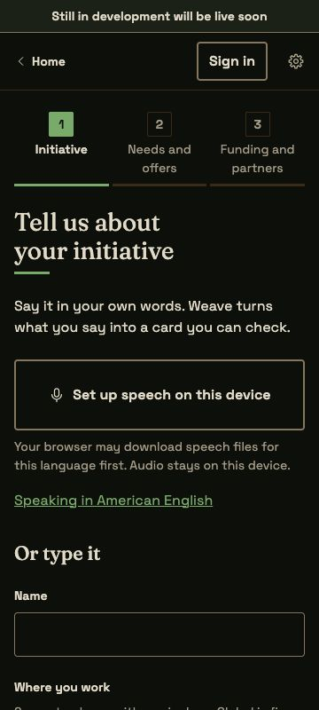
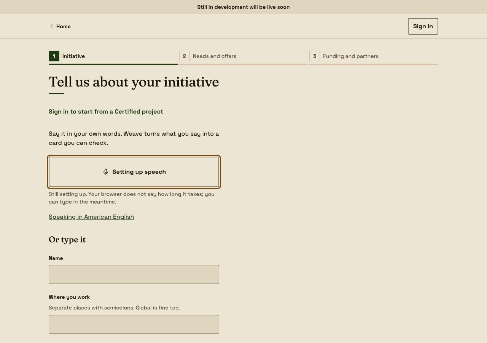
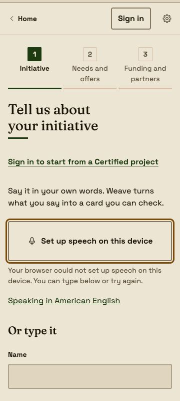
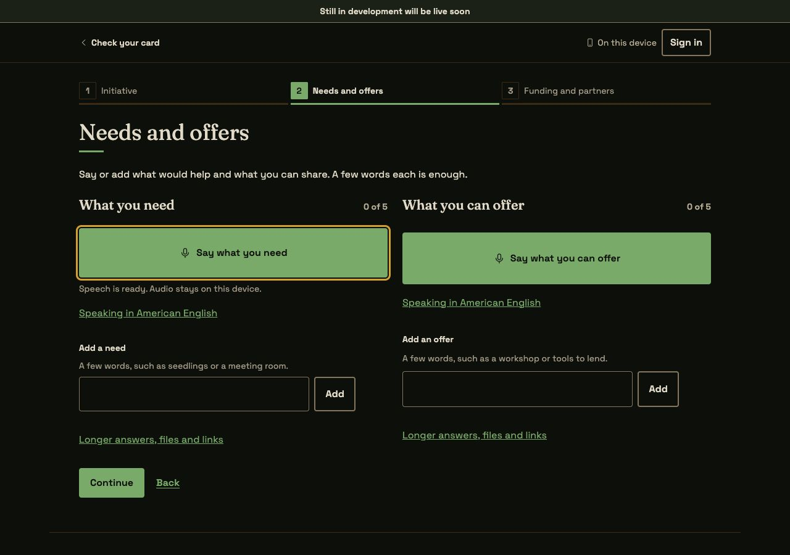

# Setting up speech on the device

Checked on 15 November 2026, on a branch from `develop` at `f54bf29`. Three proof
classes, kept apart:

- **Real browser answer, local dev server, HeadlessChrome 149** (Chromium
  149.0.7827.22 through Chrome DevTools, macOS arm64, no fixture).
  `SpeechRecognition.available({ langs, processLocally: true })` answered
  `"downloadable"` for `en-US` and `pt-BR` and `"unavailable"` for `sw-KE`, and
  Describe offered Set up speech on this device. Setup was not pressed there,
  because it could make Chromium download its speech pack. This is not Chrome
  stable.
- **Real browser answer, local dev server, Brave 156** (Chromium 156, macOS,
  through Claude in Chrome, no fixture). Brave has `available()`, `install()` and
  `processLocally`, but answered `"unavailable"` for `en-US` and `pt-BR`. Describe
  showed no voice controls, no speech wording and no "Or type it", and kept Talk it
  through instead. This is Brave's behavior, not Chrome's.
- **Fixture, HeadlessChrome 149 and the Claude app's browser pane.** Every setup
  state, with the example browser from `?speech=` standing in for Chrome. Nothing
  was downloaded.

## Observed behavior

| Phone, dark: the offer (real browser answer) | Desktop, light: taking a while (fixture) |
|---|---|
|  |  |
| **Phone, light: could not set up (fixture)** | **Desktop, dark: ready on the needs page (fixture)** |
|  |  |

- Enter on Set up speech on this device keeps the focus on the same button
  through Setting up speech (`aria-busy`, not disabled) to Speak, at 360 px and
  1280 px. The status sentence changes at each step; Continue stays primary
  until Speak works, and Talk it through instead stays during setup.
- A setup that has not finished says so after the wait (five seconds in the
  example, two minutes for a real browser). A failed setup says so and keeps the
  same button to try again.
- On needs and offers only the list the route opened offers setup. Once speech
  is ready, both lists show their Speak button; only the list that asked says
  "Speech is ready".
- Choosing Swahili keeps the focus on the language choice and shows "Local speech
  is not available for this language"; choosing Portuguese brings the offer back.
- `speech=none` shows no voice controls on Describe or in its conversation;
  typing, files, links and Build my card stay.
- No horizontal overflow at 360 px, 1280 px or a 180 px viewport, which is a
  360 px phone at 200 percent zoom.

Fixture links on the dev server: `/start/initiative?fixture=visitor&speech=setup`
(also `slow`, `fail` and `none`) and `/start/needs?fixture=draft&intake=empty&speech=setup`.

## Local checks

- `bun install --frozen-lockfile`: dependencies and lockfile unchanged.
- `bun run --filter @weave/app test`: 292 passed, including the two production
  bundle checks after `bun run --filter @weave/app build`. The bundle holds the
  setup words but not the example browser.
- `bun run --filter @weave/app typecheck` passed.
- `bun run design:check` passed; `bun run --filter @regen-commons/design-system test`
  and `bun run guidance:check` passed after this file was added.

`test/speech-setup.test.ts` stubs each browser answer (`available`,
`downloadable`, `downloading`, `unavailable`, a refusal, a missing API), a pack
that is already on the device but hidden from the site, `install()` answering
`true`, `false`, a non-boolean or rejecting with `NotAllowedError`, a setup that
runs long, and a setup that finishes before the wait.

## Not proven

- Chrome stable on a computer: a real install from Set up to Speak to a
  transcript. HeadlessChrome is not Chrome stable, and setup was not pressed there.
- Android: Chromium's source reports on-device speech unavailable on Android, so
  Speak would stay hidden there. No phone was checked.
- Safari and Firefox were not opened. Weave hides voice controls wherever
  `available()` or `processLocally` is missing.
- Speech quality, the microphone prompt after setup, a real download's length,
  and how a screen reader announces the status sentences.
