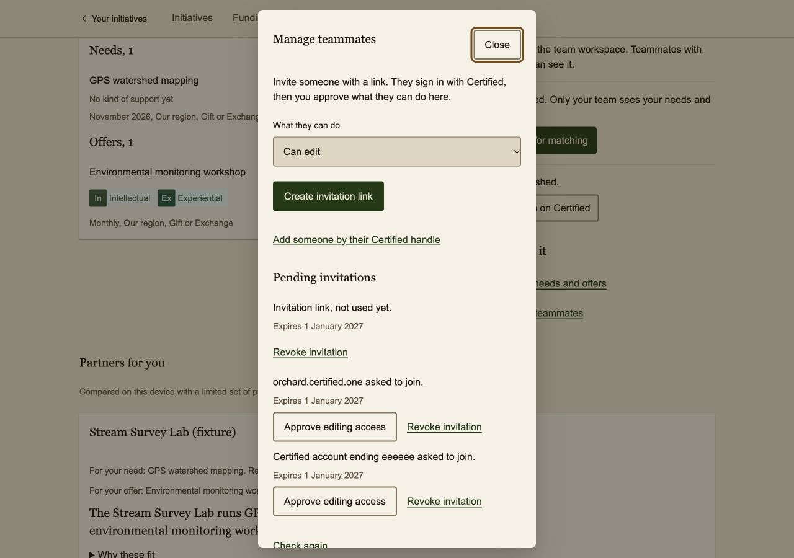
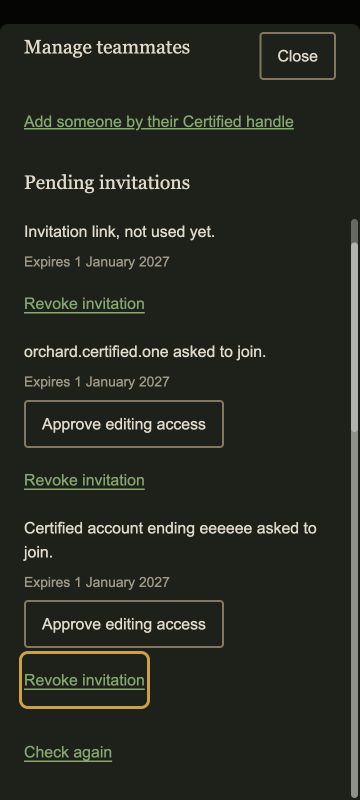

# Claimed invitation handles

Checked on 11 November 2026. Proof class: **fixture, Codex in-app browser**.
The branch starts from `develop` at `ded0618`, after PR #39 merged.

## Observed behavior

The admin's Manage teammates dialog shows both:

- `orchard.certified.one asked to join.` for the named synthetic claim.
- `Certified account ending eeeeee asked to join.` for the claim without a handle.

Both claims retain their Approve and Revoke controls. No approval or revocation was
performed during the rendered check. Approval still sends the claim's DID; the
handle is display metadata and is not stored in the database.

The dialog was inspected at 360 × 800 and 1280 × 900, in light and dark themes.
Enter opened the task, Tab reached the invitation controls with visible focus,
and Escape closed it. The checked page and dialog had no horizontal overflow.
The existing dialog layout and labels remained readable in the five-minute review.

| Desktop, light | Phone, dark |
|---|---|
|  |  |

## Local checks

- `bun install --frozen-lockfile` passed; dependencies and lockfile are unchanged.
- `bun run --filter @weave/api test`: 162 passed, 38 opt-in database/Auth checks skipped.
- `bun run --filter @weave/api typecheck` passed.
- `bun run --filter @weave/app test`: 211 passed.
- `bun run --filter @weave/app typecheck` passed.
- `bun run ci`: 607 passed, 38 skipped. This includes site/catalog, API, app,
  design-system and harness checks.
- `git diff --check` passed.

Provider and handler tests cover two-way verification, missing or changed aliases,
another DID resolving from the alias, unapproved origins, provider failure,
malformed metadata, a five-lookup concurrency limit and cancellation of a provider
that ignores abort. Parsing tests preserve an absent handle and reject malformed
ones. Existing approval tests still check the exact claimed DID and current
membership before granting access.

## Hosted checks still needed

These screenshots contain fictional identities and do not prove hosted Certified
identity lookup or PostgreSQL access policies. Before release, check a real claimed
invitation with an approved admin and verify that its current alias and forward
resolution agree. Exercise missing-alias and unavailable-service fallback with
hosted configuration, and obtain the required second critical-path review before
merge. The production pilot remains off. No SQL, migration, tester-gate or
authentication-setting change is included. No manual deployment or merge is part
of this task.

To reproduce locally, use the `app-fixture` launch target when its port is free,
open `/__fixture`, choose the admin account, open Watershed Team (fixture), then
Manage teammates. This check used the isolated fixture server on port 5175.
