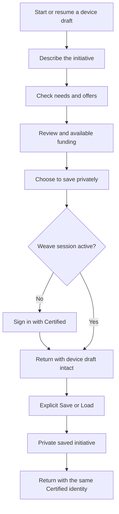

# Certified sign-in and external initiatives: design draft

Status: proposal for team review, matching alignment revised 8 November 2026. Authentication has separate recorded proof; these matching flows are specifications, not rendered or live acceptance.

Companions: [Partner brief](partner-brief.md) · [Technical spec](technical-spec.md) · [Updated business model canvas](business-model-canvas.md).

Validation update, 6 November: the [email-free saving proof](email-free-saving-proof.md)
passed real Certified signup, private Save/Load and refresh, with no Weave email
or second login. Another account could not read the initiative. The first build
must enforce Certified-only authorization and test returning access in hosted
staging. Diagnostic evidence does not establish finished product screens.

The [current product handoff](../../08-accounts-and-saving.md#matching-on-a-first-or-returning-visit)
defines the four user flows. The [network matching build](../../05-technical-spec.md#72-cross-initiative-matching-r12-r16)
and external evidence are both required by the
[implementation plan and UI handoff](../../05-technical-spec.md#76-build-plan-and-ui-handoff).
This draft supplies evidence presentation and
optional external-profile integration.

## Design decision

For someone who already has a project, shorten “Tell us about your initiative” to “Find your project” and “Check these details.” Retain the needs and offers conversations, their review actions, first funding and explicit private saving. Keep ordinary intake equally available. Linking a public project must not suggest that the person owns it, joined Regen Commons or shared their private words.

The updated target is **one Certified sign-in for private Weave saving**, including people starting art, software and research initiatives with no Ma Earth history. Do not require a public Certified project before saving. For outside initiatives, show relevant experience, published offers needing checks and confirmed offers as distinct evidence states. A good description must not look like a promise to collaborate.

Certified is the only sign-in flow, as recorded in the [decision register](../../open-decisions.md#certified-only-sign-in-and-private-saving) and R25. There is no “Connect Certified,” existing-Weave-account, migration or alternate email-code path. The [first-build contract](../../05-technical-spec.md#51-first-build-certified-sign-in-and-private-saving) owns implementation and validation. Public-source visibility is also decided; broader community-sharing services remain separate proposals.

The baseline is upstream [`495e95a`, 5 November 2026](https://github.com/regen-commons/funding-commons/tree/495e95ae6ea27521f355bc7f10af1488a1e290d9). The [prototype decisions](https://github.com/regen-commons/funding-commons/blob/495e95ae6ea27521f355bc7f10af1488a1e290d9/docs/platform/prototype/review-decisions.md) and [accounts guide](../../08-accounts-and-saving.md) distinguish working private services from development examples. The existing [app dialect](../../../../packages/design-system/dialects/app.md), [component contracts](../../../../packages/design-system/COMPONENTS.md), [voice](../../../../packages/design-system/brand/VOICE.md) and [DESIGN.md](../../../../DESIGN.md) remain authoritative. No new visual language is needed.

## Intended flow



This is the first build. Public-project lookup, sharing and publishing are later
optional actions. Signing in alone never saves or replaces a draft. Ordinary
manual intake works without a model, a public project or Ma Earth participation.


| Existing screen or pattern | Treatment |
|---|---|
| Home and three-step explanation | Retain. Add a quiet “Use an existing project” entry beside starting the initiative step, plus Resume when a device draft exists. |
| Describe | Retain for unlinked work. Linked projects skip repeating the story; missing context is optional and clearly local. |
| Check your card | Reuse for source review, with source attribution and missing-field states. Separate imported facts from derived suggestions. |
| Needs and Offers | Retain Conversation, Composer, Ask card/list, five-card counter, Keep/Change/Remove/Undo and manual mode. |
| Finish | Retain first funding and checked card. Add source status and reviewed supplements; separate private Save from any later sharing. |
| Account dialog, inline saving and Settings | One Sign in with Certified action for everyone, contextual Save/Load, saved-card choice, backups and sign-out. No account linking, migration or second sign-in option. |
| Partners, Funding and Initiatives | Retain separate pages. Within Partners distinguish confirmed offers, published offers needing checks and relevant experience, including outside projects. No external-network tab or implied Weave participation. |
| Later Team settings | Small in-place section for access, invitations and recovery; only expose when the service is ready. |

## 1. Find or link

Proposed entry route: `/start/initiative/link`, preserving `/start/initiative` for ordinary Describe. A small “Change linked project” task later opens a dialog on desktop and a bottom sheet on phones. The first lookup and review deserve a full page because selection can involve several similarly named projects.

Show “Find your project” with one labeled field accepting a name, supported profile link or full project reference. Explain: “Use details you have already shared through Certified. Your needs and offers stay in Weave.” Provide Search and “Describe it here instead.” Send only explicit search text, not the person's draft. In the first release a Ma Earth link without a verified resolver gets an honest supported-format message and the manual alternative.

Results use the existing card/grid and filter-bar patterns: project name, publisher, location when known, short description, source, and “Check this project.” An organization result expands to its projects; never pick the first automatically. Show unknown location as unknown. Keep the source link reachable without selecting it. A date says “Retrieved on 6 November 2026,” not “Confirmed” or “Verified project.” Search is public-data discovery, not a request for team access.

| State | Behavior and copy intent |
|---|---|
| First use | Explain the benefit once; ordinary Describe remains visible. |
| Loading | “Looking for projects.” Keep the input and Cancel available. Announce completion, not every intermediate response. |
| No results | “We could not find that project.” Offer another search, a supported link, or Describe here. No account demand. |
| Several plausible results | Compare publisher and place; require selection. Do not merge duplicate names. |
| Organization with no project collection | Explain the distinction in plain words. Permit unlinked initiative work with an organization reference; do not invent a project. |
| Unlisted or unavailable | Respect discovery preference; direct reference may offer private review under the technical policy. Never advertise unlisted content in browse results. |
| Invalid record or link | Preserve input. Say which part could not be read; show safe partial details where useful. |
| Offline | “You can keep working here. Finding a project needs a connection.” Offer the existing draft or manual path. |

The read evidence includes one publisher with four projects and missing fields, so these are observed mapping cases, not only edge-case design. [Public read findings](technical-spec.md#read-only-example).

## 2. Check imported details

Use two columns at 1280 px: record and source context on the left, a concise preview and next action on the right. At 360 px, stack source, record, missing fields and actions in that order. The source panel remains text, not a verification badge.

```text
Check these details                           Saved on this device only

River restoration                 [1] Project name from the source
Published by River Collective     [2] Publisher, distinct from project
From Certified • Retrieved 6 November 2026
View source   Check for changes

About the project                 [3] Imported text, read-only
…

Where the work happens            [4] Missing is explicit
No project location was supplied.
Add a place for your Weave matches

Your Weave notes                  [5] Separate editable supplement
These help your matches. They do not change the source profile.

Suggested type of work            [6] Pencil until checked
[Keep] [Change] [Remove]

[Use these details]   Choose another project
```

“Use these details” accepts an attributed snapshot. It does not prove ownership, save to an account or publish anything. Imported prose must not use the assistant's pencil styling merely because it is imported: label it “From Certified, not checked by you yet.” Pencil remains for derived suggestions. Confirmation means the person accepted this input for their work; it is not third-party certification.

For an existing Weave draft, show the current and imported values together. Explain which are source-owned and which are Weave supplements. Keep needs and offers by default. Before applying, archive the complete previous draft with files, and offer Undo through the existing backup mechanism. If backup fails, change nothing. Do not drop an 800-character local description because the source has a different shape or length; preserve the original and require an explicit concise projection. [Field and document compatibility rules](technical-spec.md#3-source-of-truth-and-system-boundaries).

## 3. Speak or type needs and offers

Start with “What does this project need now?” and “What can this project offer?” Keep the selected project name in the step header so a person knows which work they are editing. Retain the large Speak control only when local speech is available, an equally complete typing path, and Add manually. Existing source words remain editable on-device.

The assistant proposes cards; a person checks them. All eight kinds of support receive equal treatment. Needs retain purpose, amount when financial, timing, place and terms. Offers retain capacity and audience. A source profile can supply context, but cannot imply a current need, available capacity or a promise. Do not generate asks from old public narrative without showing them as proposals and asking for confirmation. Keeping a suggestion in your own draft means you accepted its wording; it does not prove you can speak for the linked project. Only a representative with established authority can confirm a public offer. Saving someone else's suggested capability as a lead never confirms their availability.

A repeat visitor sees existing open asks first, with “Still accurate,” Change, Mark met and Withdraw. Expired cards are visible separately with a reason; they do not silently reappear after rebuilding. Offer “Add another need” within the existing five-active-card limit. An empty list may continue. Unreviewed proposals or an open editor must be resolved before Continue, as today.

## 4. Finish, save, share and match

Finish shows the accepted project, checked asks, first funding and the precise save state. A linked profile label says where the profile comes from; a separate label says where the needs live. “Saved privately in Weave” is more accurate than implying that the upstream profile became private.

### One sign-in, including first use

Retain the existing explicitly opened account task and inline Finish placement. The only sign-in action is “Sign in with Certified.” Explain the benefit and destination before redirecting; do not expose bridge, token or database terms in the interface. The first-use disclosure must explain that Certified provisions an identity and link its account/privacy terms without implying the initiative is published.

```text
Keep this initiative

Sign in with Certified to save your work and open it on another device.
Certified handles sign-in. Your saved work stays private in Weave.

First time? Certified gives you a portable identity when you sign in.
This does not publish your initiative.
About Certified   Privacy

[Sign in with Certified]   Not now
```

Expected journey: preserve device work; open Certified's sign-in; enter email and a code once if needed; complete any handle/permission step; return to the same Weave task. Returning users may see an account chooser or permission consent instead of a code. Never promise no prompts forever. Do not ask for a second Weave code after a successful Certified sign-in. Certified collects the email/code it needs. Weave does not collect or request access to that email for private saving. Never make adding a contact email a second sign-in or a prerequisite for Save.

After sign-in, show saved cards and the current device draft before choosing Save or Load. Signing in is not a save. Do not replace the draft because the same external URI appears in an account. A person may have separate private scenarios for the same project. Saving and switching among several initiatives reuse the person session. Creating an ordinary private initiative requires neither a Certified project search nor an organization account.

Weave automatically creates or retrieves its internal account after Certified
sign-in. Do not show a separate registration, “I already have a Weave account,”
account-linking choice or migration route. A returning identity retrieves the
same saved initiatives. An unexpected conflict stops without merging accounts;
keep the current draft and offer sign-out or a non-disclosing support route.

For a Certified account without an email, use “Signed in with Certified” and
“Your saved initiatives” instead of an empty “Signed in as” label. A known public
handle may be secondary context, but is not a private-account ownership test.
Settings separates sign-in method from optional contact preferences. Show “No
contact email added” only where contact is relevant; do not show it as an error or
suggest saving is unavailable. Do not show contact preferences until a contact service exists.
The primary signed-in actions remain Save, Load and Sign out.

Explain recovery accurately: return through the same Certified identity.
A different identity does not gain saved work by using the same email.
Weave provides no alternative sign-in or account-transfer flow. Adding future notification contact details requires a separate,
clear purpose and consent; it never silently links accounts or publishes work.

| Sign-in state | Required experience |
|---|---|
| First-time artist, software maintainer or researcher | Ordinary Describe and private saving work without Ma Earth participation, a public profile or environmental eligibility questions. Explain Certified identity creation without adding another account form. |
| Already signed in | Save directly through the existing explicit Save action. No provider redirect for each save or project switch. |
| Leaving for Certified | Persist the draft first. If storage fails, keep the page open and offer recovery before redirecting. Record only a safe return task, never private prose in the URL. |
| Cancelled, code expired or consent declined | Return to the preserved task: “You are not signed in. Your work is still on this device.” Offer Retry and Keep working. |
| Certified succeeded but Weave session failed | “We could not finish signing you in to Weave. Your work is still here.” Retry the handoff; do not report Saved or ask for an unrelated second code. |
| Wrong identity or unexpected binding conflict | Name only the identity already proven to this browser. Offer sign-out and retry with Certified, without listing another account's initiatives, merging or transferring ownership. |
| Provider unavailable or offline | Keep local work and available funding results. Existing sessions may save while valid; otherwise offer retry later. Do not silently open a duplicate account through email fallback. |
| Return after callback | Restore the original task and focus its heading/status. Saved cards are a choice, not an automatic replacement. A changed draft in another tab triggers the existing comparison/recovery path. |
| Write permission declined later | Keep private saving available. Say the public project was not published; offer retry only for that action. |

### Optional public project creation

After private saving, a future “Publish project” action shows the exact public fields and publisher. A person can choose their own profile or a group they manage, without signing in as the group. Group selection is a permission check, not another human login. Keep images and activity references optional; no Ma Earth application is part of this action.

Keep “Save privately,” “Share with the Weave community” and “Publish project” distinct. Additional Certified write consent can appear when publishing, with a return to the reviewed projection. Show pending, failed and published states; say “Published” only after a confirmed write/read-back. An uncertain result says it is being checked before offering a retry, to avoid duplicate projects. Public profile publication does not include private needs, offers, funding answers or match history.

Later sharing needs two distinct previews: “Share with the Weave community” and “Publish selected details to other apps.” Both default off. Show fields and audience before confirmation; publishing explains that other services may keep copies. Team sharing names the invited audience and excludes transcripts and personal drafts. A source being public is never a pre-checked consent control for the needs. [Privacy contract](technical-spec.md#7-privacy-consent-and-matching).

### Matching outside Weave

Funding remains available to private drafts, with clear unknowns and eligibility checks. Its current score uses the checked description/themes and kept funding details, not the needs/offers conversation. Do not suggest that importing more offers improves a funding score. Partners compares a particular need with offers/capabilities, and an offer with needs or evidenced potential uses. Shared entries and public evidence are both part of the [core matching contract](../../05-technical-spec.md#72-cross-initiative-matching-r12-r16).

Within Partners, start with the owner's particular need or offer, then group by evidence. Needs can show **Confirmed offers**, **Offers to check** and **Relevant experience**. Offers can show **Confirmed needs**, **Requests to check** and **Potential uses**. A project can support different suggestions for different entries. Public-source labels describe provenance, never whether someone has a private Weave account. Do not apply the existing Strong/Good fit bar before calibration. No percentages, certification badge or green check implying available help.

| Card evidence | Label, reason and actions |
|---|---|
| Inferred capability | “Relevant experience” and “Availability not stated.” Say “Their project describes community mapping tools.” Show the supporting source passage/date, with View source and Save lead. Assistant interpretation stays in pencil and is named as an interpretation. |
| Inferred use of the owner's offer | “Potential use” and “They have not stated this need.” Explain the project activity that could benefit, with its source. Never claim that the project requested this help. |
| Explicit public offer | “Offer stated on source” within Offers to check. Quote or summarize the exact offer with attribution; name missing capacity, dates or terms. Do not call it confirmed because the page was fetched today. |
| Explicit public request | “Request stated on source” within Requests to check. Name the owner's offer being compared, the source request and any unknown current status or terms. |
| Representative-confirmed offer | “Confirmed offer,” with who confirmed it, scope, available capacity, terms, confirmation date and expiry. Distinguish self-confirmed availability from independent accreditation. |
| Expired, withdrawn or uncertain authority | Remove it from current offer counts and “Offers what you need.” In a person's saved leads, show “Needs checking” or “Withdrawn” with the known reason and date. Keep relevant historical experience separately where permitted. |

Illustrative content, not a live project:

```text
For your need: An interactive map for the exhibition

Community mapping tools                         Outside Weave
Relevant experience
Their project describes tools for community maps.
Availability to help with your exhibition is not stated.

Source: Project description • Retrieved 6 November 2026
Why this appeared

[View source]   Save lead
```

Save lead is a private bookmark, not a confirmation, invitation or message. No Ask for an introduction action appears for an external project without an opted-in recipient and a working introduction service. Do not expose scraped email addresses. If there is no supported evidence, say so rather than filling a card from shared themes alone.

Only current confirmed offers appear under “Offers what you need.” Published offers and relevant experience remain discoverable in their own groups; missing reciprocal needs do not hide a useful one-way candidate. Show “This search covers the projects we have checked” when corpus coverage is partial. Distinguish no relevant evidence, an unavailable source and an unavailable matching service. Preserve saved leads during outages; do not renew their confirmation dates on refresh.

Show baseline results before optional local refinement. Model download, cancelled
refinement or no WebGPU cannot block useful results. A private local query shows
the coverage of its downloaded public snapshot; a shared-entry query can use the
API index. Never silently switch a private query to remote processing. Changing
the active initiative cancels pending results and keeps the correct owner/entry
context visible. The canonical handoff requires working empty, partial, stale,
offline and session-expired states before visual polish.

A person keeping their initiative private can see named public-source suggestions, supporting passages and source links without sharing their own initiative, as [decided on 6 November](../../open-decisions.md#public-source-partner-suggestions-while-private). Explain: “These suggestions use public information. Your initiative stays private.” Show the evidence group and what remains unknown. Saving a lead retains a private reference; it does not contact the other project, publish the initiative or confirm availability. Private Weave records never become evidence for this view, including records linked to the same public project. The broader sharing rule for other Weave partner services is unchanged. Do not invent counts when the service is unavailable or add a membership gate.

For representatives, “Confirm this offer” opens a review of the exact terms and their authority to speak for the project. They can change, decline or withdraw it; they are not asked to approve a capability inferred about somebody else. The technical pilot proposes expiry at the earlier of the stated end date or 90 days after confirmation. Show that date before confirmation and offer a reminder only when the service works. Renewing availability is an explicit action, never a side effect of signing in or refreshing a profile. [Evidence lifecycle](technical-spec.md#evidence-and-confirmation-contract).

## 5. Return, switch, repair and recover

| Situation | Experience |
|---|---|
| Return to linked work | Resume the last device draft. Show source-check status quietly; offer Review needs and offers as the main task. Do not repeat onboarding or request external sign-in for a public read. |
| Switch initiative | A “Working on…” control opens saved cards and New initiative. Archive active device work before loading. Show unsaved/memory-only state; a failure leaves the active project unchanged. |
| Two tabs | Explain that another tab changed the draft. Preserve both sets of words and offer recovery; never silently switch the active project. |
| Source changed | “The source has changed.” Open a field comparison with previous and current versions. Needs/offers remain intact. Accepting changes recalculates affected matches. |
| Source is stale but editable elsewhere | “Update the source profile” opens the confirmed destination. Preserve progress on departure. On return offer Check for changes. Do not imply the update succeeded before a read confirms it. |
| Person cannot edit upstream | Offer “Write a correction” and Copy correction. Keep it local and label supplements; do not claim a message was sent or expose the owner's contact details. |
| Source missing | “We cannot find the source project.” Keep dated private data and asks; offer Retry, relink with comparison, or continue as an unlinked initiative. Source unavailability is not a deletion request for Weave work. |
| Unlink | Explain that future source checks stop and the accepted text becomes a local copy with provenance. Keep a backup and all asks. No upstream deletion. |
| Sign out on shared device | Say “Sign out of Weave.” Retain the warning that local drafts/backups remain; offer the existing separate device-data controls. Do not imply every Certified application was signed out. |

## 6. Team and member access, after Phase 0

Team settings show “Who can work on this initiative” separately from “Who can update its Certified profile.” Use plain role explanations rather than implying the two rosters synchronize automatically. Show invite pending, expired, accepted, revoked and missing authority states. Only a maintainer can change access or approve public sharing; an editor can update team asks. A reader has no misleading edit controls.

A conflict screen shows “This need changed while you were editing” with the saved text and “Your changes.” Keep a copy option and compare before retrying. If access is lost, say that the team's save was rejected and preserve the person's unsent words locally. Another maintainer can continue the work; last-maintainer departure requires handover. These are proposed Weave capabilities, not current services. [Team contract](technical-spec.md#6-teams-authorization-and-continuity).

Recommend keeping browsing and ordinary drafting open. A member without a project can use Weave and accept a team invitation; a non-owner collaborator does not need to create a duplicate project. A future member-only service should explain its specific benefit and gate only that service, preserving recovery/export. Put the membership link in the footer as the current plan does. Council must decide exceptions and organizational entitlement. [Policy comparison](technical-spec.md#8-membership-policy-recommendation).

## 7. Validation before release

The user-requested outcomes are one routine authentication journey and useful matching across shared entries and external projects. Authentication has separate local and limited hosted evidence in the [core build contract](../../05-technical-spec.md#51-first-build-certified-sign-in-and-private-saving). Source coverage, sharing and the combined matching screens still need the [final acceptance](../../05-technical-spec.md#76-build-plan-and-ui-handoff). Test fixtures for understandable interaction, then verify the same tasks through real integrations. A fixture cannot establish single sign-on, authorization or a successful publication.

| Task | Pass evidence | Technical dependency |
|---|---|---|
| New art, software and research initiative | Each person completes manual intake, one Certified email-code ceremony, return to Weave, explicit private Save and later Load. No Ma Earth step, public project or second Weave code. The person can explain where their private words live. | V1–V3; independent project-creation gate |
| Existing Certified user | Reuse or select the existing identity, retain draft through redirects, save and switch projects. Record actual credential/consent prompts; do not count a permission screen as a second identity. | V1, V3 |
| Returning saved-work user | Sign out, return through the same Certified identity on another browser and load the same saved content. Account UUID and initiative IDs remain unchanged; no linking screen appears. | V2 |
| Cancel, outage and mail-app round trip | Recover the same words and files with accurate save state. Retry does not create another account/project. Keyboard focus returns to the relevant task. | V3; draft preservation and Certified recovery gates |
| Judge an outside candidate | Given the same candidate shown with inferred experience, a published offer and a confirmed offer, participants distinguish experience from availability and identify the supporting source. Saving a lead is understood to send nothing. | V4–V6 |
| Confirm or withdraw an offer | An authorized representative reviews capacity, audience, terms and expiry; a non-representative cannot confirm it. Withdrawal removes active-offer eligibility and updates saved-lead wording. | V5; authority and concurrency gates |
| Publish only when chosen | Understand the exact audience and selected fields; decline write permission and still privately save. When permitted, personal/group publication succeeds without another Weave login; uncertain writes reconcile before retry. | Upstream-write and independent project-creation gates |
| Private public-source discovery | See named suggestions and supporting public evidence without sharing. Confirm the query stays local and private records are not exposed; saving a private lead neither contacts the project nor publishes the initiative. | V4–V6; recorded public-source decision |
| Sparse or unavailable data | Explain missing coverage, source failure and no relevant evidence correctly. No false offer counts, private-data leaks or invitation controls without a recipient. | V4–V6 |

Proposed usability round: at least six participants spanning art, software and research, with new Certified identities, existing Certified identities and returning saved-work scenarios represented. Observe completion before asking opinions. Record login abandonment, duplicate email entry, lost context, mistaken publication, and mistaken interpretation of inferred experience as a confirmed offer. Any unintended publication or cross-account disclosure blocks release; revise and retest any evidence label that leads someone to believe unconfirmed help is available. This small round is diagnostic, not a statistical quality claim. The technical spec separately defines the held-out retrieval evaluation and acceptance floor.

Record unresolved product decisions in the [central register](../../open-decisions.md), including offer expiry policy and future contact workflow, before their implementation. Certified-only sign-in and public-source display are recorded as user decisions; broader council sharing policy remains separate. This table tracks validation tasks; it does not close the remaining decisions. [Technical gates and current evidence](technical-spec.md#10-acceptance-criteria-and-evidence-still-needed).

## Accessibility, components and review

Reuse Card, Record, Notice, Stamp, Review sheet, Conversation, Ask list, Save status, Inline field and TaskDialog. Add source attribution and field-comparison compositions as candidate patterns only when implemented. Keep thin React wrappers and token-owned CSS. Respect the shared left edge, system theme, 48 px controls and at least 44 px dense targets; no new colors to signify Certified trust.

Use labeled native fields, links and buttons; one `h1` matching the page title. Move focus to that heading on navigation. Dialogs have visible Close, Escape and return focus. Search results announce a count; errors connect to the field. Do not require drag, speech, hover or color perception. At 200 percent text size and 360 px, comparisons stack with repeated labels, not horizontal scrolling. Avoid sticky actions that cover inputs or the on-screen keyboard. Preserve bottom navigation outside focused intake, footer access, light/dark contrast and reduced motion.

Future rendered proof must cover 360 px and 1280 px, both themes, keyboard, enlarged text, long names and Portuguese/Spanish expansion. Run DESIGN.md's five-minute review. Label evidence `fixture`, `local Supabase`, `preview` or `production` and name the browser. The linked authentication reports contain rendered diagnostic-harness proof; the proposed product screens have no rendered acceptance proof. Local Modern Web Guidance retrieval was attempted but failed on registry network access; no package was refreshed. The design uses repository standards.

Also retain the original pilot tasks: select the correct project among duplicates; review a missing location; complete asks using typing only; switch without loss; correct stale source information; and, in the later team phase, resolve a conflict and revoke access. The [earlier business pilot thresholds](business-model-canvas.md#pilot-and-decision-rules) supplement the new gates; they do not establish that the identity bridge or external matching works.

## Sources

Checked 6 November 2026: pinned upstream code and the repository design/flow sources linked above; [Certified account experience](https://certified.app/welcome); [Hypercerts project model](https://docs.hypercerts.org/core-concepts/projects-and-collections); [public read evidence and limits](technical-spec.md#2-finding-reading-and-linking-a-project); and [the follow-up authentication and matching source review](technical-spec.md#sources-and-research-limits). Initial research inspected external interfaces read-only. Subsequent real authentication tests are recorded in the [initial proof](sign-in-proof.md) and [signup/linking follow-up](signup-linking-proof.md). All wireframes, copy and proposed interactions in this document remain design recommendations; diagnostic-harness evidence does not establish finished product behavior.
