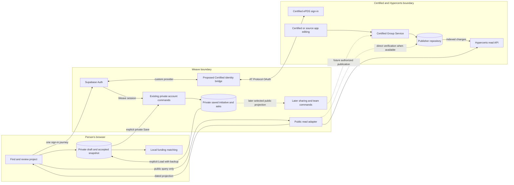
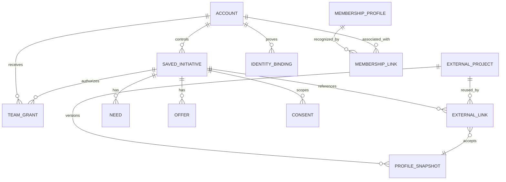
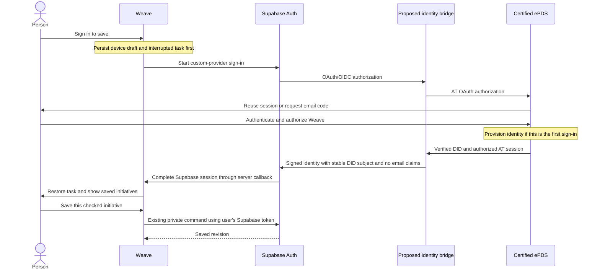

# Certified sign-in and external initiatives: technical research draft

Status: research and integration specification, revised 6 November 2026. Certified-only sign-in and private public-source discovery reflect recorded user decisions. Other proposals remain for review. No deployment or partner agreement is implied.

Companions: [Partner brief](partner-brief.md) · [Design spec](design-spec.md) · [Updated business model canvas](business-model-canvas.md).

Build alignment, 8 November: [core technical spec section 7](../../05-technical-spec.md#7-matching-engine)
now owns matching across shared Weave entries and external project evidence,
including offers matched to potential uses when no need is stated. Its
[six-milestone plan](../../05-technical-spec.md#76-build-plan-and-ui-handoff)
supersedes this research draft's earlier sequencing and numeric ranking proposals.
Both evidence sources are required before UI polish. This file retains the
integration research, provenance and source-specific constraints.

Validation update, 6 November: the [email-free saving proof](email-free-saving-proof.md)
passed real Certified signup, private Save/Load, full-page refresh and independent
cross-account denial. The account had no email or confirmation timestamp and no
second login was requested. Earlier account-linking experiments are historical
research, not part of the chosen product. The proof's email-only authorization
alternative must be removed for the Certified-only build. Hosted end-to-end
validation remains open.

## Recommendation and scope

Certified is the only sign-in flow that establishes a Weave session for private saving. New users must not complete Certified authentication and then a second Supabase email-code flow. Keep a Weave initiative ID, an optional external project reference, a dated profile snapshot and Weave-owned workflow data. An initiative can be created privately without a Ma Earth listing or a public Certified project. Public project creation, team access and publishing asks are separate authorized actions.

For matching initiatives outside Weave, distinguish inferred capabilities, offers explicitly stated in a public source, and current offers confirmed by an authorized representative. A description can establish relevant experience; it cannot establish available capacity. Preserve the working funding rubric while introducing a separately evaluated partner-discovery path.

The user's 6 November decision removes account migration, linking and alternate Weave email-code sign-in, including contingency paths. The owning [PRD](../../04-prd.md), [accounts guide](../../08-accounts-and-saving.md) and [first-build contract](../../05-technical-spec.md#51-first-build-certified-sign-in-and-private-saving) now express that direction. The companion brief and canvas use the same scope. Rollout remains conditional on validation, not document approval alone.

The hypothesis is **supported for profile reuse, but insufficient for replacing Weave's initiative record**. Certified supplies accounts and shared-account services; Hypercerts supplies interoperable records; AT Protocol supplies identity and repositories. None of the inspected schemas supplies Weave's complete private draft, matching, consent, membership or collaboration model. “Canonical” here means the selected publisher's authoritative record, not a global registry proving that only one project represents a real-world initiative.

This research starts from upstream `main` at [`495e95ae6ea27521f355bc7f10af1488a1e290d9`](https://github.com/regen-commons/funding-commons/commit/495e95ae6ea27521f355bc7f10af1488a1e290d9), dated 5 November 2026. The remote SHA was read and cloned into a temporary directory; the shared branch and Git references were not changed. Repository links below identify owning documents; implementation claims refer to that pinned commit. These drafts do not supersede the [platform plan](../../README.md) or resolve [open decisions](../../open-decisions.md).

## 1. What exists today

### Weave baseline

The [PRD](../../04-prd.md) defines an initiative broadly enough to include a project, organization, collective or place-based effort. Its three intake steps produce a checked initiative, up to five needs and five offers. Drafts and source material stay in IndexedDB. Funding matching works locally. The first version is due **30 November 2026**; real-user local-AI evidence is due 20 November in the [proposal](../../01-proposal-brief.md).

The live slice stores a version-1 checked document, not the full relational target in the older technical spec. [`accountDocument`](https://github.com/regen-commons/funding-commons/blob/495e95ae6ea27521f355bc7f10af1488a1e290d9/packages/app/src/account/document.ts) explicitly excludes conversation, files, unfinished edits, confidence and assistant history. [`parseDocument`](https://github.com/regen-commons/funding-commons/blob/495e95ae6ea27521f355bc7f10af1488a1e290d9/packages/api/src/account-contract.ts) rejects unknown fields, permits five asks of each kind and limits the checked description to 800 characters. Adding an external reference is a versioned contract change, not an extra JSON field that existing clients will preserve.

[Saving and accounts](https://github.com/regen-commons/funding-commons/blob/495e95ae6ea27521f355bc7f10af1488a1e290d9/docs/platform/08-accounts-and-saving.md#private-account-connection) records production sign-in, private save, second-browser load, backup recovery and cross-account denial. This research did not repeat authenticated production tests. The current upstream also contains the contextual account dialog and inline Finish flow from Step 7. Verification alone never uploads or replaces a draft. Save uses a persisted request ID and expected revision; Load archives the complete device draft and files before replacement. Authentication uses the existing Supabase pool through `/api/account`, with a host-only HttpOnly cookie, at most one hour, no retained refresh token, and no JavaScript-readable Auth token.

At the researched baseline, server copies are private and owner-readable. Sharing, team editing, introductions, reminders and membership handoff require additional service work. The broad schema in [technical spec sections 4–5](../../05-technical-spec.md) is a future target; its older three-way visibility model does not override the private contract or the [current matching validation questions](../../open-decisions.md#matching-build-validation). The website repository owns Phase 0 migration application.

### External capability evidence

“Observed” means a public read succeeded during this research. “Documented” means an official source describes it; authenticated writes were not exercised. “Proposed” means a recommendation in this draft.

| Capability | Evidence and limit, checked 6 November 2026 |
|---|---|
| Relationship | Ma Earth is an application and ecosystem contributor. Certified is operated by Hypercerts Foundation and provides identity/PDS services. Hypercerts defines shared records on AT Protocol. These are related, distinct systems. [Ma Earth privacy, updated 23 July 2026](https://maearth.com/privacy); [Hypercerts case study, 18 September 2026](https://hypercerts.org/blog/3mvru46xfus2r). |
| Project identity | A project is `org.hypercerts.collection` with `type: "project"`. An actor profile or organization record describes its publisher, not a particular project. One organization can have several projects. [Projects and collections](https://docs.hypercerts.org/core-concepts/projects-and-collections). |
| Independent creation and scope | Certified describes support beyond ecology. Its source implements `/project/new` for personal or group repositories with optional activities and no Ma Earth/environmental requirement in that flow. ePDS documents account provisioning during first sign-in. These are documented/source-reviewed capabilities, not authenticated production proof. [Certified scope](https://certified.app/welcome), [project form at 4b63234](https://github.com/hypercerts-org/certified-app/blob/4b632346fee1a8effd800403fb937df368d759ca/src/app/project/new/page.tsx), [ePDS at dfb8e44](https://github.com/hypercerts-org/ePDS/blob/dfb8e44d39091f741fcaea3d0a77452e6126e629/README.md). |
| Session reuse | ePDS source supports browser-session reuse across clients, with handling for account selection, expired cookies and forced login. This supports the one-sign-in target but does not guarantee prompt-free access in every browser or scope change. [Session reuse implementation](https://github.com/hypercerts-org/ePDS/blob/dfb8e44d39091f741fcaea3d0a77452e6126e629/packages/auth-service/src/lib/session-reuse.ts). |
| Public reads | Production XRPC reads are public; discovery is indexed and may lag repositories. Observed profile, search, list and individual collection requests succeeded. [XRPC API](https://docs.hypercerts.org/reference/xrpc-api). |
| Team accounts | CGS is documented as running. Public `/health` returned `0.6.1+e0d66a76`. It adds roles and an audit trail over a shared repository. Health proves availability/version, not successful permissions or recovery. [CGS service](https://docs.hypercerts.org/reference/services/certified-group-service), [observed health endpoint](https://groups.certified.app/health). |
| Libraries | Lexicon source package is `2.0.1`; its 2.0 change concerns package exports, not a wholesale record migration. The separate API type package is documented. The new full SDK remains unreleased; the old SDK repository is deprecated. Use documented HTTP contracts for the pilot; approve and pin dependencies separately. [Lexicon changelog](https://github.com/hypercerts-org/hypercerts-lexicon/blob/444b3145569dee21e2507a8ba1981adb171d72f4/CHANGELOG.md), [API package](https://github.com/hypercerts-org/api/blob/5819bd97155ba574bfe4dec53c0d73bb7f20b66a/packages/api/README.md), [SDK status](https://docs.hypercerts.org/reference/sdk), [old SDK](https://github.com/hypercerts-org/hypercerts-sdk). |
| Private data | AT repositories contain public records. An organization's `visibility: "unlisted"` is a discovery preference, not confidentiality. Public records are unsuitable for private Weave drafts. [AT repository specification](https://atproto.com/specs/repository), [organization schema](https://github.com/hypercerts-org/hypercerts-lexicon/blob/444b3145569dee21e2507a8ba1981adb171d72f4/lexicons/app/certified/actor/organization.json). |

Documentation is evolving. The documentation landing page named newer versions than some individual pages and search excerpts. Use the pinned schemas and observed endpoint shapes here; recheck compatible releases before implementation. In particular, the API package README warns that indexed records can fail current Lexicon validation. Treat external JSON as untrusted, validate each selected record defensively and preserve partial-result errors rather than making an entire search fail.

## 2. Finding, reading and linking a project

### Identifiers and lookup contract

Store the DID-based record URI, for example `at://<publisher-did>/org.hypercerts.collection/<rkey>`, as the external identity. Store CID separately as the content version. A handle, display name, Ma Earth page URL or Certified profile URL is a lookup aid. A publisher DID alone is not a project ID. Handle-based URIs can change meaning; a DID-preserving move between PDSs can retain record identity. Moving a record to a different DID creates a different URI and requires an explicit relink. [AT URI specification](https://atproto.com/specs/at-uri-scheme), [account identity](https://docs.hypercerts.org/architecture/account-and-identity).

The verified API base is `https://api.hypercerts.dev/xrpc/`. The [pinned API schemas](https://github.com/hypercerts-org/api/tree/5819bd97155ba574bfe4dec53c0d73bb7f20b66a/docs/sources/lexicons) document:

| Method | Inputs relevant to Weave | Use |
|---|---|---|
| `app.certified.actor.getProfile` | `actor`: DID or handle | Resolve the selected publisher profile. |
| `org.hypercerts.collection.listCollections` | `authors`, `types`, `limit`, `cursor` | List projects under a DID; `types=project`. |
| `org.hypercerts.collection.searchCollections` | Required `search`; optional `authors`, `types`, pagination | Literal case-insensitive substring in title or short description. Not semantic search or proof of ownership. |
| `org.hypercerts.collection.getCollection` | `uri`: full DID-based record URI | Read the selected indexed collection, with attribution and CID. |
| `com.atproto.repo.getRecord` on the resolved PDS | `repo`, `collection`, `rkey`; optional version according to protocol contract | Verify a known source directly when reachable. This path was blocked with HTTP 403 here. |

Public discovery sends only the search text or supplied public identifier. Never send the user's full draft to find a project. Prefer an explicit Search action and a same-origin server adapter. Initially accept a validated AT URI or Certified handle/profile link, then show candidate projects. A Ma Earth URL needs a documented mapping to AT URI; do not guess a slug convention or scrape private application pages. Make that mapping a partner request. Respect unlisted/discovery preferences even where records remain technically readable.

### Read-only example

On 6 November, the [Bees and Trees Uganda public profile query](https://api.hypercerts.dev/xrpc/app.certified.actor.getProfile?actor=bees-and-trees-uga.certified.one) returned DID `did:plc:pktwukejt6bnubpkhldnaeyc`. [Listing that publisher's projects](https://api.hypercerts.dev/xrpc/org.hypercerts.collection.listCollections?authors=did%3Aplc%3Apktwukejt6bnubpkhldnaeyc&types=project&limit=5) returned four records. This is a public example, not a pilot participant or endorsement.

The [selected collection read](https://api.hypercerts.dev/xrpc/org.hypercerts.collection.getCollection?uri=at%3A%2F%2Fdid%3Aplc%3Apktwukejt6bnubpkhldnaeyc%2Forg.hypercerts.collection%2F3mwg4n6pmks2r) returned:

```text
URI: at://did:plc:pktwukejt6bnubpkhldnaeyc/org.hypercerts.collection/3mwg4n6pmks2r
CID: bafyreicr6uunzpaa7hzwbkvctviqz6pvnab5sziptgdqwe5jboqlhm55vi
Indexed at: 2026-11-05T16:18:51.240988592+00:00
Record fields: $type, banner, createdAt, items, shortDescription, title, type
```

It had no long description or collection-level location. Another project had an inline description; other reads exposed Leaflet rich text and location blobs. Therefore full mapping cannot assume four complete Weave fields. The [DID document](https://plc.directory/did:plc:pktwukejt6bnubpkhldnaeyc) advertised `https://certified.one` and `https://groups.certified.app`. Direct handle resolution and direct `getRecord` at that PDS returned HTTP 403 from this environment. This does not prove the PDS disallows public reads generally. Indexed reads and metadata were verified; repository freshness and cryptographic verification were not.

### Profile fields and provenance

The [collection schema](https://github.com/hypercerts-org/hypercerts-lexicon/blob/444b3145569dee21e2507a8ba1981adb171d72f4/lexicons/org/hypercerts/collection.json) includes title, short and long descriptions, media, linked items, location, tags, languages, creation time and optional signatures. Only title and creation time are required. Profile website and organization URLs are separate records; do not silently present them as project-specific links. [Profile schema](https://github.com/hypercerts-org/hypercerts-lexicon/blob/444b3145569dee21e2507a8ba1981adb171d72f4/lexicons/app/certified/actor/profile.json).

For every imported value retain the source URI, CID, field path, fetch time, mapping version and any reviewer confirmation. Keep `indexedAt`, client-declared `createdAt`, fetch time and “person checked this” as distinct dates. Signatures and a publisher identity establish provenance, not truth, accreditation, eligibility or that the reader represents the project. Third-party endorsements and funding records retain their own authors and subjects.

Location records implement Location Protocol and may hold inline text, a blob or external URI. A bare decimal coordinate pair can have ambiguous ordering. First release: use a supplied place label as reviewable context; do not infer a watershed, project operating area or applicant registration country from it. Unsupported geometry stays explicit. A strong reference pins a CID; do not substitute a newer linked location silently. [Location documentation](https://docs.hypercerts.org/lexicons/certified-lexicons/location). The linked Location Protocol registry was not accessible through the web tool, so geometry interoperability remains a separate test.

## 3. Source of truth and system boundaries

All entities and services below are proposed except the identified existing browser, account API and public external services.



### Field ownership matrix

| Field or record | Authority | Who may change it | Weave treatment |
|---|---|---|---|
| Project title, shared narrative, upstream media, published project location and tags | Selected publisher repository | Its authorized upstream editors | Read-only imported values; dated snapshot. Correction proposals kept separately. |
| Organization profile, legal metadata and website | Publisher's actor records | Authorized actor/group editors | Show publisher context separately. Do not infer project ownership, legal eligibility or public contact permission. |
| Missing project-specific links or place clarification | Explicit Weave supplement | Local draft author; later authorized Weave team | Label “Added in Weave.” Never claim the source supplied it. |
| Unlinked initiative's name, description, places and links | Weave checked document | Current owner; later granted team | Remains fully editable. Linking offers a field comparison; no destructive replacement. |
| Local concise summary, lenses, stage, themes, beneficiaries and work languages | Weave review | Person checks derived proposals | Pencil until confirmed. Upstream `langs` describes record text, not necessarily languages the team works in. |
| Needs and offers, status, capacity, timing, terms, forms of capital | Weave | Draft author; saved owner; later Weave editor | Private by default. Keep IDs/revisions independently of profile changes. |
| External capability evidence and published assertions | Cited source for its words; Weave for its interpretation | Adapter records provenance; representative confirms only within proven authority | Separate from an active Weave offer. Fetching, indexing or saving a lead never confirms availability. |
| Funding answers, private notes, transcripts and files | Weave/device per existing boundary | Their owner | No external publication. Organizational legal data is only a proposal for funding answers. |
| Matches, dismissals, partnership work and reminders | Weave | Authorized workflow actor | Derived from versioned inputs; not Certified profile properties. |
| External identity, source CID and fetch metadata | Validated adapter | System; explicit relink command | Person chooses the project, cannot rewrite its identity by editing a text field. |
| Account, team grants, sharing consent and membership | Each owning system | Its authorized commands | Separate records and checks, never inferred from matching email or public profile. |

Weave needs a cache for continuity and a local workflow record for identity, permissions, save/reload and references from needs, offers and matches. The accepted snapshot is an attributed input, not a second independently maintained canonical profile.

### Entities and relationships



`SAVED_INITIATIVE.id` stays the existing UUID. `EXTERNAL_PROJECT` is deduplicated by protocol and normalized DID-based URI, not name. Several private initiatives may reference it without learning about one another. Restrict one active primary project link per initiative for the pilot; broader organization initiatives may remain unlinked. A URL pointing at an organization is a publisher reference until a project is chosen.

`EXTERNAL_LINK` records selected URI, accepted snapshot/CID, linked-by account when saved, verification state (`reference_only`, `authority_verified`, `revoked`), and a revision. `PROFILE_SNAPSHOT` is a bounded projection with per-field provenance, not an unrestricted blob/media archive. The private association between account, project and draft must never appear in a public cache. For Phase 0, embed the validated projection in the versioned saved document if simpler; normalized tables are a later implementation choice, not a required rewrite.

`IDENTITY_BINDING` records the DID proven during the sole Certified sign-in flow and its internal account UUID. It does not require a second routine login. It is not Regen Commons membership. Keep the person's DID, a managed group's DID and a project's record URI distinct: selecting another project or group does not create a new person account. `TEAM_GRANT` is an explicit Weave permission. `MEMBERSHIP_LINK` must follow website-approved identity/affiliation rules; an organization's membership does not automatically make every editor a member.

## 4. Where needs and offers belong

The inspected Lexicon inventory contains no dedicated need/offer contract with Weave's capital forms, capacity, exchange terms, expiry and review lifecycle. The collection has no documented typed need/offer metadata property. Its items convention concerns activities, features and collections. A need is not evidence of completed work, and an offer is not a funding receipt or an enforceable commitment. [Pinned schema inventory](https://github.com/hypercerts-org/hypercerts-lexicon/tree/444b3145569dee21e2507a8ba1981adb171d72f4/lexicons), [activity schema](https://github.com/hypercerts-org/hypercerts-lexicon/blob/444b3145569dee21e2507a8ba1981adb171d72f4/lexicons/org/hypercerts/claim/activity.json).

There are technically plausible extension paths. An `org.hypercerts.context.attachment` can reference a project through `subjects`, link content and carry an update. A new application-owned AT Lexicon can define typed asks referencing the project's URI and reviewed CID. Neither establishes a shared needs/offers standard, automatic index support or partner UI support. Arbitrary fields that survive serialization are not interoperable semantics. [Attachment schema](https://github.com/hypercerts-org/hypercerts-lexicon/blob/444b3145569dee21e2507a8ba1981adb171d72f4/lexicons/org/hypercerts/context/attachment.json), [AT Lexicon specification](https://atproto.com/specs/lexicon).

| Option | Benefits | Costs and access consequences | Recommendation |
|---|---|---|---|
| Protocol-native asks from the start | Public portability and publisher provenance; potential reuse by other applications | Requires agreed schema, discovery, authorized writers and lifecycle. Repository records are publicly readable. Cannot hold private drafts; cross-record writes and team permissions add launch risk. | Reject as the first release. Explore only for explicitly public, checked records. |
| Weave records keyed to external project identity | Preserves privacy, existing save path and matching; no upstream write permission needed | Others cannot consume the private records; later export needs a mapping | First release. Carry stable IDs and provenance now. |
| Staged hybrid | Public profile reuse now; selected public needs/offers become portable later | Requires explicit publication status and one authority per field, plus retries and retraction handling | Recommended direction. Do not schedule dual writes before a second consumer exists. |

Later publication should be a separate action on a checked public projection, never a side effect of Save or Keep. Candidate contract for partner review: ask ID, kind, project URI, project CID reviewed, author DID, description, multiple capital forms, place scope, terms, timing, need amount/purpose or offer capacity/audience, status, expiry, confirmed time, supersession and schema version. Choose the namespace and lifecycle jointly; no namespace is reserved by this draft.

Weave remains the editing authority for these asks in the first interoperable pilot; external records are declared exports with their own URI/CID and publication status. Use a durable outbox with idempotent record keys and visible pending/failed states. A failed export does not undo the private save or pretend that publication succeeded. Do not accept changes from a second editing application until merge and authority rules are agreed. Eventually moving authority upstream is a separate migration, with private notes and drafts still local.

Public attachments may communicate a readable needs update sooner, but should link the structured representation and identify its vocabulary. Do not put a private Weave URL or sensitive payload in a public attachment. An unrelated account can publish a reference to a project; that reference does not prove representation. Consumers must check publisher authority or explicitly label the author as an independent contributor.

Native records would be written by the repository controller or an authorized application; group writes additionally follow CGS roles and record authorship. A CGS member cannot be assumed to edit a colleague's published ask. Do not promote Weave editors to upstream admins merely to bypass that limit. Confirm support for the proposed Lexicon, permission scopes and indexing before promising that custom records will work across services. Anyone able to read the public repository could read the published asks.

## 5. Editing, refresh and failure behavior

### Editing policy

| Approach | First-release behavior | Later gate |
|---|---|---|
| Edit upstream from Weave | Not included | Additional write authorization within the Certified identity flow, least-privilege scopes, project-specific authority, supported version checks, conflict tests and audited write receipts. Re-read before committing. No second Weave login. |
| Open Certified or source app to edit | Preferred route for authoritative fields | Verify the actual edit destination and supported fields with partners; do not fabricate a deep link. Return to Weave and choose Check for changes. |
| Suggest a correction | Keep a local, attributed correction draft; offer Copy correction | A partner-supported submission route, consent and delivery acknowledgement are needed before claiming it was sent. No automated message. |
| Weave-only edits | Needs/offers and clearly named supplements are editable by authorized Weave actors | Public presentation must preserve which facts are supplements. |

A stale project must not block useful work. A person may add a temporary Weave-only clarification for matching, with the source value retained. Do not overwrite the imported title or description invisibly. The review shows source text, proposed correction and the context actually used for matching. If a source later changes to the same value, offer to retire the supplement; never resolve that silently. Missing values may be completed locally, but remain labeled “Added in Weave.”

### Refresh and availability contract

Proposed pilot defaults: a bounded read on explicit link or refresh; reuse cached metadata for up to 24 hours between automatic checks; label older fetched copies “Check for updates.” This is an operational cache policy, not a claim that a project becomes substantively stale after a day. “Last confirmed” requires a person's review and must not be refreshed by a successful fetch.

| Event | Required result |
|---|---|
| CID unchanged | Update successful fetch time; retain confirmation date and matching inputs. |
| CID changed | Stage a field diff. Keep accepted snapshot until explicit review; then invalidate affected matches and derived suggestions. Never replace an open edit. |
| Linked dependency changes | Resolve the pinned reference; distinguish the pinned version from a newer candidate. If the pinned version cannot be retrieved, mark the field unavailable. |
| Index is behind PDS | Show pending refresh, prefer validated authoritative content when available; do not treat index lag as failed upstream editing. |
| Timeout, 403, 429 or service outage | Keep last checked private copy, show date and Retry; honor backoff. No automatic unlink, delete or fallback to a different project. |
| Confirmed source deletion or account removal | Mark link missing. Preserve private needs/offers and lawful user recovery data. Stop presenting the cached profile as current and suppress new public redistribution pending review. Do not resurrect deleted public content from cache. |
| Offline | Continue typed edits and local matching from accepted inputs; show that online saving and checking the source are unavailable. Explicit save retry when connected. |
| Handle changes or PDS moves | Resolve DID, retain URI. Do not attach the old handle to a new publisher. |
| Source replaced under another DID | Show explicit relink with evidence and field comparison; retain link history. No name-based merge. |
| Invalid, oversized or unsupported record | Explain the unsupported part; show safe fields only. Manual/unlinked intake remains available. |

External descriptions and URLs are untrusted. Render safe text, never remote HTML or executable embeds. Validate URL schemes and record types, cap nesting, fetched bytes and request time; do not crawl every collection item. A server resolving user-supplied locations must reject private/internal addresses and unsafe redirects. A fixed API allowlist is the simpler pilot boundary. Do not fetch arbitrary website previews or media merely because a source includes them.

## 6. Teams, authorization and continuity

### Certified capabilities and remaining uncertainties

| Topic | Verified source position | Limit for this integration |
|---|---|---|
| Ownership and roles | CGS has member, admin and owner roles. Members create and edit their own records; admins edit others' records and manage lower-role membership; owner handles role changes and ownership transfer. | Repository control is separate from the CGS owner role. A group role can cover more than one project. [CGS service](https://docs.hypercerts.org/reference/services/certified-group-service). |
| Adding and inviting | API documents `member.add` by DID and `member.remove`; members can leave, except the owner must transfer first. | No invitation token, email delivery or invitee-acceptance flow was found in the inspected API. Confirm Certified and Ma Earth UI behavior. [Pinned API reference](https://github.com/hypercerts-org/certified-group-service/blob/7d6787711903f732902e2cbebf8cee7cc48038af/docs/api-reference.md). |
| Transfer | Owner proposes, recipient signs in to accept; cancellation and seven-day expiry are documented. | Release notes say availability to users depends on client support. Transfer of group role is not transfer of legal ownership or PDS recovery credentials. [CGS releases](https://docs.hypercerts.org/releases/cgs). |
| Recovery | Operator `admin.setOwner` is documented; account recovery depends on the PDS path. Imported groups do not receive a CGS recovery key. | Verify operator policy, enabled production endpoints and recovery evidence. Do not promise self-service recovery when the sole owner is unavailable. [API reference](https://github.com/hypercerts-org/certified-group-service/blob/7d6787711903f732902e2cbebf8cee7cc48038af/docs/api-reference.md). |
| Delegation and revocation | Service-auth JWTs and scoped API keys are documented; key access is capped by its creator's current role. | Test removal, in-flight requests, stale sessions and any stored integration key. Do not use shared passwords. [CGS service](https://docs.hypercerts.org/reference/services/certified-group-service). |
| Concurrent editing | The source `putRecord` handler checks authorship and forwards the request to the PDS. | No collaborative merge UI or verified lost-update protection was demonstrated. Check `swapRecord`/`swapCommit` support through both standard and CGS aliases before upstream editing. [Pinned handler](https://github.com/hypercerts-org/certified-group-service/blob/7d6787711903f732902e2cbebf8cee7cc48038af/src/api/repo/putRecord.ts). |

Some older API prose still calls the owner immutable although newer transfer endpoints and release notes exist. Also, the inspected handler's special profile rule names `app.bsky.actor.profile`; do not assume identical special treatment for `app.certified.actor.profile` without testing its authorship rules. These are compatibility questions, not findings from an authenticated security audit.

### Proposed Weave team model

Keep Phase 0's owner-only saving. The next team release introduces initiative-scoped `maintainer`, `editor` and `reader` grants, separately from Certified roles. Maintainers manage invitations, publication and grants; editors change shared team needs and offers; readers view the explicitly shared workspace. Ask editing does not require editing the external profile. Require at least one maintainer, encourage two, and prevent removal of the last one without an accepted handover. A second maintainer allows operations to continue if the first leaves.

A reference-only link may be used privately without proving ownership. Creating an official shared team or publishing on its behalf requires a confirmed mandate: verified upstream authority at the needed scope, or a documented Regen Commons review with the project team. A matching email, membership badge, domain handle or public link alone is insufficient. Upstream authority does not automatically grant access to existing private Weave drafts.

Use accepted, expiring Weave invitations tied to the invited account, not public URLs that reveal private draft content. Transfer selected checked needs/offers from a personal draft to the team only after a preview naming the recipients. The personal transcript and unfinished alternatives stay private. Before team mode exists, do not suggest sharing one account as a workaround.

Leaving or losing upstream rights stops future upstream writes and suspends any Weave authority derived solely from that upstream grant until review. Explicit Weave team grants are reviewed independently; an external change must neither expose private data to a new owner nor silently destroy a former editor's personal work. A Weave maintainer can revoke team access immediately. Use current database grants on each command, not stale JWT metadata. Preserve recoverable unsent text on the device, labeled as personal; reject further team writes after revocation. Record who changed access and why.

Team commands require actor, initiative, item ID, expected item revision and request UUID. A revision mismatch returns the current version and preserves the editor's proposed text. Let the person compare and retry; no last-write-wins overwrite. Add/remove and the five-active-card limit require an initiative-level transaction as well as item revisions. This is a proposed extension of the current document-level conflict protection, not a CRDT project.

```mermaid
sequenceDiagram
  actor A as Person A
  participant W as Weave browser
  participant R as Public read adapter
  participant H as Hypercerts API
  participant D as Weave account and data
  actor B as Person B
  A->>W: Choose a public project
  W->>R: Public URI or search only
  R->>H: Read collection and publisher
  H-->>W: Safe projection, URI, CID, source dates
  A->>W: Check imported details and keep asks
  Note over W: Device draft remains private
  A->>D: Explicit Save with request ID and expected revision
  D-->>W: Private saved document and new revision
  Note over A,B: Later team phase; separate accepted grants
  A->>D: Share selected checked asks with team
  B->>D: Load permitted team need at revision 4
  A->>D: Update same need at revision 4
  D-->>A: Saved revision 5
  B->>D: Update using revision 4
  D-->>B: Conflict, current revision 5
  Note over B: Keep proposed words; compare before retry
```

### Authentication boundaries

**Chosen design for the first build:** use Certified as the only sign-in provider through an email-free, server-side OIDC bridge into Supabase Auth. Configure the custom provider with `email_optional: true` and the `openid` scope. Do not enable or expose manual linking as part of Weave. Keep normal Supabase user sessions and owner-authorized private commands. The bridge translates a verified AT Protocol identity into the identity-provider contract Supabase accepts; it is proposed integration work, not an existing Certified service. Prefer an evaluated, maintained provider implementation over writing token/security protocols from scratch. Dependency approval remains separate.

Supabase documents custom OAuth/OIDC providers. AT Protocol uses a particular OAuth profile with discovery, PKCE, PAR and DPoP, and cannot be assumed to work through generic OAuth configuration alone. Direct third-party JWT acceptance is not the chosen path: the current account provider also calls Supabase `/auth/v1/user` and expects the existing account contract. A Certified access token must never be passed to private Weave commands as though it were a Supabase JWT. [Supabase custom providers](https://supabase.com/docs/guides/auth/custom-oauth-providers), [AT OAuth specification](https://atproto.com/specs/oauth), [existing provider](https://github.com/regen-commons/funding-commons/blob/495e95ae6ea27521f355bc7f10af1488a1e290d9/packages/api/src/account-provider.ts).

The proposed bridge and callback handlers belong behind the same-origin API boundary in `packages/api`; the app owns the task and return state. This is an ownership allocation, not a claim those routes exist. The Supabase configuration and any identity-binding migration follow the website's migration ownership. Hosting a bridge in the current runtime, its durable session store and an acceptable implementation are validation gate V1.



The two protocol exchanges are one user authentication journey. Neither the Supabase step nor the bridge asks for another email code. Certified collects any email/code needed for its own sign-in. Weave does not add an email field or a contact-email requirement to private saving. Handle selection and first-use permission consent may add steps; do not promise a fixed screen count. [Certified authentication guidance](https://docs.hypercerts.org/architecture/account-and-identity).

#### Identity, session and returning-account contract

- Use a fixed bridge issuer and the verified person DID as the stable provider subject. Create or retrieve one internal Supabase account UUID for that proven identity and preserve it on return. Handles and email changes do not create new identities. Never derive a UUID from a DID or use an organization DID as the human account key.
- Prove DID/PDS/issuer consistency and use supported AT OAuth libraries for state, PKCE, DPoP and token rotation. Each OAuth leg has its own one-use state and callback validation. Store tokens, signing keys and pending exchanges server-side with bounded expiry, encrypted durable storage and concurrency control; process memory alone is insufficient on Vercel. Secrets and private drafts never enter redirects or logs.
- Request identity-only AT scope (`atproto`) for private saving. The bridge validates Certified's issuer and the DID of the authenticated session, then projects only the stable subject into OIDC identity claims. Omit `email` and `email_verified` from ID tokens and user-info even if upstream unexpectedly supplies them. Do not fabricate addresses, mark absent email as verified, or copy optional contact data into `auth.users.email`. Additional publication permissions belong to a separate action.
- `email_optional: true` permits absent email; it does not disable matching when email is present. Tests must fail if the bridge leaks email claims. This approach applies to the Certified provider, not a global prohibition on email matching for other providers. Experimental provider linking domains are not required and are not a complete no-merge solution: they still allow matching within a domain. [Custom provider configuration](https://supabase.com/docs/guides/auth/custom-oauth-providers), [linking rules](https://github.com/supabase/auth/blob/v2.197.0/internal/models/linking.go).
- Change `AccountUser.email` to nullable and accept absent/empty Auth email without inventing a replacement. Authorize through the database, not through the presence of a display attribute. The website-owned `private.weave_actor()` build candidate must require an authoritative `auth.identities` entry for the exact trusted Certified provider and verified issuer/DID subject. Remove the local proof's confirmed-email alternative from Weave eligibility; email-only sessions must fail even when their email is confirmed. Preserve active-session ownership, expiry, non-anonymous status, ban checks, RLS, revisions, quotas and idempotency. Editable `user_metadata` never grants access. A production binding/configuration change needs migration ownership and a second auth review.
- Preserve the current host-only HttpOnly Weave session and at-most-one-hour lifetime in the first proof. Any temporary callback correlation cookie needs an explicit SameSite/CSRF design; do not weaken the ordinary private-save endpoint to make redirects work. Keep AT tokens server-side; the existing Supabase access token may travel only in the HttpOnly account cookie, never JavaScript storage or response bodies. Retain no Supabase refresh token. Longer sessions require a separate reviewed change.
- New and returning users take the same Certified path. A first sign-in provisions the internal account; returning with the same proven identity retrieves its UUID and saved rows. There is no migration, account linking, email lookup or alternate login. A conflicting identity fails without merging accounts or moving initiative ownership.
- The [local email-free proof](email-free-saving-proof.md) established fresh saving and refresh. The first build must additionally prove sign-out/re-entry, second-browser Load and strict Certified-only authorization. Historical linking tests do not add migration requirements.
- A Certified outage keeps device work available and offers retry through Certified. It never creates a replacement account through an email fallback.

- Cancelling, denying permissions, callback replay, expiration or exchange failure leaves device work intact and performs no save, load, publication or account merge. After success, restore the intended task and require the existing explicit Save/Load choice. Project switching reuses the person session; group writes independently check current group authority.
- “Sign out of Weave” ends the Weave session and associated bridge access according to the tested revocation contract. It must not claim to sign the person out of every Certified application or erase local drafts. Upstream write revocation never becomes a claim that private rows were deleted. Test local logout, upstream revocation, account recovery and remaining sessions separately.

#### Optional contact and recovery

Authentication email and contact preferences are separate concepts. A new Certified
account may have no email in Weave. If future notifications require contact details,
store them under the owning contact/consent service and verify that purpose without
making it another login or a condition of Save. Never use optional contact email
to search for or merge accounts. Recovery must regain the same Certified identity.
A new identity does not inherit saved rows, and there is no alternative Weave
authentication or account-transfer path in this build.

#### Project creation without Ma Earth

An artist, software maintainer or researcher can create an ordinary Weave initiative with a stable local UUID, authenticate once and save it privately with no external project URI. Certified identity provisioning does not publish that initiative. The pilot retains full manual intake and never requires an environmental category, funding history or existing impact claim.

After the separate publication gate, “Publish project” previews the public projection and asks whether it belongs to the person or a group they are authorized to manage. Write `org.hypercerts.collection` with `type: "project"` through the PDS or CGS as appropriate, then retain the returned URI/CID. Certified's inspected form supports both paths, with optional activity references. Do not create a new organization account for every project or request a shared organization password. [Independent project creation](https://github.com/hypercerts-org/certified-app/blob/4b632346fee1a8effd800403fb937df368d759ca/src/app/project/new/page.tsx), [group registration through the person's session](https://github.com/hypercerts-org/certified-app/blob/4b632346fee1a8effd800403fb937df368d759ca/src/app/api/groups/register/route.ts).

Use a persisted publication request ID and stable record key, with read-back reconciliation after an uncertain response, so retry cannot create duplicate projects. A pending, failed or declined public write does not roll back private saving. Group creation, project publication and ask export remain distinct commands with distinct previews; none is a side effect of authentication.

Any new database objects need grants, RLS and command-level authorization, including direct Data API denial tests. Keep private association tables outside public projections; membership or steward status alone grants no private access. Preserve the repository's narrow, reviewed command pattern and migration owner. [Existing technical boundary](../../05-technical-spec.md#33-supabase-project-and-migration-ownership), [Supabase RLS guidance, updated 3 November 2026](https://supabase.com/docs/guides/database/postgres/row-level-security). No live schema or Auth settings were inspected or changed for this research.

## 7. Privacy, consent and matching

There are four distinct actions: using already public details; saving a private Weave copy; sharing with named collaborators or the Weave community; and publishing to the open AT network. Each changes a different audience. Team sharing does not make a private initiative a public matching candidate. A publicly accessible Certified profile does not make attached Weave needs public.

The first release sends no private need, offer, transcript, file, funding answer or matching result upstream. Public profile retrieval does not authorize cloud AI processing. D35's consent boundary remains. External public data is also not automatically licensed for every downstream use: confirm profile/media reuse, attribution and correction policy before public redisplay; use text-only private review in the initial pilot.

Ma Earth's terms retain organizational content ownership and describe a license to Ma Earth and its affiliates, with limits on sublicensing. They do not by themselves establish a blanket CC BY license for Weave. Treat public readability and permission to republish as separate questions. [Ma Earth terms section 6.4, updated 20 July 2026](https://maearth.com/terms).

When external publication is introduced, show the exact selected fields, destination, publisher and the consequences of open replication. Deletion/retraction can stop Weave distribution and remove the source record, but cannot guarantee erasure of copies already fetched. Do not inherit the older plan's broad “retractable everywhere” implication. [Ma Earth terms, section 6.3](https://maearth.com/terms), [AT repository specification](https://atproto.com/specs/repository).

### What the matching code actually does

At the pinned Weave baseline, [`projectFrom`](https://github.com/regen-commons/funding-commons/blob/495e95ae6ea27521f355bc7f10af1488a1e290d9/packages/app/src/funding/profile.ts) maps the checked description and themes, plus separately kept funding details and program answers. Needs and offers are not inputs to the shipped funding score. Import review can update that checked description; a financial need does not silently populate budget or legal eligibility fields.

The [shared engine](https://github.com/regen-commons/funding-commons/blob/495e95ae6ea27521f355bc7f10af1488a1e290d9/dist/matching.mjs) separates thematic fit, readiness and research priority. Keyword relevance weights uncommon shared terms and gives theme terms triple query weight. Research priority starts with up to 70 topic, 10 geography, 15 access and 5 award points, then applies sourced limits. The original Funding Commons path can blend lexical and local semantic relevance equally; the [current Weave adapter](https://github.com/regen-commons/funding-commons/blob/495e95ae6ea27521f355bc7f10af1488a1e290d9/packages/app/src/funding/engine.ts) passes no semantic results. Thematic fit is a separate grade, not the priority sum or a probability of funding.

The [partner interface](https://github.com/regen-commons/funding-commons/blob/495e95ae6ea27521f355bc7f10af1488a1e290d9/packages/app/src/pages/ListPage.tsx) uses development fixtures. The planned [partner formula](https://github.com/regen-commons/funding-commons/blob/495e95ae6ea27521f355bc7f10af1488a1e290d9/docs/platform/05-technical-spec.md#72-partner-score-r12) weights reciprocal complementarity at 35 percent, strongest one-way complementarity at 20, place at 20, themes at 15 and lens complementarity at 10, then applies freshness. It assumes structured needs/offers and does not specify an adequate missing-data contract. [Team coverage](https://github.com/regen-commons/funding-commons/blob/495e95ae6ea27521f355bc7f10af1488a1e290d9/packages/app/src/funding/team.ts) counts example requirements; it neither proves collaboration nor lifts eligibility limits.

The [canonical matching contract](../../05-technical-spec.md#72-cross-initiative-matching-r12-r16) replaces zero-filling missing asks and the earlier uncalibrated formula. Keep the live funding rubric unchanged. Certified presence, endorsements, donations and Weave participation are not ranking bonuses. An opportunity remains different from an eligibility decision.

### Evidence and confirmation contract

Store capability evidence separately from `OFFER`. A candidate can have several observations with different evidence states; it does not receive one global “verified” flag.

| Evidence kind | Required basis | Permitted conclusion |
|---|---|---|
| `inferred_capability` | Cited work, output or description supporting a proposed capability | Relevant experience; availability unknown. Never an active offer or team commitment. |
| `inferred_use` | Cited project activities supporting a plausible use of the querying initiative's offer | A potential recipient of that offer. Never a need asserted on behalf of the other project. |
| `published_offer` | A source explicitly offers a service/resource, with the exact supporting passage and its date when available | An offer stated by that source. Current capacity, terms or authority may still need checking. Apply the same distinction to an externally stated need. |
| `published_need` | A source explicitly requests support, with the supporting passage and date when available | A request to check against the querying initiative's offer, not an owner-confirmed Weave need. |
| `confirmed_offer` | An authorized representative affirms the exact offer revision, audience, capacity, timing, place scope, terms and current status | A current offer usable for direct need-to-offer matching within those limits. Confirmation is not a guarantee of delivery or funding eligibility. |

Each evidence record carries a stable candidate reference; source URI or canonical URL; CID or content hash; field/path and supporting passage; publisher identity; source date if known; fetched time; extraction method/version; and whether interpretation or translation was involved. Keep model confidence separate from human confirmation. No inferred field may overwrite its source. The pilot uses bounded, permitted public text; arbitrary websites and media crawling require another adapter and reuse review.

An offer confirmation adds the representative's proven authority, confirmed revision, `confirmed_at`, `valid_until` and status. Initial pilot rule: validity ends at the earlier of the stated expiry or 90 days after confirmation; missing confirmation cannot pass the active-offer gate. This is a proposed operational limit to validate, not an upstream guarantee. A material change to scope, capacity, timing or terms requires renewed confirmation; an unrelated profile edit does not. Fetching unchanged data never renews confirmation.

The candidate can confirm through Weave or a compatible upstream record that explicitly carries these assertions and verified authority. Thus prior Weave use is not required. Until that upstream contract is proven, source statements remain `published_offer`. A researcher checking a citation, a steward curating a record, or another user clicking Keep/Save lead cannot confirm someone else's availability. Starting with inferred capability requires a new offer proposal followed by representative confirmation, never automatic promotion. Declined, expired or withdrawn offers leave active matching; historical work may remain attributed experience only where reuse is permitted. An unavailable confirmation source becomes “Needs checking” for new matches, without deleting private history.

### Retrieval and ranking for external initiatives

1. **Build a permitted candidate corpus.** Start with selected public Certified project collections and explicitly approved public-text sources across art, software, research and place-based work. Retain source identity, coverage and retrieval errors. The existing Hypercerts search is substring search over titles/short descriptions; it is not the partner algorithm. Implement bounded pagination and per-record validation before promising full network coverage. Deduplicate exact identities; never merge people or projects by name.
2. **Use a particular need or offer as the query.** Compare a need with candidate capabilities or offers. Compare an offer with stated requests or activities that could use it; label the latter as inference. Needs-only and offers-only initiatives can both receive suggestions. Shared queries use the API shortlist in the core contract; private queries use a bounded public snapshot locally. Do not send private text or embeddings upstream or to cloud AI without a separate disclosed choice. Show partial coverage.
3. **Require supporting evidence.** Reject a direct offer match when an explicit constraint conflicts with the need. Negation, a request for help, past work, payment terms and availability must survive extraction. Missing facts remain unknown. Remote work does not receive a local-place requirement unless the need actually requires it; shared geography or theme alone cannot establish a capability.
4. **Rank within evidence groups.** Group by the querying entry and distinguish current confirmed entries, public statements, relevant experience and potential uses. The core contract specifies hybrid retrieval and rules; compare it with the lexical baseline under the pinned model/CSP gates. Count each candidate once per entry; extra documents do not multiply its score. Do not blend incomparable raw scores or reuse the earlier reciprocal formula's bands.
5. **Explain each result.** Store the query entry revision, evidence reference/version, evidence kind, retrieval method/version, assessed scope, unknowns and reason. Produce a reason tied to a passage, not an invented offer or need. No Strong/Good fit bands before held-out evaluation establishes their meaning. Missing reverse asks do not count as zero reciprocity; known reciprocity can be an explained refinement.
6. **Invalidate precisely.** Changing the query entry, evidence passage, status or authority invalidates affected results. Weave withdrawals/expiry disappear on the next authorized read; external changes trigger invalidation when observed, with the last check shown. Measure indexing lag rather than promising immediate cross-network revocation. Cancel stale worker results when the active initiative changes.

Only current `confirmed_offer` evidence enters “Offers what you need,” confirmed-offer counts or proposed team requirement coverage. A published offer remains a checkable lead. An inferred capability never satisfies a fund's partner prerequisite. Even a confirmed offer cannot lift a funding cap until the program's sourced rules permit that partnership and the separate team-scoring contract is implemented.

| Example | Expected result |
|---|---|
| Art initiative needs an interactive map; outside software project describes a completed mapping tool | Relevant mapping experience, availability unknown. Source link and Save lead; no claim of offered developer time. |
| Mapping initiative offers volunteer mapping; an external project describes watershed restoration without requesting mapping | Potential use of the offer, tied to the restoration activity. No fabricated mapping need or claim that the project wants volunteers. |
| Research lab says “We need a developer” | Published need, not a development offer. It cannot satisfy another initiative's developer need. |
| Collective explicitly advertises paid workshops without current dates | Published offer; price and availability need checking. Never silently describe it as free support. |
| Authorized group representative confirms two remote mentoring sessions until a given date | Confirmed offer within that capacity, audience and expiry; missing reciprocal needs do not exclude it. |
| Same watershed and themes, but no evidence addressing the need | Browseable project, no supported capability match. |
| Formerly confirmed offer is withdrawn or capacity is exhausted | Excluded from active offers and team coverage; no promotion from its cached description. |

### Participation, privacy and contact

Keep `external_reference` distinct from a claimed, shared Weave initiative. Indexing an external project creates no Weave account, membership, invitation or team grant. Claiming representation requires the mandate check in section 6 and never reveals private scenarios that previously linked the same URI.

Following the [user's 6 November decision](../../open-decisions.md#public-source-partner-suggestions-while-private), drafts and private initiatives can see personalized public-source suggestions with project names, source links and supporting evidence. Sharing the querying initiative is not required. Compute the private need or offer query locally against a bounded permitted public snapshot and show its coverage; do not send it upstream or expose private Weave records associated with a public project. The broader sharing rule for other Weave partner services is unchanged. Unknown counts stay unknown, and counts of relevant experience must not be called counts of confirmed offers. Respect unlisted and redistribution restrictions before any public display.

For an external lead, offer View source and Save lead. Do not offer a Weave introduction until there is an opted-in recipient and a working service; do not scrape contact details or send invitations automatically. Private lead selections and dismissals belong to the saving account, not the public corpus. Public publication of a project's profile never publishes private asks, query text or match history.

## 8. Membership policy recommendation

Keep four concepts distinct: account, Regen Commons membership, upstream project authority, and Weave editor rights. Website membership itself separates application review, standing and publication. This was checked against the website's `origin/main` snapshot [`34aca0c`](https://github.com/regen-commons/website/blob/34aca0c0ea42fadba7e4d96fd593e9ae34bac46e/docs/membership-management.md), not its working branch; its remote freshness was not independently established.

The table concerns requiring a **public Certified project**. Using Certified for sign-in does not require such a project, a Ma Earth application or Regen Commons membership.

| Policy option | Effect | Recommendation |
|---|---|---|
| Certified project required to join Regen Commons | Excludes individuals, supporters, emerging groups and collaborators without ownership | Reject. Membership is a council-governed relationship, not a data-provider requirement. |
| Required to browse | Adds identity friction to public knowledge | Reject. Keep public funding and public directory browsing open. |
| Required for all project work | Improves external identity coverage but strands existing/private or offline initiatives | Reject as a universal gate. Allow unlinked drafts and local initiatives. |
| Required only for selected interoperable actions | External public publication can require an appropriate project identity and write mandate | Recommend. Gate the capability that needs the identity. |

If council later adopts members-first features under D2/R28, apply membership entitlement separately from team authorization. A member without a project can browse, learn and contribute through an invitation. A collaborator need not own a Certified project. Recommend allowing invited non-member collaborators to edit that team's asks while reserving any future funded member service for the eligible team; council must decide this exception. Loss of membership should not block export, private recovery or handover. Local drafts remain usable without sign-in, and sign-in never publishes an initiative.

Technical limits concern authentication, data formats and enforcement. The decisions to require membership, admit non-member collaborators, recognize an organization's membership, fund stewardship, license public data and settle disputed representation belong to Regen Commons. Record accepted decisions in [open decisions](../../open-decisions.md), rather than treating this draft as a new policy register.

## 9. Build order and rollout

The owning [first-build contract](../../05-technical-spec.md#51-first-build-certified-sign-in-and-private-saving)
defines the baseline, paths, sequencing and proof for Certified-only sign-in and
private saving. It replaces the earlier account-migration plan. It includes no
linking service, email fallback, contact collection or public project requirement.

| Stage | Scope and dependency | Completion evidence |
|---|---|---|
| First build | Stable identity bridge, strict Certified-only private authorization, contextual app Save/Load and sign-out. Keep the version-1 checked document. | V1–V3, including repeated sign-in and second-browser load preserving account UUID and complete saved content. |
| Profile reuse | Optional public lookup, attributed snapshots and versioned provenance after the first build. | Correct source selection, safe comparison, missing fields, atomic device backup and backward-compatible document readers. |
| External discovery | Separate evidence adapter/evaluator, permitted public corpus and the recorded public-source display decision. | V4–V6: useful evaluated results, named public evidence for private initiatives, no unsupported offer claims or private-query disclosure. |
| Confirmation and public projects | Verified representative authority and optional reviewed PDS/CGS writes. | Accurate offer terms/expiry, independent permission checks, publication read-back and idempotent retry. |
| Teams and portable asks | Accepted grants, maintainer continuity and a schema with a named second reader. | Cross-team denial, revocation, conflict recovery and independently interpreted public asks. |

If Certified integration is unavailable, keep local drafting usable and state that
account saving is unavailable. Do not substitute a Weave email-code flow. An
existing deployed service is not changed by this specification; changes require
the normal release process. Preserve stored data without an account-migration
feature or deletion operation.

The later profile-reuse stage may introduce a version-2 envelope for external
references and provenance. Version-1 documents load as unlinked with checked
values and ask IDs preserved. Deploy compatible readers before new writers;
unsupported older writers must not strip newer metadata. Linking a public project
is a source-reference action, not identity/account linking.

Use separate rollout controls for Certified enrollment, public lookup, discovery
and publication. Disabling a later feature leaves private saving available.
Disabling new enrollment must preserve tested access to the same UUID for already
provisioned Certified identities. Do not use a new issuer or subject mapping as a
rollback mechanism; it would create different identities.

## 10. Acceptance criteria and evidence still needed

The following integration gates are **not yet fully proven**. The [email-free saving proof](email-free-saving-proof.md) and earlier authentication experiments supply partial V1–V3 evidence; they do not close the full gates. These gates supplement the existing save/lookup gates below. References V1–V6 are test identifiers within this proposal, not replacements for the central open-decision register.

| Gate and responsible role | Required proof and unresolved issue |
|---|---|
| V1: API and identity maintainers | With approved test accounts, new Certified signup and existing Certified sign-in each finish in a normal Supabase session. Count credential prompts: one email-code ceremony for a fresh signup, no second Supabase code; zero or one on return depending on provider-session state. Test provider consent, handle selection, no email claims, new-account private save with no confirmed email, bridge hosting/durable storage and Safari/Chrome/PWA redirects. A source review or mocked callback is insufficient. |
| V2: API and website database maintainers | Preserve account UUID and complete saved rows on Certified sign-out/re-entry, concurrent first sign-in and second-browser Load. Test identity conflicts, absent email, email-leak negative controls and wrong-account access without linking or merging. Confirmed-email-only users, forged metadata, unknown providers, removed trusted identities, banned users and missing/revoked/expired sessions must fail. Prove API and direct database denial across accounts; private commands use user-scoped tokens, without service-role bypass. |
| V3: API and app maintainers | Test denied consent, expired state, callback replay, nonce/issuer mismatch, invalid redirect, token refresh failure, provider outage, logout and revoked upstream access. Drafts/files survive every exit. Refusing public-write permission still allows private saving. Save/Load remains explicit. |
| V4: Matching maintainer and domain reviewers | Follow the [canonical evaluation and performance gates](../../05-technical-spec.md#76-build-plan-and-ui-handoff): both needs and offers in every domain, held-out labels, separate recall and relevance, no unsupported confirmations, latency/memory/coverage evidence and no-match cases. This supersedes the earlier need-only evaluation proposal. Targets remain unmeasured until the report is recorded. |
| V5: Matching and authorization maintainers | Confirmed offers require a representative and current exact terms. Test missing/reverse needs, expired/withdrawn/exhausted offers, revoked authority, negation, paid versus free, past work, source changes and local-only constraints. Another user keeping an inference never promotes it. Unknown data does not become a negative capability judgment or eligibility approval. |
| V6: Product steward and source partners | Establish allowed redisplay, source retention/correction, unlisted treatment, rate limits, index lag and measured corpus coverage. Verify named public-source results work for private initiatives without exposing their query or private records, following the recorded display decision. Verify recipients opt in before introductions; absence of a contact route produces a source link, not a fake request action. |

For V4, “relevant” means a reviewer can point to evidence addressing the stated need; it does not mean available to help. Count published offers separately from confirmed offers. Report sample sizes, annotation disagreement and abstentions; a passing aggregate cannot hide failure in one domain. Keep fixed acceptance fixtures alongside the held-out retrieval evaluation.

The remaining gates also require future verification:

| Gate | Observable acceptance |
|---|---|
| Public lookup | Search, handle and full URI resolve to a chosen collection; organization with multiple projects requires selection. Duplicate names never auto-link. Missing/unlisted/malformed records have honest outcomes. |
| Identity and provenance | Handle change preserves DID-based link; CID change stages a diff. Every imported field is traceable. Unresolved strong references are not replaced silently. |
| Privacy | Network capture of draft, link, sign-in and Save shows no private initiative payload sent to external services; only the disclosed identity/authentication exchange goes to Certified and the bridge. Public caches contain no private account/project associations. Unlisted is never treated as private storage. |
| Existing saving | Version-1 save/load, retry after lost response, expired session, two browsers, cross-account denial and atomic backup restoration still work. Signing in or linking a public source alone does not save. |
| Failure and offline | API outage, direct-PDS 403, 429, source deletion and invalid record retain words and show precise state. Typed intake and cached funding remain usable offline. |
| Document compatibility, later | Existing draft/files survive public-source link, unlink, switch, reload, failed quota and failed upgrade. Version-1 writers cannot erase version-2 metadata. Disable flag leaves saved records readable. |
| Team phase | Invitation acceptance, two maintainers, revoke/leave/recover, cross-team denial and last-maintainer protection proven through API and direct database paths. Private drafts are excluded from team access. |
| Concurrency | Two editors changing the same ask preserve both versions; parallel additions enforce the five-card limit; revocation racing a save is denied according to a documented transaction boundary. |
| Upstream write phase | OAuth scope, caller role, authorship, revocation and stale CID tests pass on partner-approved test accounts. Read-before-write alone is insufficient. Demonstrate atomic version rejection through CGS. |
| Independent project creation | New art, software and research initiatives save privately without a public project. Optional personal/group publication needs no Ma Earth participation or activity claim. Repeated or uncertain publication requests reconcile to one URI; source read-back confirms the published projection. |
| Public exchange phase | Second application reads typed asks and statuses; source attribution survives update. Failed/retried publication is idempotent. Retraction limits are shown and understood. |
| Experience | Complete linked and unlinked flows by keyboard and typing at 360 px/1280 px in both themes, reduced motion and enlarged text. Use the design spec's pilot tasks. |

Evidence already obtained on 6 November: public read results in section 2; source review of independent Certified creation, ePDS signup/session reuse and the Weave adapters; and `node --test tests/matching.test.mjs tests/scoring.test.mjs tests/thematic-fit.test.mjs` against the pinned upstream checkout, with **43 passing tests**. Those tests cover the existing funding rubric, not external partner retrieval or offer confirmation. The subsequent [local sign-in proof](sign-in-proof.md) demonstrates authenticated private saving and browser reload through the identity bridge. The [follow-up proof](signup-linking-proof.md) adds user-attested fresh Certified signup, explicit local legacy linking, preserved saved work and Certified-only return. It is historical evidence, not a requirement to build account linking. It does not establish hosted provider isolation, upstream project writes or production readiness. Documentation checks alone do not establish integration behavior.

Before partner agreements, Weave can test public reads, schema mappings, synthetic permissions, document compatibility, conflicts and proposed UI states locally. Successful public reads are not a substitute for verified production OAuth, team writes, recovery, publication permissions, service limits or a partner commitment. Ask the partners for those contracts before their respective phases.

## Sources and research limits

All external sources were accessed 6 November 2026 unless a publication/update date is given beside the claim. Undated documentation is cited by access date, not assigned a publication date. Primary evidence includes:

- [Weave upstream baseline](https://github.com/regen-commons/funding-commons/tree/495e95ae6ea27521f355bc7f10af1488a1e290d9), [platform plan](../../README.md), [PRD](../../04-prd.md), [technical spec](../../05-technical-spec.md), [accounts](../../08-accounts-and-saving.md), [prototype decisions](https://github.com/regen-commons/funding-commons/blob/495e95ae6ea27521f355bc7f10af1488a1e290d9/docs/platform/prototype/review-decisions.md), [open decisions](../../open-decisions.md), and [existing canvas](../../02-business-model-canvas.md).
- [Certified welcome](https://certified.app/welcome), [Hypercerts services](https://docs.hypercerts.org/reference/services), [CGS source at 7d67877](https://github.com/hypercerts-org/certified-group-service/tree/7d6787711903f732902e2cbebf8cee7cc48038af), [API at 5819bd9](https://github.com/hypercerts-org/api/tree/5819bd97155ba574bfe4dec53c0d73bb7f20b66a), [Lexicons at 444b314](https://github.com/hypercerts-org/hypercerts-lexicon/tree/444b3145569dee21e2507a8ba1981adb171d72f4).
- Follow-up source review: [Certified app at 4b63234](https://github.com/hypercerts-org/certified-app/tree/4b632346fee1a8effd800403fb937df368d759ca), [ePDS at dfb8e44](https://github.com/hypercerts-org/ePDS/tree/dfb8e44d39091f741fcaea3d0a77452e6126e629), [Supabase custom OAuth/OIDC](https://supabase.com/docs/guides/auth/custom-oauth-providers) and [AT OAuth](https://atproto.com/specs/oauth). Source capability is not deployed end-to-end proof.
- Public example queries and DID document in section 2; health query in section 1. No authenticated partner access, invitations, writes, transfers or deletion were attempted. Full example payloads and contact details are not reproduced in these drafts.

Official sources support the public read path and document group services. They do not establish a universal Ma Earth URL resolver, service guarantees, a shared needs/offers schema, production recovery procedure or a cross-app concurrent editing contract. Those limits shape the staged recommendation.
